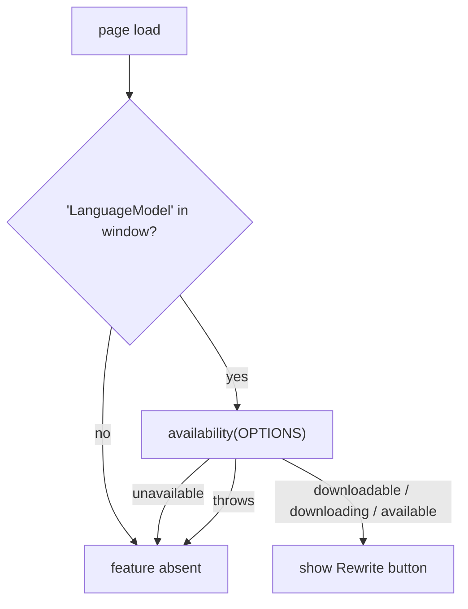

# Spec: Rewrite with on-device AI

|                   |                                                                                                                                                                                                                                                                                                                                                                         |
| ----------------- | ----------------------------------------------------------------------------------------------------------------------------------------------------------------------------------------------------------------------------------------------------------------------------------------------------------------------------------------------------------------------- |
| **Status**        | Implemented (2026-10-12).                                                                                                                                                                                                                                                                                                                                               |
| **Source**        | [ai/](../../web/src/ai/) (`types.ts`, `support.ts`, `language-model.ts`), [data/rewrite/](../../web/src/data/rewrite/) (`prompt.ts`, `validate.ts`, `diff.ts`), [RewriteButton.tsx](../../web/src/components/RewriteButton.tsx), [RewriteDialog.tsx](../../web/src/components/RewriteDialog.tsx) and their CSS modules; state in [App.tsx](../../web/src/App.tsx) (§4). |
| **Tests**         | [rewrite.test.ts](../../web/src/__tests__/rewrite.test.ts), [RewriteDialog.test.tsx](../../web/src/__tests__/RewriteDialog.test.tsx), [App.test.tsx](../../web/src/__tests__/App.test.tsx) › "rewrite", [rewrite.feature](../../web/features/rewrite.feature); the fake model is [fake-language-model.ts](../../web/src/__tests__/fake-language-model.ts) (§11).        |
| **Related specs** | [site-architecture.md](./site-architecture.md) (ARCH-14, ARCH-15, ARCH-24, §10.3), [tokenizer.md](./tokenizer.md) (P1, P2: untrusted input), [explanation-content-model.md](./explanation-content-model.md) (EXP-5, EXP-32), [explanation-panel.md](./explanation-panel.md)                                                                                             |
| **Platform docs** | [Get started with built-in AI](https://developer.chrome.com/docs/ai/get-started), [Prompt API](https://developer.chrome.com/docs/ai/prompt-api), [Inform users of model download](https://developer.chrome.com/docs/ai/inform-users-of-model-download)                                                                                                                  |

## 1. Purpose and principles

Users can ask for a Dockerfile shaped to their own needs ("use Python 3.13 and run as a non-root user", "make the image smaller", "add a health check") and get a rewritten version of the Dockerfile they are looking at. The rewritten file opens in the viewer, where every part of it can be clicked and explained like the bundled examples. The rewrite runs **only** on the browser's built-in, on-device model; the feature does not exist anywhere that model isn't available.

| #      | Principle                                                                                                                                                                                                |
| ------ | -------------------------------------------------------------------------------------------------------------------------------------------------------------------------------------------------------- |
| **P1** | **On-device or nothing.** The rewrite uses Chrome's built-in model through the Prompt API. There is no server, no API key and no cloud fallback. Where the model isn't supported, the feature is absent. |
| **P2** | **Private by construction.** The Dockerfile and the request never leave the device. The site makes no network request for this feature, and the CSP stays unchanged.                                     |
| **P3** | **The explainer stays the point.** The output is a Dockerfile to study: it opens in the viewer with full explanations (EXP-12), and the changes are listed so the user learns what changed and why.      |
| **P4** | **AI output is untrusted text.** It is validated before use, rendered only as text, never executed, and clearly labelled as AI-generated and possibly wrong.                                             |
| **P5** | **No cost for everyone else.** Users without the model download nothing extra: the feature's code is a separate chunk loaded on first use, and the main bundle grows only by the support check.          |

## 2. Platform

The feature is built on the **Prompt API** (`LanguageModel`), which is available to web pages from Chrome 148, uses Gemini Nano on the device, and needs no origin-trial token.

| Option considered     | Status on the web (2026-10) | Fit                                                                                                                   | Decision |
| --------------------- | --------------------------- | --------------------------------------------------------------------------------------------------------------------- | -------- |
| Prompt API            | Chrome 148 stable           | General instructions, system prompt, structured output (`responseConstraint`), streaming, abort, context measurement. | **Use**  |
| Rewriter API          | Developer and origin trial  | Built for prose (tone, length, format of text); no structured output; would need an origin-trial token that expires.  | No       |
| Writer API            | Developer and origin trial  | Writes new prose from a prompt; same limits as the Rewriter API.                                                      | No       |
| Server or cloud model | —                           | Violates P1 and P2, and needs secrets and a backend the static site doesn't have (ARCH-24).                           | No       |

**Platform facts this spec relies on** (from the platform docs above; re-check them whenever the docs change):

- **AIR-1** The model runs on desktop Chrome only (Windows 10/11, macOS 13+, Linux, ChromeOS on Chromebook Plus), with at least 22 GB of free disk space and either a GPU with more than 4 GB of VRAM or 16 GB of RAM and 4 CPU cores. It is not available on Android, iOS or in other browsers. The first use downloads the model over an unmetered connection; afterwards no network is needed, and no data is sent to Google or anyone else.
- **AIR-2** `LanguageModel.availability(options)` resolves to `"unavailable"`, `"downloadable"`, `"downloading"` or `"available"`. It must be called with the same options as the later session (`expectedInputs`, `expectedOutputs`), because support can depend on them.
- **AIR-3** When the model still has to be downloaded, `LanguageModel.create()` needs **user activation** (a click or key press), and reports progress through a `monitor` callback's `downloadprogress` events (`loaded` from 0 to 1).
- **AIR-4** The API is available to top-level documents and same-origin iframes (Permissions Policy `language-model`), not in Web Workers.
- **AIR-5** Sessions have a context window (`contextWindow`, `contextUsage`, `measureContextUsage()`); a prompt that can't fit fails with `QuotaExceededError`. `prompt()` and `promptStreaming()` accept an `AbortSignal` and a `responseConstraint` (a JSON Schema); `destroy()` frees a session; `clone()` copies its initial prompts.
- **AIR-6** On the web, sampling parameters (`temperature`, `topK`) are not available; this spec doesn't use them, and output is not deterministic.

## 3. Availability: when the feature exists



- **AIR-7** **Support check.** After first render, `App` runs the check once: feature-detect `LanguageModel` on `window`, then call `availability()` with the session options (AIR-14). The check is a few lines in the main bundle; it never creates a session and never starts a download.
- **AIR-8** **Absent, not disabled.** The Rewrite button is rendered only when the result is `downloadable`, `downloading` or `available`. Otherwise it is **not rendered at all**: a disabled control that can never become enabled on that device is noise for the many users of other browsers. Nothing else in the UI mentions the feature.
- **AIR-9** The dialog checks again when it opens, and `App` repeats the support check when the dialog closes, because Chrome can remove the model when free disk space drops below 10 GB. If it is `unavailable` when the dialog opens, the dialog shows the "isn't available" error (§7) and the button disappears when the dialog closes.
- **AIR-10** Before first render nothing is shown, so the button can appear a moment after the page loads. It sits at the end of the viewer header, after the copy button, so its appearance shifts no other control.

## 4. Architecture

| Module                         | Layer      | Responsibility                                                                                                                                                          |
| ------------------------------ | ---------- | ----------------------------------------------------------------------------------------------------------------------------------------------------------------------- |
| `ai/types.ts`                  | Browser    | Minimal local type declarations for the parts of `LanguageModel` used here (no new dependency).                                                                         |
| `ai/support.ts`                | Browser    | `SESSION_OPTIONS` (AIR-14) and `findLanguageModel()`, the AIR-7 check. Tiny and in the main bundle.                                                                     |
| `ai/language-model.ts`         | Browser    | `rewriteDockerfile()`: the base session with download monitoring (AIR-15, AIR-17), context check, prompting, validation and error mapping to `RewriteError` codes (§7). |
| `data/rewrite/prompt.ts`       | Data, pure | The system prompt, the user message builder and the JSON Schema (§6).                                                                                                   |
| `data/rewrite/validate.ts`     | Data, pure | Parses the model's JSON and validates the Dockerfile with the tokenizer (AIR-22). Node-tested (ARCH-17).                                                                |
| `data/rewrite/diff.ts`         | Data, pure | Line diff between the current and rewritten Dockerfile, for the review view (AIR-25).                                                                                   |
| `components/RewriteButton.tsx` | UI         | The header button. On click, loads the dialog chunk and opens it.                                                                                                       |
| `components/RewriteDialog.tsx` | UI         | The dialog (§5): request, download progress, generation, review, apply.                                                                                                 |

- **AIR-11** **Layering.** Only `ai/*` touches `LanguageModel`, `window` or `navigator`; it is outside `src/data/`, so the data-layer guard (ARCH-1) still holds. `data/rewrite/*` is pure and has no knowledge of the API. `App` passes the `LanguageModel` object found by the support check down as the `model` prop, so tests pass a fake (§11).
- **AIR-12** **Lazy chunk.** `RewriteDialog`, `ai/language-model.ts` and `data/rewrite/*` load with a dynamic `import()` on the first click of the Rewrite button. This is a deliberate exception to ARCH-14 ("no lazy loading"): it costs nothing for users who don't have or don't use the feature (P5). Explanations stay in the main bundle and synchronous. If the chunk fails to load (offline, or a deploy replaced it), the button reads "Rewrite couldn't load" and the next click retries (ARCH-28).
- **AIR-13** **Budgets.** `scripts/check-size.ts` budgets the entry chunk and lazy chunks separately: the main entry keeps the ARCH-15 budget (40 KB gzipped), and each lazy chunk has its own budget of **8 KB gzipped**. Measured 2026-10-12: the feature adds 1.0 kB gzipped to the entry, mostly Vite's dynamic-import helper; the `RewriteDialog` chunk is 4.4 kB gzipped plus 1.1 kB of CSS. Vite's module-preload polyfill is turned off (`build.modulePreload.polyfill: false`): the lazy chunk depends only on the entry, so there is nothing to preload.

### 4.1 Session options

- **AIR-14** Every `availability()` and `create()` call uses the same options: `expectedInputs: [{ type: 'text', languages: ['en'] }]` and `expectedOutputs: [{ type: 'text', languages: ['en'] }]`. The UI and prompt are English, like the rest of the site.
- **AIR-15** **One base session per page.** The first rewrite creates a base session with the system prompt as its initial prompt. Each request runs on `base.clone()`, which is destroyed when the request ends, so requests don't leak context into each other. The base session is destroyed on `pagehide`.

## 5. User flow and UI

### 5.1 Entry point

- **AIR-16** The **Rewrite** button sits in the viewer header after the copy button, with a sparkle icon (decorative) and the text "Rewrite". Its accessible name is "Rewrite this Dockerfile with on-device AI". It opens the dialog for the Dockerfile currently shown.

### 5.2 Dialog

The dialog is a native `<dialog>` opened with `showModal()`. Unlike the explanation panel (which is non-modal by design, PNL P1), this is a focused task that changes the Dockerfile, so modal semantics, the browser's focus containment and Escape-to-close are the right fit. Focus returns to the Rewrite button on close.

| State           | Content                                                                                                                                                                                                                                                                                                                                                                                                                                                           |
| --------------- | ----------------------------------------------------------------------------------------------------------------------------------------------------------------------------------------------------------------------------------------------------------------------------------------------------------------------------------------------------------------------------------------------------------------------------------------------------------------- |
| **Request**     | Heading "Rewrite this Dockerfile". A labelled `<textarea>` "What do you need?" (max 500 characters, with a counter). Suggestion chips that insert text: "Make the image smaller", "Run as a non-root user", "Pin base image versions", "Add a health check", "Use a multi-stage build". A note: "Runs on your device with Chrome's built-in AI. Nothing is sent to a server." Buttons: **Rewrite** (primary; disabled while the request is empty) and **Cancel**. |
| **Downloading** | Shown only when the model must be downloaded first (AIR-17). "Downloading Chrome's on-device AI model. This happens once and may take a few minutes." A `<progress>` element with the percentage. **Cancel** stops waiting (the browser may keep downloading in the background).                                                                                                                                                                                  |
| **Generating**  | "Rewriting…" with an indeterminate progress indicator and the number of characters received so far. **Stop** aborts the request (AIR-20).                                                                                                                                                                                                                                                                                                                         |
| **Review**      | The changes list from the model, headed "What changed (AI-generated, may be inaccurate)". A line diff of current vs. rewritten (AIR-25), with a toggle to show the full rewritten file. Buttons: **Open in viewer** (primary), **Copy**, **Try again** (back to Request with the same text), **Cancel**.                                                                                                                                                          |
| **Error**       | A message from §7 and the buttons that apply to it (**Try again**, **Cancel**).                                                                                                                                                                                                                                                                                                                                                                                   |

- **AIR-17** **Download.** If `availability()` returned `downloadable` or `downloading`, pressing **Rewrite** calls `create()` inside the click handler, so user activation is present (AIR-3), and the Downloading state shows progress from the `monitor`. When `loaded` reaches 1, the progress bar becomes indeterminate ("Preparing the model…") while Chrome extracts and loads the model. The dialog never starts a download on its own, and never before the user presses **Rewrite**.
- **AIR-18** The dialog has no `<form>` submission. The production CSP has `form-action 'none'` (ARCH-24), so buttons handle `click` (and Ctrl/Cmd+Enter in the textarea) directly.
- **AIR-19** **One request at a time.** While downloading or generating, **Rewrite** is disabled and the textarea is read-only. While generating, the same button becomes **Stop**, so keyboard focus stays on it.
- **AIR-20** **Stop and cancel.** Stop, Cancel, Escape and closing the dialog abort the request through its `AbortController` and destroy the cloned session. An aborted request shows nothing, not an error.

### 5.3 Applying the result

- **AIR-21** **Open in viewer** adds a fourth example, **Rewritten**, to the example toggle, selects it and closes the dialog. The panel closes as on any example switch (PNL-8). The rewritten file is tokenized and explained like any example: every token with a ref is interactive (EXP-12), and fragments that the content doesn't know fall back to the honest generic text (EXP-32).
  - Only one rewritten Dockerfile exists at a time; a new one replaces it.
  - Rewriting while **Rewritten** is selected uses the rewritten file as the base, so the user can refine step by step.
  - The **Rewritten** example's description shows the request, truncated to 80 characters, and an "AI-generated" label.
  - It lives in memory only: it is not stored in `localStorage` and is gone after a reload. `df-example` never stores `rewritten`; if it did, the existing fallback to `simple` applies.

## 6. Prompt and output

- **AIR-22** **Structured output.** Every request passes `responseConstraint` with this JSON Schema, and the reply is parsed with `JSON.parse`:

  ```json
  {
    "type": "object",
    "properties": {
      "dockerfile": { "type": "string" },
      "changes": { "type": "array", "items": { "type": "string" }, "maxItems": 8 }
    },
    "required": ["dockerfile", "changes"],
    "additionalProperties": false
  }
  ```

- **AIR-23** **System prompt** (initial prompt of the base session, AIR-15). Kept in `data/rewrite/prompt.ts`, covered by a snapshot test, and reviewed like content. It says, in short:
  - You rewrite Dockerfiles. Reply with the complete rewritten Dockerfile in `dockerfile` and up to 8 short, plain-English bullet points in `changes`, one per meaningful change.
  - Keep everything the user didn't ask to change. Don't invent files, scripts, ports or package names the original doesn't imply; if the request needs one, use a clearly named placeholder and say so in `changes`.
  - Never put secrets, tokens or passwords in the Dockerfile; suggest build secrets (`RUN --mount=type=secret`) instead.
  - Output only valid Dockerfile syntax: no Markdown fences, no prose inside `dockerfile`.
- **AIR-24** **User message.** The request text and the current Dockerfile, each between clearly marked delimiters (`<request>…</request>`, `<dockerfile>…</dockerfile>`), built by a pure function. The request is limited to 500 characters (AIR-16) and the Dockerfile to 16 KB; before prompting, `measureContextUsage()` checks that the message fits the session's free context, and if not the dialog shows the "too long" error without prompting.
- **AIR-25** **Validation.** `validate.ts` accepts a reply only if:
  - it parses and matches the schema;
  - `dockerfile`, after trimming and removing a single surrounding Markdown code fence if the model added one anyway, is non-empty, at most 16 KB and at most 400 lines;
  - tokenizing it (tokenizer.md) yields at least one `FROM` instruction and **no `unknown` lines** (TOK-13), i.e. every non-blank, non-comment line belongs to an instruction.

  The diff (`diff.ts`) is a line-based longest-common-subsequence diff, rendered as text lines prefixed `+`/`-`/` ` with colour as a secondary cue only.

- **AIR-26** `changes` items are rendered as plain text list items (EXP-5); items longer than 200 characters are cut with `…`. They are model claims, labelled as such, and never shown as explanations from the content layer.

## 7. Errors

| Condition                                                    | Message (and actions)                                                                                          |
| ------------------------------------------------------------ | -------------------------------------------------------------------------------------------------------------- |
| `availability()` becomes `unavailable` (AIR-9)               | "Chrome's on-device AI isn't available on this device right now." (Cancel)                                     |
| Download fails, or `create()` rejects with `NotAllowedError` | "The on-device model couldn't be prepared. Try again later." (Try again, Cancel)                               |
| Too long for the context (AIR-24) or `QuotaExceededError`    | "This Dockerfile and request are too long for the on-device model. Try a shorter request." (Try again, Cancel) |
| Reply fails validation (AIR-25)                              | "The AI's answer wasn't a valid Dockerfile. Try again, or rephrase your request." (Try again, Cancel)          |
| `NotSupportedError` or any other error                       | "Something went wrong with the on-device model." (Try again, Cancel)                                           |
| User aborted (AIR-20)                                        | No message.                                                                                                    |

- **AIR-27** Error messages are fixed strings. The model's raw text and exception messages are never shown to the user; they go to `console.debug` only.

## 8. Accessibility

- **AIR-28** The dialog is labelled by its heading and described by the on-device note, and the textarea is labelled by its visible label. The state text (Downloading, Preparing, Rewriting…, Review, errors) is announced through a visually hidden `role="status"` region **inside the dialog**: a modal dialog makes the rest of the page inert, which hides the page's status region (PNL-25) from assistive technology. Progress ticks are not announced, only state changes. Both `<progress>` elements have accessible names.
- **AIR-29** On entering Review or Error, focus moves to that state's heading (`tabIndex={-1}`), so keyboard and screen reader users land on the result. Back in Request (Stop, Try again from Review), focus returns to the textarea.
- **AIR-30** The diff is readable without colour: each line starts with `+`, `-` or a space, removed lines are also struck through, and the diff region (`role="region"`, `aria-label` "Changes to the Dockerfile", or "Rewritten Dockerfile" when showing the full file) is focusable for scrolling (axe `scrollable-region-focusable`).
- **AIR-31** All controls meet the target-size rule used by the panel (PNL-30), and the dialog passes axe in both colour schemes (ARCH-29).

## 9. Security and privacy

- **AIR-32** **No new origins or headers.** The model is part of the browser, so the CSP (ARCH-24) needs no `connect-src` change; the feature makes no `fetch`. The lazy chunk is same-origin and covered by `script-src 'self'`.
- **AIR-33** **Text only.** The rewritten Dockerfile, the diff and `changes` are rendered as text nodes only, like all content (EXP-5, PNL-12). The output is never evaluated, executed or used as a URL.
- **AIR-34** **Untrusted input to the tokenizer.** The tokenizer is already total and linear (tokenizer P1, P2, INV-9), and AIR-25 caps the size, which settles the robustness and performance points of ARCH §10.3 for this source of Dockerfiles. Persistence is avoided entirely (AIR-21).
- **AIR-35** **Honest labelling.** The dialog and the **Rewritten** example say the content is AI-generated and may be wrong, and the request note says processing happens on the device (P2). No claim is made beyond what the platform docs state (AIR-1).

## 10. Non-goals and future extensions

**Non-goals:** a cloud or polyfilled fallback (P1); support in browsers without the Prompt API; chat-style multi-turn conversation; explaining or rewriting a Dockerfile the user pastes in (a separate feature, ARCH §10.3); storing rewrites; editing the rewritten file by hand.

**Future extensions:**

- **Paste your own Dockerfile**, reusing AIR-25 validation and the **Rewritten** example slot.
- **Streaming preview** of the Dockerfile as it is generated, once partial JSON can be rendered safely, or by moving `changes` to a second request.
- **Explain the diff:** link each `changes` item to the lines it touches.
- **Other languages**, by widening AIR-14's `languages` together with the site's own localization.

## 11. Testing

The real model is unavailable in CI (Puppeteer's Chrome for Testing has no `LanguageModel`), so all automated tests use a **fake** `LanguageModel` with scripted availability, download progress, replies, delays and errors: [fake-language-model.ts](../../web/src/__tests__/fake-language-model.ts) for unit tests, and an equivalent injected through `evaluateOnNewDocument` for E2E. jsdom has no modal dialogs, so [setup.ts](../../web/src/__tests__/setup.ts) emulates `showModal()`, `close()` and Escape.

| Layer   | What                                                                                                                                                                                                                                                                                                                           |
| ------- | ------------------------------------------------------------------------------------------------------------------------------------------------------------------------------------------------------------------------------------------------------------------------------------------------------------------------------ |
| Pure    | `rewrite.test.ts` (Node): the user message builder and delimiters; the response schema; the system prompt snapshot; validation (valid file, fenced file, prose, empty, too large, too many lines, no `FROM`, `unknown` lines, schema violations, long changes); the diff.                                                      |
| Support | `App.test.tsx` › "rewrite" (AIR-7/8): no `LanguageModel` → no button; each `availability()` result; a throwing `availability()`; the check never calls `create()`.                                                                                                                                                             |
| Dialog  | `RewriteDialog.test.tsx` with the fake model: every state in §5.2; `create()` only after a click when downloadable (AIR-17); progress updates; one base session and destroyed clones (AIR-15); Stop/Escape abort and destroy the clone (AIR-20); each error row of §7; the fixed error strings (AIR-27); focus moves (AIR-29). |
| App     | `App.test.tsx` › "rewrite": Open in viewer adds and selects **Rewritten** and closes the panel, its tokens open explanations, rewriting again uses it as the base, `df-example` never stores it, the button disappears when the model goes away (AIR-9).                                                                       |
| E2E     | `rewrite.feature`: with `LanguageModel` removed, the button is absent; with the fake, a full flow from request to the explained **Rewritten** example with no CSP violations; axe with the review open in both colour schemes.                                                                                                 |
| Budget  | `npm run size` checks the entry and each lazy chunk separately (AIR-13).                                                                                                                                                                                                                                                       |
| Manual  | Before release, on a supported desktop: the first-use download, then each suggestion chip on each bundled example; record the results as a short checklist in the PR. Model output is non-deterministic (AIR-6), so this is a spot check, not a golden test.                                                                   |

## 12. Related changes in other documents

- [site-architecture.md](./site-architecture.md): ARCH-3 (the `languageModel` and `rewritten` state), ARCH-13 and ARCH-14 (the lazy chunk, AIR-12), ARCH-15 (per-chunk budgets, AIR-13), §10.1 (the rewrite is never stored) and §10.3 (AIR-25 and AIR-34 for model-generated Dockerfiles).
- [explanation-panel.md](./explanation-panel.md) PNL-25: the rewrite dialog has its own status region (AIR-28).
- README.md: the feature list and project tree.
