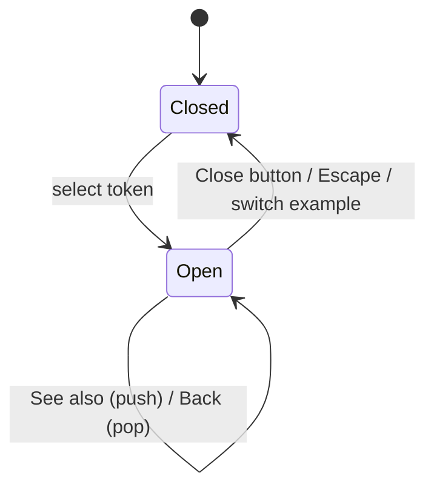

# Spec: Explanation panel

|             |                                                                                                                                                                                                                                                                                                                                                                                                                                         |
| ----------- | --------------------------------------------------------------------------------------------------------------------------------------------------------------------------------------------------------------------------------------------------------------------------------------------------------------------------------------------------------------------------------------------------------------------------------------- |
| **Status**  | Implemented (2026-10-12). The design was rewritten the same day; §11 records the migration from `SidePanel`.                                                                                                                                                                                                                                                                                                                            |
| **Source**  | [ExplanationPanel.tsx](../../web/src/components/ExplanationPanel.tsx), [ExplanationContent.tsx](../../web/src/components/ExplanationContent.tsx), [RichText.tsx](../../web/src/components/RichText.tsx) and their CSS modules; the viewer keyboard model in [DockerfileViewer.tsx](../../web/src/components/DockerfileViewer.tsx). State in [App.tsx](../../web/src/App.tsx); layout in [App.module.css](../../web/src/App.module.css). |
| **Tests**   | [ExplanationPanel.test.tsx](../../web/src/__tests__/ExplanationPanel.test.tsx), [ExplanationContent.test.tsx](../../web/src/__tests__/ExplanationContent.test.tsx), [App.test.tsx](../../web/src/__tests__/App.test.tsx) › "explanation panel" and "viewer keyboard", [instruction_explanation.feature](../../web/features/instruction_explanation.feature), [accessibility.feature](../../web/features/accessibility.feature)          |
| **Related** | [explanation-content-model.md](./explanation-content-model.md) (what the panel renders), [run-command-explanations.md](./run-command-explanations.md), [site-architecture.md](./site-architecture.md) (state, ARCH-2/3, accessibility ARCH-29)                                                                                                                                                                                          |

## 1. Purpose and principles

The panel shows the explanation for the part of the Dockerfile the user selected. It sits beside the Dockerfile on wide screens and is a bottom sheet on narrow ones. Selecting a token opens it; the user closes it explicitly. It never opens by itself.

| #      | Principle                                                                                                                                                                                                   |
| ------ | ----------------------------------------------------------------------------------------------------------------------------------------------------------------------------------------------------------- |
| **P1** | **Non-modal.** The Dockerfile stays fully usable while the panel is open. Selecting token after token is the main way to explore, so nothing may block it: no focus trap, no backdrop, no inert background. |
| **P2** | **Never lose the user's place.** Focus, selection and scroll position are never dropped. Closing the panel puts keyboard focus back where the user was, and the selected token is always visible.           |
| **P3** | **One short announcement per change.** Screen reader users hear what changed once (title and summary), not the whole panel, and not twice.                                                                  |
| **P4** | **Content is data.** The panel renders text nodes and `<code>` elements only (EXP-5).                                                                                                                       |
| **P5** | **One behaviour at every size.** The layout changes between desktop and mobile; state, keyboard and focus rules do not.                                                                                     |

## 2. Components and contract

| Module                              | Responsibility                                                                                                                      |
| ----------------------------------- | ----------------------------------------------------------------------------------------------------------------------------------- |
| `components/ExplanationPanel.tsx`   | The shell: open/closed state, the exit transition, Escape, focus return, Back and Close buttons. Owns no content logic.             |
| `components/ExplanationContent.tsx` | Renders one `Explanation`: category, title, summary, deprecation notice and sections (§4). Pure: props in, markup out, no hooks.    |
| `components/RichText.tsx`           | `InlineText` (`Inline[]` → text and `<code>`) and `Blocks` (`RichText` → `<p>`/`<ul>`). Shared by the panel and any future surface. |

```ts
interface PanelEntry {
  key: string; // refKey(ref) (TOK-2); identifies the entry for keys and scroll reset
  ref: ExplanationRef;
  explanation: Explanation;
}

<ExplanationPanel
  entry={PanelEntry | null} // null = closed
  previousTitle={string | null} // title of the entry Back returns to, or null
  onBack={() => void}
  onClose={() => void}
  onNavigate={(ref: ExplanationRef) => void} // "See also"
/>
```

- **PNL-1** **Controlled, one source of truth.** The panel is open exactly when `entry` is non-null. There is no separate `isOpen` flag, so "open with nothing to show" cannot happen. The panel never changes what it shows by itself; it raises `onBack`, `onClose` and `onNavigate`.
- **PNL-2** **Exit transition.** When `entry` becomes `null`, the panel keeps rendering the last entry until its closing transition ends (`transitionend`, or immediately under reduced motion), then unmounts the content. A closed panel has the `inert` attribute and `data-state="closed"`; an open one has `data-state="open"`.
- **PNL-3** The `<aside>` element is always in the DOM and keeps `data-testid="side-panel"` for tests (§10).
- **PNL-31** `ExplanationContent` and `RichText` contain no state or effects and are unit-tested on their own, with explanations built directly (no tokenizer needed).

## 3. State (owned by `App`)

```ts
type PanelState = {
  sourceTokenId: string; // the viewer token that opened the panel
  stack: PanelEntry[]; // top = shown; deeper entries are reachable with Back
} | null;
```

`App` derives `entry` (the top of the stack) and `previousTitle` (the entry below it) for the panel, and `activeTokenId` for the viewer (PNL-33).



| #          | Trigger                               | New state                                               | Focus                       |
| ---------- | ------------------------------------- | ------------------------------------------------------- | --------------------------- |
| **PNL-4**  | Select a token with a ref (EXP-12)    | `{ sourceTokenId: token.id, stack: [entry for token] }` | stays on the token (PNL-20) |
| **PNL-5**  | Select a different token while open   | replaced as in PNL-4; the content swaps in place        | stays on the token          |
| **PNL-6**  | Select the current source token again | unchanged (selection is not a toggle)                   | unchanged                   |
| **PNL-26** | Activate a "See also" button          | the ref's entry is pushed onto `stack`                  | the panel heading (PNL-34)  |
| **PNL-35** | Activate Back                         | the top entry is popped                                 | the panel heading           |
| **PNL-7**  | Close button, or Escape anywhere      | `null`                                                  | per PNL-23                  |
| **PNL-8**  | Switch example                        | `null`                                                  | stays on the example button |

- **PNL-9** Tokens whose ref is `null` (whitespace, comments) are plain text and cannot be selected. Every other token is selectable, because `getExplanation` is total (EXP-12).
- **PNL-10** Opening the panel does not change the URL or history, and its state is not persisted; on reload it is closed. Deep links (`#<example>/<refKey>`) are a future extension (§9, ARCH §10.2).
- **PNL-33** **Selection highlight.** A token has the active style and `aria-current="true"` exactly when the panel is open, it is the source token, and the shown entry is its own (stack depth 1). After "See also" the panel explains something else, so no token claims it; Back to depth 1 restores the highlight. Closing clears it.
- **PNL-36** The stack holds at most 20 entries; pushing more drops the oldest entry above the token's own, so Back always leads home to the token's explanation (and its highlight, PNL-33). Following a "See also" link to the entry already shown does nothing.

## 4. Content layout

The open panel shows these regions from top to bottom. A region whose field is absent or empty is not rendered (EXP-7).

| Region                   | Source          | Markup                                                                                                                                                                                                                             |
| ------------------------ | --------------- | ---------------------------------------------------------------------------------------------------------------------------------------------------------------------------------------------------------------------------------- |
| Header (does not scroll) |                 | Holds everything down to the deprecation notice.                                                                                                                                                                                   |
| · Back                   | `previousTitle` | `<button>` "Back" with accessible name `Back to <previousTitle>`; only when the stack is deeper than 1.                                                                                                                            |
| · Category               | `category`      | `<p>` label above the title.                                                                                                                                                                                                       |
| · Title + Close          | `title`         | `<h2 tabIndex={-1}><code>{title}</code></h2>` and the close button (accessible name "Close explanation"). Long titles wrap (`overflow-wrap: anywhere`); they never push the close button out of view.                              |
| · Summary                | `short`         | `<p>` with inline content.                                                                                                                                                                                                         |
| · Deprecation notice     | `deprecated`    | `<p role="note">Deprecated since {since}. Use {instead} instead.</p>`                                                                                                                                                              |
| Details                  | `details`       | One `<p>` per paragraph block and one `<ul>` per list block (EXP-16, EXP-17).                                                                                                                                                      |
| Syntax                   | `syntax`        | `<h3>Syntax</h3>` + `<pre tabIndex={0} role="region" aria-label="Syntax"><code>`. Whitespace is preserved and the block scrolls horizontally; it is focusable so keyboard users can scroll it (axe `scrollable-region-focusable`). |
| See also                 | `related`       | `<h3>See also</h3>` + `<ul>` of `<button>`s labelled like `COPY --from` (PNL-26).                                                                                                                                                  |
| Learn more               | `links`         | `<h3>Learn more</h3>` + `<ul>` of `<a target="_blank" rel="noopener noreferrer">` links (PNL-27).                                                                                                                                  |

- **PNL-11** The header stays fixed and the body scrolls on its own (`overflow-y: auto`), so Back and Close are always reachable.
- **PNL-12** All text is rendered as text nodes; `Inline` code parts become `<code>` elements with a text child. No field is ever rendered as HTML (EXP-5, CMDX-22).
- **PNL-27** Each external link ends with a decorative icon (`aria-hidden`) and visually hidden text " (opens in a new tab)", so the new-tab behaviour is announced.
- **PNL-29** When the shown entry changes (`entry.key` differs), the body's scroll position resets to the top. Re-rendering the same entry keeps it.
- **PNL-37** The panel never shows a loading or error state: content is bundled and lookup is synchronous (ARCH-14, EXP-15).

## 5. Layout and motion

### 5.1 Desktop (> 768px)

- **PNL-13** The panel is an item in the workspace flex row. Open, its width is `clamp(20rem, (100% − gap) / 3, 30rem)` and the viewer takes the rest. Closed, its width, border and opacity are `0`.
- **PNL-14** Opening and closing animate width, opacity and `translateX(20px → 0)` over `--transition-slow`, with the content visible throughout (PNL-2).
- **PNL-15** The panel's height is capped at the workspace height; long content scrolls inside the panel, never the page.

### 5.2 Mobile (≤ 768px)

- **PNL-16** The panel is a bottom sheet: `position: fixed` to the bottom of the viewport, full width, at most `65dvh` tall, rounded top corners, a shadow, and bottom padding of `env(safe-area-inset-bottom)` for devices with a home indicator. It animates in from `translateY(30px)`.
- **PNL-17** There is no backdrop and the page is not inert (P1). Tapping another token swaps the content (PNL-5).
- **PNL-18** While the sheet is open, the page reserves its height: the document gets matching `scroll-padding-bottom` and bottom padding, so every line of the Dockerfile can be scrolled above the sheet.

### 5.3 Keeping the selection visible

- **PNL-28** After the panel opens or its source token changes, the source token is scrolled into view if any part of it is hidden: inside the viewer (both axes, since the viewer narrows when the panel opens) and, on mobile, above the sheet. It uses `block: 'nearest'` and `inline: 'nearest'`, so a visible token never moves.

### 5.4 Motion

- **PNL-19** Every panel transition and the PNL-28 scroll respect `prefers-reduced-motion: reduce`: transitions are off (ARCH-12) and scrolling is instant.

## 6. Keyboard and focus

### 6.1 Moving through the Dockerfile

With nearly every token selectable (EXP-12), a tab stop per token would put hundreds of stops between the viewer and the panel. The viewer is therefore one composite widget.

- **PNL-24** **One tab stop, arrow keys inside.** The viewer follows the WAI-ARIA APG _Layout Grid_ pattern:
  - The source is `role="grid"` (labelled "Dockerfile source"); each physical line is a `row`; each token is a `gridcell`, so comments and plain text stay in the accessibility tree. Line numbers are `aria-hidden`.
  - Only selectable tokens take focus, using a roving `tabindex`: exactly one token has `tabIndex={0}`, initially the first selectable token, afterwards the last one focused.
  - **Left/Right** move to the previous/next selectable token, continuing onto the previous/next line. **Up/Down** move to the selectable token on the nearest line above/below whose column range overlaps the current token's start column, or else the closest one on that line. **Home/End** go to the first/last selectable token of the line; **Ctrl+Home/Ctrl+End** to the first/last in the file.
  - **Enter** or **Space** selects the focused token (PNL-4). Clicking a token also moves the roving tab stop to it.
- **PNL-38** The DOM order is viewer, then panel, so **Tab** from the viewer goes straight into the open panel, and **Shift+Tab** from the panel's first control returns to the viewer's tab stop.

### 6.2 Panel focus rules

| #          | Rule                                                                                                                                                                                                                                                                          |
| ---------- | ----------------------------------------------------------------------------------------------------------------------------------------------------------------------------------------------------------------------------------------------------------------------------- |
| **PNL-20** | Selecting a token **never moves focus**, whether it opens the panel or swaps its content. The user stays in the Dockerfile and hears the change through the status region (PNL-25); Tab reaches the panel (PNL-38).                                                           |
| **PNL-21** | **Escape** closes the panel from anywhere on the page. It is handled by one `keydown` listener on `document`, registered only while the panel is open, and ignored when `event.defaultPrevented` is set (a future popup inside the panel can claim Escape).                   |
| **PNL-22** | **No focus trap** (P1). Tab and Shift+Tab leave the panel like any other region.                                                                                                                                                                                              |
| **PNL-23** | **Focus return.** When the panel closes while focus is inside it (or would be lost because its content unmounts), focus moves to the source token, which also becomes the viewer's tab stop. If focus is elsewhere (in the viewer, on the example buttons), it is left alone. |
| **PNL-32** | Focus is moved **before** the panel becomes `inert`. Making an element inert while it holds focus sends focus to `<body>`, which PNL-23 exists to prevent.                                                                                                                    |
| **PNL-34** | After "See also" or Back, the button that was activated disappears, so focus moves to the panel heading (`<h2 tabIndex={-1}>`). The heading is focusable only programmatically and gets no extra tab stop.                                                                    |

## 7. Semantics and accessibility

| Element                | Semantics                                                                                                                                                                                                                                              |
| ---------------------- | ------------------------------------------------------------------------------------------------------------------------------------------------------------------------------------------------------------------------------------------------------ |
| Panel `<aside>`        | `complementary` landmark with the stable name "Explanation" (`aria-label`). No `aria-live`. `inert` and `data-state="closed"` while closed (PNL-2).                                                                                                    |
| Status region          | **PNL-25** A visually hidden `<div role="status">` rendered by `App`, outside the panel and always in the DOM. On open, swap, See also and Back it is set to `"<title>: <flatten(short)>"`; on close it is cleared. It is the page's only live region. |
| Selected token         | `aria-current="true"` per PNL-33. Tokens carry no `aria-pressed` or `aria-expanded`: selecting is not a toggle (PNL-6), and hundreds of "collapsed" buttons would be noise.                                                                            |
| Close and Back buttons | Accessible names `Close explanation` and `Back to <title>`; icons are decorative. **PNL-30** Targets are at least 24×24 CSS px (WCAG 2.2 SC 2.5.8), and at least 44×44 under `(pointer: coarse)`.                                                      |
| Toolbar hint           | Static text, not a live region. It may hide while the panel is open; the status region carries all announcements (P3).                                                                                                                                 |
| Contrast               | Category label, inline code, deprecation notice and the See also buttons meet WCAG AA in both colour schemes; `accessibility.feature` runs axe with the panel open in each (ARCH-29).                                                                  |

## 8. Decisions

These settle the open questions of the previous version of this spec.

| Question (previous §)                   | Decision                                                                                                                                                                        |
| --------------------------------------- | ------------------------------------------------------------------------------------------------------------------------------------------------------------------------------- |
| Panel semantics vs. focus trap (§8.1)   | **Non-modal everywhere** (P1, P5). The trap goes (PNL-22); focus returns on close (PNL-23). A modal sheet on mobile was rejected because it would block tapping the next token. |
| `aria-live` on the whole panel (§8.2)   | Removed. One visually hidden status region announces title and summary (PNL-25).                                                                                                |
| Highlight after close (§8.3)            | Cleared on close. The highlight and `aria-current` follow the open panel (PNL-33).                                                                                              |
| Selecting the active token again (§8.4) | Stays a no-op, and `aria-pressed` is replaced by `aria-current`, so the semantics no longer promise a toggle (PNL-6).                                                           |
| Mobile sheet hides the token (§8.5)     | The page reserves the sheet's height and scrolls the token into view (PNL-18, PNL-28). Swipe-to-dismiss stays out of scope (§9).                                                |
| Close animation has no content (§8.6)   | The last entry stays rendered until the transition ends (PNL-2).                                                                                                                |
| Hint text as a live region (§8.7)       | The hint becomes static; the status region is the single announcement channel (§7).                                                                                             |
| Focus on open (PNL-20)                  | Selecting never moves focus. With one tab stop for the viewer (PNL-24), the panel is a single Tab away, so moving focus there would only cost the user their place.             |
| Hundreds of tab stops after EXP-12      | The viewer is a layout grid with a roving tab stop (PNL-24).                                                                                                                    |

## 9. Non-goals and future extensions

**Non-goals:** a modal dialog; a backdrop; resizing or pinning the panel; showing several explanations at once; content editing.

**Future extensions:**

- **Deep links:** mirror `PanelState` into the URL hash (`#complex/flag:RUN:--mount`) so an explanation can be shared; the stack makes Back map naturally onto history entries. Needs an ARCH §10.2 decision.
- **Swipe to dismiss** the mobile sheet, with a visible drag handle; the Close button stays the accessible way.
- **Explain the line:** a header action that shows the whole instruction's explanation, built from the instruction ref of the source token's line.

## 10. Testing contract

Tests identify the panel by `[data-testid="side-panel"]` and read its state from `data-state`. The title is `h2` inside the panel, the summary is the status region's text, and buttons are found by accessible name. The Cucumber steps in [site.steps.ts](../../web/features/step_definitions/site.steps.ts) change in the same PR as any of these hooks.

| Rule                                      | Unit (Vitest + jsdom)                                                                                                   | E2E (Cucumber + Puppeteer)                                                                                      |
| ----------------------------------------- | ----------------------------------------------------------------------------------------------------------------------- | --------------------------------------------------------------------------------------------------------------- |
| PNL-1/2 open state, exit content, `inert` | `data-state`; content still rendered until `transitionend` is dispatched; `inert` while closed                          | —                                                                                                               |
| PNL-4/5/6 select, swap, same token        | click `FROM`, then `WORKDIR`, then `WORKDIR` again                                                                      | `instruction_explanation.feature` (existing scenarios)                                                          |
| PNL-7/23/32 close and focus return        | Escape with focus in the panel → focus on the source token, never `<body>`; with focus on an example button → unchanged | press Escape inside the panel; `document.activeElement` is the token                                            |
| PNL-8 switch example                      | closes; focus stays on the example button                                                                               | `example_switcher.feature`                                                                                      |
| PNL-12 text-only rendering                | `ExplanationContent` with markup-like strings renders no extra elements                                                 | —                                                                                                               |
| PNL-13/16/18 layout                       | —                                                                                                                       | at 1280px the panel is 20–30rem wide; at 375px it is pinned to the bottom and the last line can scroll above it |
| PNL-19 reduced motion                     | —                                                                                                                       | `reduced_motion.feature`                                                                                        |
| PNL-20/22/38 no focus move, no trap       | focus stays on the token after selecting; Tab from the last panel control leaves the panel                              | —                                                                                                               |
| PNL-24 viewer keyboard                    | one token has `tabIndex=0`; each arrow, Home/End and Ctrl+Home/End move; Enter selects                                  | keyboard-only scenario: Tab into the viewer, arrows, Enter, Tab into the panel                                  |
| PNL-25 announcements                      | status text after open, swap, See also and Back; empty after close                                                      | —                                                                                                               |
| PNL-26/34/35/36 See also and Back         | push, pop, heading focus, depth limit, Back's accessible name                                                           | —                                                                                                               |
| PNL-27 new-tab links                      | `rel="noopener noreferrer"` and the hidden "(opens in a new tab)" text                                                  | —                                                                                                               |
| PNL-28 selection visible                  | `scrollIntoView` called with `nearest` options (stubbed in jsdom)                                                       | at 375px the selected token is above the sheet                                                                  |
| PNL-29 scroll reset                       | body `scrollTop` is 0 after a swap                                                                                      | —                                                                                                               |
| PNL-30 target size, contrast              | —                                                                                                                       | `accessibility.feature` (axe, both schemes, panel open)                                                         |
| PNL-33 highlight                          | `aria-current` on the source token only at depth 1 and while open                                                       | —                                                                                                               |

In jsdom, Preact effects run asynchronously: assert focus with `waitFor`.

## 11. Migration from the previous implementation

The migration below is complete (2026-10-12); it is kept as a record.

### 11.1 Changes

| Current                                                                      | Target                                                                                                                                           | Who must update                                                  |
| ---------------------------------------------------------------------------- | ------------------------------------------------------------------------------------------------------------------------------------------------ | ---------------------------------------------------------------- |
| `SidePanel` with `token`, `isOpen`, `onClose`, `onNavigate`                  | `ExplanationPanel` with `entry`, `previousTitle`, `onBack`, `onClose`, `onNavigate`; content split into `ExplanationContent` and `RichText` (§2) | `App`, `SidePanel.test.tsx` (split into panel and content tests) |
| `activeToken` + `isPanelOpen` in `App`; "See also" fakes a token             | `PanelState` with `sourceTokenId` and a stack (§3)                                                                                               | `App`, `App.test.tsx`, ARCH-3 in site-architecture.md            |
| Content unmounts at once on close                                            | Kept until the exit transition ends (PNL-2)                                                                                                      | `ExplanationPanel`                                               |
| `aria-hidden` mirrors open state; `aria-live` on the panel                   | `inert` + `data-state`; a separate status region (PNL-2, PNL-25)                                                                                 | `ExplanationPanel`, `App`, Cucumber steps, unit tests            |
| Focus moves to the close button on open; Tab is trapped; focus lost on close | No focus move on select; no trap; focus returns to the token (PNL-20, -22, -23)                                                                  | `ExplanationPanel`, `App`                                        |
| Two Escape handlers with `stopPropagation`                                   | One `document` listener while open (PNL-21)                                                                                                      | `ExplanationPanel`                                               |
| Every token is a tab stop; `aria-pressed` follows `activeToken`              | One roving tab stop in a layout grid; `aria-current` per PNL-33 (PNL-24)                                                                         | `DockerfileViewer`, its CSS (focus styles), `App.test.tsx`       |
| Width exactly one third                                                      | `clamp(20rem, …, 30rem)` (PNL-13)                                                                                                                | `SidePanel.module.css` / `App.module.css`                        |
| Mobile sheet can hide the selected token                                     | Reserved space and scroll into view (PNL-18, PNL-28)                                                                                             | `App.module.css`, `ExplanationPanel` or `App`                    |
| Close button 28×28; no Back; links don't announce new tabs                   | Target sizes, Back, new-tab text (PNL-30, PNL-35, PNL-27)                                                                                        | panel components and CSS                                         |
| Toolbar hint is `aria-live`                                                  | Static text (§7)                                                                                                                                 | `App`                                                            |

### 11.2 Rule mapping

Rule numbers PNL-1 to PNL-23 keep their topics, so references elsewhere (PNL-5 in the content spec, PNL-12 in ARCH-24, EXP-5 and CMDX-22) stay valid. PNL-24 onwards are new.

| Rule            | Change                                                                                                                                                                                                                             |
| --------------- | ---------------------------------------------------------------------------------------------------------------------------------------------------------------------------------------------------------------------------------- |
| PNL-1           | `entry` replaces `token` + `isOpen`.                                                                                                                                                                                               |
| PNL-2           | Content survives the exit transition; `inert` replaces `aria-hidden`.                                                                                                                                                              |
| PNL-6           | Still a no-op, now with `aria-current` instead of `aria-pressed`.                                                                                                                                                                  |
| PNL-7           | Also clears the highlight (PNL-33).                                                                                                                                                                                                |
| PNL-13          | Width is clamped.                                                                                                                                                                                                                  |
| PNL-18          | "The token may be hidden" becomes "space is reserved"; PNL-28 scrolls the token into view.                                                                                                                                         |
| PNL-20          | "Focus moves to the close button" becomes "selecting never moves focus".                                                                                                                                                           |
| PNL-21          | One listener instead of two.                                                                                                                                                                                                       |
| PNL-22          | The focus trap is removed.                                                                                                                                                                                                         |
| PNL-23          | Was "required, not implemented"; now specified in full.                                                                                                                                                                            |
| PNL-24 – PNL-38 | New: viewer keyboard, status region, See also stack, link text, selection visibility, scroll reset, target sizes, component split, focus before `inert`, highlight, heading focus, Back, stack limit, no loading state, Tab order. |

### 11.3 Other documents to update in the same change

- [site-architecture.md](./site-architecture.md): ARCH-2 (props of the panel), ARCH-3 (the state table becomes `activeExample` + `PanelState`), and the module map (§2) for the new component files.
- [run-command-explanations.md](./run-command-explanations.md) CMDX-25: the hint is static text (§7).
- README.md: the project tree lists the new component files.
