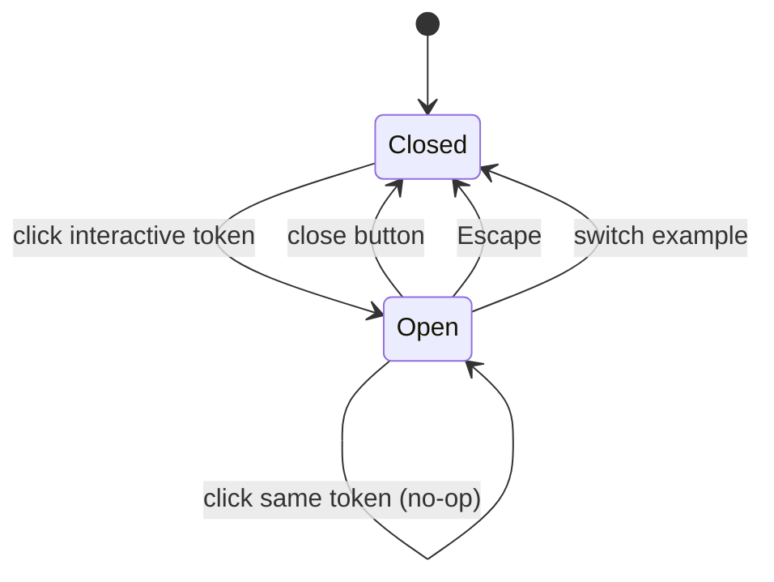

# Spec: Explanation panel

| | |
|---|---|
| **Status** | Draft. Documents current behaviour. Deviations and open questions are flagged inline. |
| **Source** | [SidePanel.jsx](../../web/src/components/SidePanel.jsx), [SidePanel.module.css](../../web/src/components/SidePanel.module.css); state and layout in [App.jsx](../../web/src/App.jsx) / [App.module.css](../../web/src/App.module.css) |
| **Tests** | [SidePanel.test.jsx](../../web/src/__tests__/SidePanel.test.jsx), [App.test.jsx](../../web/src/__tests__/App.test.jsx) › "side panel", [instruction_explanation.feature](../../web/features/instruction_explanation.feature) |
| **Related** | [explanation-content-model.md](./explanation-content-model.md) (what the panel renders), [run-command-explanations.md](./run-command-explanations.md) |

## 1. Purpose

The panel shows the explanation for the token the user selected. It sits next to the Dockerfile on wide screens and appears as a bottom sheet on narrow screens. The user opens it by clicking a token and dismisses it explicitly; it never opens by itself.

## 2. Component contract

```jsx
<SidePanel token={Token & { explanation: Explanation } | null} isOpen={boolean} onClose={() => void} />
```

- **PNL-1** The panel is **controlled**. `App` owns `isOpen` and `activeToken`. The panel never changes its own visibility; it only calls `onClose`.
- **PNL-2** The panel shows content only when `isOpen && token?.explanation`. Otherwise the `<aside>` element is still rendered but has no children. When the panel is closed, its content is **unmounted**, not hidden.
- **PNL-3** The `<aside>` is always in the DOM. It has `data-testid="side-panel"`, which unit tests and Cucumber tests rely on (see §9).

## 3. State transitions (owned by `App`)



| # | Trigger | `isOpen` | `activeToken` |
|---|---|---|---|
| **PNL-4** | Click a token whose `getExplanation(key)` is non-null | `true` | that token plus its explanation |
| **PNL-5** | Click a different token while open | stays `true` | replaced; the panel stays open and its content swaps in place |
| **PNL-6** | Click the active token again | stays `true` | unchanged (clicking again does **not** close the panel) |
| **PNL-7** | Close button or Escape | `false` | **unchanged** (see §8.3) |
| **PNL-8** | Switch example | `false` | `null` |

- **PNL-9** Tokens without an explanation are rendered as `<span>` and cannot open the panel. `handleTokenClick` also ignores them as a guard.
- **PNL-10** Opening the panel does not change the URL or history, and the panel's state is not persisted. On reload the panel is closed.

## 4. Content layout

When open, the panel shows these regions from top to bottom. Each optional region appears only if the matching field is present (see EXP-7 in the content spec).

| Region | Source | Markup |
|---|---|---|
| Header (does not scroll) | `title`, `short` | `<h2><code>{title}</code></h2>`, close button, `<p>{short}</p>` |
| Details | `details` | Blocks split on `\n\n`; each becomes `<p>` or `<ul>` (see EXP-16/17 in the content spec) |
| Syntax | `syntax` | `<h3>Syntax</h3>` + `<pre><code>`. Whitespace is preserved and the block scrolls horizontally. |
| Learn more | `links` | `<h3>Learn more</h3>` + `<ul>` of `<a target="_blank" rel="noopener noreferrer">` links, each with a decorative external-link icon (`aria-hidden`) |

- **PNL-11** The header stays fixed and the body scrolls on its own (`overflow-y: auto`), so the close button is always reachable.
- **PNL-12** All text is rendered as text nodes; no field is ever rendered as HTML (see EXP-5 in the content spec).

## 5. Layout and responsiveness

### 5.1 Desktop (> 768px)

- **PNL-13** The panel is an item in the workspace flex row. When open it takes **one third** of the workspace width (`(100% − gap) / 3`) and the viewer shrinks to two thirds. When closed its width is `0`, its border is `0`, its opacity is `0` and it ignores pointer events. The viewer then takes the full width.
- **PNL-14** Opening and closing animate width, opacity and `translateX(20px → 0)` over `--transition-slow` (280 ms).
- **PNL-15** The panel's height is capped at the workspace height. Long content scrolls inside the panel, not the page.

### 5.2 Mobile (≤ 768px)

- **PNL-16** The panel is `position: fixed` to the bottom of the viewport. It spans the full width, has a maximum height of `65dvh`, rounded top corners, a shadow and `z-index: 100`. It animates in from `translateY(30px)`.
- **PNL-17** There is no backdrop. The page behind stays scrollable and clickable, and tapping another token swaps the content (PNL-5).
- **PNL-18** The sheet covers the bottom of the viewer. Nothing scrolls the selected token into view, so the token may be hidden behind the sheet (see §8.5).

### 5.3 Motion

- **PNL-19** **Required:** panel transitions must respect `prefers-reduced-motion: reduce`.
  > ⚠️ **Currently violated.** Only `ExampleToggler` has a reduced-motion rule; the panel always animates.

## 6. Keyboard and focus

| # | Behaviour | Current implementation |
|---|---|---|
| **PNL-20** | When the panel goes from closed to open, focus moves to the close button. | `useEffect([isOpen])`. Swapping content while the panel is open (PNL-5) does **not** move focus. |
| **PNL-21** | Escape closes the panel, whether focus is inside it or elsewhere on the page. | A `keydown` listener on `document` while open, plus an `onKeyDown` handler on the `<aside>` that calls `stopPropagation()` so `onClose` fires only once. |
| **PNL-22** | Tab and Shift+Tab wrap between the first and last focusable elements inside the panel. | A `keydown` listener on the panel. The focusable elements are `a`, `button` and `[tabindex]:not([tabindex="-1"])`, excluding disabled ones. |
| **PNL-23** | **Required:** when the panel closes, focus returns to the token that opened it. | ⚠️ **Not implemented.** The panel content unmounts (PNL-2), so focus falls back to `<body>` and keyboard users lose their place in the Dockerfile. |

## 7. Semantics and accessibility

| Attribute | Value | Notes |
|---|---|---|
| `role` | `complementary` | A landmark. |
| `aria-label` | `"Explanation panel"` | Static. Does not name the token being explained. |
| `aria-hidden` | `"true"` / `"false"` | Mirrors `isOpen`. Tests use it as the open/closed signal (§9). |
| `aria-live` | `"polite"` | Applies to the whole panel, so every open and every content swap is announced. |
| Close button | `aria-label="Close explanation panel"`, 28×28 px | The icon is decorative (`aria-hidden`). |
| Trigger token | `<button aria-pressed>` | `aria-pressed` reflects `activeToken`, not `isOpen` (see §8.3). |

## 8. Known deviations and open questions

### 8.1 Panel semantics vs. focus trap

PNL-22 traps focus the way a modal dialog does. Yet the panel is declared as a non-modal landmark (`complementary`), and on desktop the viewer stays fully usable beside it. With the trap active, a keyboard user who tabs into the panel can only get out by pressing Escape, and focus is then lost (PNL-23).

**Decision needed.** Pick one model:

- **(a) Non-modal (recommended for desktop).** Remove the trap. Keep `complementary`. Return focus to the token on close. Consider not moving focus on open at all, and announcing the content instead.
- **(b) Modal (plausible for the mobile sheet).** Use `role="dialog"` with `aria-modal="true"` and `aria-labelledby` pointing at the `<h2>`. Add a backdrop and make the background inert. Keep the trap.
- **(c) Split by breakpoint.** Use (a) on desktop and (b) on mobile.

### 8.2 `aria-live` on the whole region

With `aria-live="polite"` on the entire `<aside>`, screen readers may read the full explanation every time the content swaps, which also duplicates the focus move in PNL-20. **Proposed:** remove `aria-live` from the `<aside>`. Name the panel with `aria-labelledby` pointing at the title. If an announcement is wanted, announce only `title` + `short` through a dedicated visually-hidden live region.

### 8.3 Selected token stays highlighted after close

PNL-7 leaves `activeToken` set, so after closing, the token keeps its active style and `aria-pressed="true"`. **Decision needed:** clear the selection on close (simplest, and consistent with `aria-pressed`), or keep it as a deliberate "last viewed" marker. If it is kept, `aria-pressed` should follow `isOpen && id === activeTokenId`.

### 8.4 Clicking the active token again

PNL-6: clicking an already-pressed toggle button does nothing. Toggle-button semantics (`aria-pressed`) suggest the panel should close. **Decision needed:** make it a toggle, or keep it as a no-op and drop `aria-pressed` in favour of `aria-current` or `aria-expanded` + `aria-controls`.

### 8.5 Mobile sheet hides the selected token

PNL-18. **Options:**

- scroll the selected token into the visible area above the sheet,
- add bottom padding to the page equal to the sheet height while it is open,
- or accept it and document it.

There is also no swipe-to-dismiss and no backdrop tap to close.

### 8.6 Close animation has no content

Because of PNL-2, content unmounts the moment `isOpen` becomes `false`, so an empty box animates closed. **Optional:** keep the last content mounted until `transitionend`.

### 8.7 Hint text hidden while open

The toolbar hint "Click a keyword, flag, or command fragment to explore" is an `aria-live` region that empties while the panel is open, and it is hidden on mobile. This is minor; note it if §8.2 introduces a single announcement channel.

## 9. Testing contract

Tests decide whether the panel is open or closed only by reading the `aria-hidden` attribute on `[data-testid="side-panel"]`. The title is read from `[data-testid="side-panel"] h2 code`, and the close button is found by `aria-label="Close explanation panel"`. If §8.1 or §8.2 changes these attributes, the Cucumber steps in [site.steps.js](../../web/features/step_definitions/site.steps.js) must change in the same PR.

| Rule | Unit | E2E | What to add |
|---|---|---|---|
| PNL-4 open on token click | ✅ | ✅ | |
| PNL-5 content swaps while open | ❌ | ✅ | Unit test: click `FROM` then `WORKDIR` |
| PNL-6 same-token click | ❌ | ❌ | Pin whichever behaviour §8.4 decides |
| PNL-7 close via button | ✅ | ✅ | |
| PNL-7 close via Escape | ✅ (focus on the panel and on the document) | ❌ | E2E: press Escape |
| PNL-8 close on example switch | ✅ | ✅ (`example_switcher.feature`) | |
| PNL-12 text-only rendering | ❌ | — | See EXP-5 in the content spec |
| PNL-13/16 layout split / bottom sheet | — | ❌ | E2E at 1280px and 375px: panel bounding box ≈ one third of the width / pinned to the bottom |
| PNL-19 reduced motion | ❌ | ❌ | E2E with `emulateMediaFeatures([{name:'prefers-reduced-motion',value:'reduce'}])`: computed `transition-duration` is `0s` |
| PNL-20 focus on open | ❌ | ❌ | `document.activeElement` is the close button. Preact runs `useEffect` asynchronously, so in jsdom wrap the assertion in `waitFor`; an immediate assertion still sees the clicked token focused. |
| PNL-22 Tab wrapping | ❌ | ❌ | Replace or remove according to §8.1 |
| PNL-23 focus restored on close | ❌ | ❌ | Fails today; add it before fixing |
| Links open safely | ✅ partial | ❌ | Assert `rel="noopener noreferrer"` |
