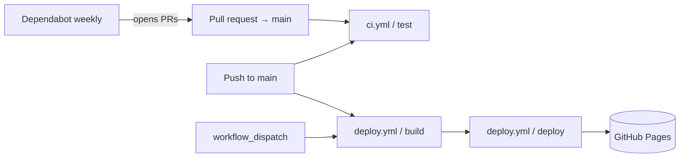

# Spec: GitHub workflows

| | |
|---|---|
| **Status** | Draft. Documents current behaviour. Deviations and proposals are flagged inline. |
| **Source** | [.github/workflows/ci.yml](../../.github/workflows/ci.yml), [.github/workflows/deploy.yml](../../.github/workflows/deploy.yml), [.github/dependabot.yml](../../.github/dependabot.yml) |
| **Related** | [site-architecture.md §9](./site-architecture.md) (CI/CD and hosting overview) |

## 1. Purpose

The repository's automation has three jobs:

1. **Verify** every change to `main`: lint, unit/component tests, end-to-end tests, and a build.
2. **Publish** `main` to GitHub Pages (custom domain `https://dockerfile.pub/`).
3. **Keep dependencies current**: npm packages and GitHub Actions versions.



## 2. `ci.yml`: verification

### 2.1 Triggers and environment

| # | Rule | Current |
|---|---|---|
| **WF-1** | Runs on every PR that targets `main` and on every push to `main`. | ✅ `pull_request: [main]`, `push: [main]` |
| **WF-2** | A single job `test` on `ubuntu-latest`. Every `run` step uses `working-directory: web`. | ✅ |
| **WF-3** | Least privilege: `contents: read` only. | ✅ (job level) |
| **WF-4** | The Node version matches the project's supported version (see WF-19). | Node **22** |
| **WF-5** | Dependencies are installed with `npm ci` against `web/package-lock.json`. The npm cache is keyed on that lockfile. | ✅ `setup-node` `cache: npm`, `cache-dependency-path: web/package-lock.json` |

### 2.2 Steps (in order)

| # | Step | Command | Fails the job when |
|---|---|---|---|
| 1 | Checkout | `actions/checkout@v7` | — |
| 2 | Set up Node | `actions/setup-node@v7` | — |
| 3 | Install dependencies | `npm ci` | The lockfile is out of sync with `package.json`, or install fails |
| 4 | Install Chrome for Puppeteer | `npx puppeteer browsers install chrome` | Download fails |
| 5 | Lint | `npm run lint` (ESLint on `src/`, `--max-warnings 0`) | Any error or warning |
| 6 | Unit / component tests | `npm run test:run` (Vitest) | Any test fails |
| 7 | Feature tests | See §2.3 | Server never responds, or any scenario fails |
| 8 | Upload artifacts | `actions/upload-artifact@v7`, runs only `if: failure()` | — |
| 9 | Build | `npm run build` | Vite build fails |

- **WF-6** Step 4 is required, not redundant. Puppeteer normally downloads Chrome in its `postinstall` script, but recent npm versions can skip install scripts that aren't covered by `allowScripts`. Locally, `npm ci` warns: `puppeteer@25.4.0 (postinstall) … not yet covered by allowScripts`. Installing Chrome explicitly makes the E2E step independent of that.
  > The step is named "Install Chromium dependencies" but installs Chrome itself, not system libraries. **Proposed:** rename it to "Install Chrome for Puppeteer".

### 2.3 Feature-test step contract

```sh
npm run dev -- --host 127.0.0.1 --port 4173 > /tmp/vite-dev.log 2>&1 &
SERVER_PID=$!
trap 'kill $SERVER_PID' EXIT
for i in {1..30}; do curl --silent --fail "$BASE_URL" >/dev/null && break; sleep 1; done
curl --silent --fail "$BASE_URL" >/dev/null
npm run test:features
```

- **WF-7** The step starts the Vite **dev** server in the background on `127.0.0.1:4173` and sends its log to `/tmp/vite-dev.log`.
- **WF-8** It polls the server for up to 30 seconds. The second `curl --fail`, outside the loop, makes the step fail with a clear error if the server never came up, instead of letting Cucumber fail later with confusing errors.
- **WF-9** **Exit codes must propagate.** `npm run test:features` is the last command, so its exit code is the step's exit code. The `trap` kills the dev server on any exit. Any future wrapper around Cucumber (a script, `shell.exec` or similar) must preserve a non-zero exit code; otherwise CI will report green on failures.
- **WF-10** Environment: `BASE_URL=http://127.0.0.1:4173`. Screenshots of failed scenarios go to `FEATURE_ARTIFACTS_DIR=/tmp/feature-test-artifacts` (see `features/support/hooks.js`).
- **WF-11** When any step fails, the screenshots and `/tmp/vite-dev.log` are uploaded as the `feature-test-artifacts` artifact. A missing path is ignored, so this upload never hides the original failure.

### 2.4 Gaps

- **WF-12 E2E runs against the dev server, not the production build** (ARCH-21). Problems that only appear in production — base path, minification, asset hashing, CSS ordering — are not tested.
  **Proposed:** move Build before the feature tests and serve the result with `npm run preview -- --host 127.0.0.1 --port 4173 --strictPort`.
- **WF-13 No `concurrency`.** Pushing again to a PR leaves the earlier runs going.
  **Proposed:** add `concurrency: { group: ci-${{ github.ref }}, cancel-in-progress: ${{ github.event_name == 'pull_request' }} }`.
- **WF-14 No `timeout-minutes`.** A hung Puppeteer or dev-server process uses the default 6-hour limit.
  **Proposed:** `timeout-minutes: 15` on the job.
- **WF-15 Format is not checked.** Prettier is configured, but CI never runs `prettier --check`.
  **Proposed:** add a `format:check` script and a step for it next to Lint.
- **WF-16 Bundle budget is not enforced** (ARCH-15).
  **Proposed:** a step after Build that fails if gzipped JS exceeds 20 KB or gzipped CSS exceeds 5 KB.

## 3. `deploy.yml`: publish to GitHub Pages

### 3.1 Triggers, permissions, concurrency

| # | Rule | Current |
|---|---|---|
| **WF-17** | Runs on push to `main` and on manual `workflow_dispatch`. | ✅ |
| **WF-18** | Only one Pages deployment runs at a time; a running deployment is never cancelled midway. | ✅ `concurrency: { group: pages, cancel-in-progress: false }` |
| **WF-19** | Uses the same Node version as `ci.yml`. | ⚠️ **Node 20** here vs **22** in CI. `package.json` has no `engines` field; the README says "Node.js 20+". |
| **WF-20** | Least privilege per job: `build` needs only `contents: read`; `deploy` needs `pages: write` and `id-token: write`. | ⚠️ All three permissions are set at the **workflow** level, so `build` (which runs third-party npm install scripts) also gets `pages: write` and `id-token: write`. |

### 3.2 Jobs

**`build`** (`ubuntu-latest`, `working-directory: web`):

1. `actions/checkout@v7`
2. `actions/setup-node@v7` with Node 20 and the npm cache
3. `npm ci`
4. `npm run test:run`
5. `npm run build`
6. `actions/upload-pages-artifact@v5` with `path: web/dist`

**`deploy`** (`needs: build`, environment `github-pages`, URL taken from the step output):

1. `actions/deploy-pages@v5`

- **WF-21** The deployed artifact is exactly `web/dist/` from the `build` job. Nothing is built in the `deploy` job.
- **WF-22** The custom domain (`dockerfile.pub`) is set in the repository's Pages settings, not in a workflow or a `CNAME` file (ARCH-23). The workflow does not need to know the domain, because Vite's `base: '/'` works for root hosting.

### 3.3 Gaps

- **WF-23 Deploy is not gated on CI** (ARCH-20).
  - `deploy.yml` starts on the same push as `ci.yml` and runs only unit tests.
  - A commit that fails lint, the feature tests, or a build on CI's Node version can still go live.

  **Decision needed.** Recommended: option 1.
  1. Run `deploy.yml` on `workflow_run: { workflows: [CI], types: [completed], branches: [main] }`, with `if: github.event.workflow_run.conclusion == 'success'`, and check out `github.event.workflow_run.head_sha`.
  2. Merge the two into one workflow, with `deploy` depending on `test` through `needs` and running only on push to `main`.
  3. Keep them independent and rely on branch protection requiring CI before merge. This still leaves direct pushes and `workflow_dispatch` ungated.
- **WF-24 Unneeded Chrome download.** `npm ci` in `build` may download Puppeteer's Chrome for nothing.
  **Proposed:** set `PUPPETEER_SKIP_DOWNLOAD: '1'` on that step.
- **WF-25 No post-deploy smoke test** (ARCH-22).
  **Proposed:** a third job `smoke`. It `needs: deploy`, installs dependencies and Chrome, and runs `npx cucumber-js features/site.feature` with `BASE_URL=${{ needs.deploy.outputs.page_url }}`. That requires exposing `page_url` as a job output.
- **WF-26 What `workflow_dispatch` may deploy.** A manual run can be started from any branch. Whether that branch can actually deploy depends on the `github-pages` environment's deployment-branch policy. That policy lives outside the repo and has not been verified.
  **Required:** the environment allows only `main`. Record the setting here once confirmed.

## 4. `dependabot.yml`: dependency updates

| Ecosystem | Directory | Schedule | Notes |
|---|---|---|---|
| `npm` | `/web` | weekly | Default limit of 5 open PRs; no grouping, labels or ignore rules |
| `github-actions` | `/` | weekly | Keeps the `@vN` action tags current |

- **WF-27** Dependabot PRs go through `ci.yml` like any other PR (WF-1). No secrets are needed, so the reduced token permissions Dependabot PRs get are not a problem.
- **WF-28** Nothing auto-merges; every update needs a human to merge it.
- **Optional:**
  - group dev-dependency updates (`groups: { dev: { dependency-type: development } }`) to cut PR noise,
  - group the paired `@vitest/*` and `vitest` updates and the `eslint*` updates so they land together.

## 5. Cross-cutting rules

- **WF-29 Action pinning.** Actions are pinned to **major tags** (`@v7`, `@v5`), and Dependabot keeps them current. That is acceptable for first-party `actions/*`.
  **Required:** pin any non-`actions/*` action added later to a full commit SHA, with a version comment.
- **WF-30 No secrets.** Neither workflow uses repository secrets. Pages deployment authenticates with OIDC (`id-token: write`).
  **Required:** any future secret is used only in jobs that never run untrusted PR code, so never under `pull_request` from forks.
- **WF-31 One Node version** across `ci.yml`, `deploy.yml`, `package.json#engines` and a `.nvmrc`. `setup-node` should read the version with `node-version-file: web/.nvmrc` so it is defined in one place.
- **WF-32 Workflow names are API.** WF-23 option 1 refers to `CI` by name, and branch protection refers to the `test` check by name. Renaming either requires updating those references in the same change.

## 6. Settings outside the repo

The workflows depend on these settings, but they cannot be seen in the repository. Record their verified values here.

| Setting | Expected | Verified |
|---|---|---|
| Pages source | GitHub Actions | ❓ |
| Pages custom domain | `dockerfile.pub`, HTTPS enforced | ✅ (redirect observed 2026-10-11); HTTPS enforcement ❓ |
| `github-pages` environment branch policy | `main` only | ❓ |
| Branch protection on `main` | Require the `test` check from `ci.yml`; require PRs | ❓ |
| Actions permissions | Default `GITHUB_TOKEN` read-only | ❓ |

## 7. Verification checklist

- [ ] WF-12: E2E runs against `vite preview` of the production build.
- [ ] WF-13: CI concurrency group added.
- [ ] WF-14: `timeout-minutes` set on every job.
- [ ] WF-15: `prettier --check` step.
- [ ] WF-16: bundle-size step.
- [ ] WF-19 / WF-31: one Node version from `.nvmrc`; `engines` field added.
- [ ] WF-20: Pages permissions moved to the `deploy` job.
- [ ] WF-23: deploy gated on a successful CI run.
- [ ] WF-24: `PUPPETEER_SKIP_DOWNLOAD` in the deploy build.
- [ ] WF-25: post-deploy smoke test.
- [ ] WF-26 / §6: settings outside the repo verified and recorded.
- [ ] WF-6: Chrome install step renamed.
