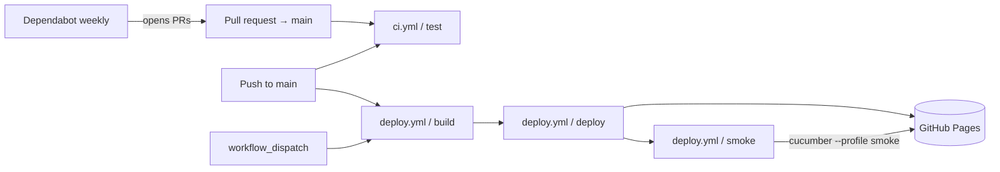

# Spec: GitHub workflows

|             |                                                                                                                                                                                        |
| ----------- | -------------------------------------------------------------------------------------------------------------------------------------------------------------------------------------- |
| **Status**  | Draft. Documents current behaviour. Deviations and proposals are flagged inline.                                                                                                       |
| **Source**  | [.github/workflows/ci.yml](../../.github/workflows/ci.yml), [.github/workflows/deploy.yml](../../.github/workflows/deploy.yml), [.github/dependabot.yml](../../.github/dependabot.yml) |
| **Related** | [site-architecture.md §9](./site-architecture.md) (CI/CD and hosting overview)                                                                                                         |

## 1. Purpose

The repository's automation has three jobs:

1. **Verify** every change to `main`: lint, format, type-check, unit/component tests, a production build with a size budget, and end-to-end tests against that build.
2. **Publish** `main` to GitHub Pages (custom domain `https://dockerfile.pub/`), then smoke-test the live site.
3. **Keep dependencies current**: npm packages and GitHub Actions versions.



## 2. `ci.yml`: verification

### 2.1 Triggers and environment

| #         | Rule                                                                                                               | Current                                                                                                           |
| --------- | ------------------------------------------------------------------------------------------------------------------ | ----------------------------------------------------------------------------------------------------------------- |
| **WF-1**  | Runs on every PR that targets `main` and on every push to `main`.                                                  | ✅ `pull_request: [main]`, `push: [main]`                                                                         |
| **WF-2**  | A single job `test` on `ubuntu-latest`, `timeout-minutes: 15`. Every `run` step uses `working-directory: web`.     | ✅                                                                                                                |
| **WF-3**  | Least privilege: `contents: read` only.                                                                            | ✅ (job level)                                                                                                    |
| **WF-4**  | The Node version comes from `web/.nvmrc` (WF-31).                                                                  | ✅ `node-version-file: web/.nvmrc` (22)                                                                           |
| **WF-5**  | Dependencies are installed with `npm ci` against `web/package-lock.json`. The npm cache is keyed on that lockfile. | ✅ `setup-node` `cache: npm`, `cache-dependency-path: web/package-lock.json`                                      |
| **WF-13** | A new push to a PR cancels that PR's in-progress run. Pushes to `main` are never cancelled.                        | ✅ `concurrency: { group: ci-${{ github.ref }}, cancel-in-progress: ${{ github.event_name == 'pull_request' }} }` |

### 2.2 Steps (in order)

| #   | Step                         | Command                                                                                                   | Fails the job when                                                |
| --- | ---------------------------- | --------------------------------------------------------------------------------------------------------- | ----------------------------------------------------------------- |
| 1   | Checkout                     | `actions/checkout@v7`                                                                                     | —                                                                 |
| 2   | Set up Node                  | `actions/setup-node@v7`                                                                                   | —                                                                 |
| 3   | Install dependencies         | `npm ci`                                                                                                  | The lockfile is out of sync with `package.json`, or install fails |
| 4   | Install Chrome for Puppeteer | `npx puppeteer browsers install chrome`                                                                   | Download fails                                                    |
| 5   | Lint (JS, CSS, Markdown)     | `npm run lint`: ESLint on `web/`, Stylelint on `web/src/**/*.css`, markdownlint on every `*.md` (ARCH-27) | Any error or warning                                              |
| 6   | Lint workflows               | `docker run … rhysd/actionlint:1.7.12@sha256:…` from the repo root                                        | Any actionlint or shellcheck finding in `.github/workflows/`      |
| 7   | Check formatting             | `npm run format:check` (Prettier over the whole repo except `.prettierignore`)                            | Any file differs from Prettier's output                           |
| 8   | Type-check                   | `npm run typecheck` (`tsc -p jsconfig.json`, strict, ARCH-6)                                              | Any type error                                                    |
| 9   | Unit / component tests       | `npm run test:run` (Vitest)                                                                               | Any test fails                                                    |
| 10  | Build                        | `npm run build`                                                                                           | Vite build fails                                                  |
| 11  | Check bundle size            | `npm run size` (`scripts/check-size.js`, ARCH-15)                                                         | Gzipped JS > 20 KB, gzipped CSS > 5 KB, or no JS in `dist/assets` |
| 12  | Feature tests                | See §2.3                                                                                                  | Server never responds, or any scenario fails                      |
| 13  | Upload artifacts             | `actions/upload-artifact@v7`, runs only `if: failure()`                                                   | —                                                                 |

- **WF-6** Step 4 is required, not redundant. Puppeteer normally downloads Chrome in its `postinstall` script, but recent npm versions can skip install scripts that aren't covered by `allowScripts`. Locally, `npm ci` warns: `puppeteer@25.4.0 (postinstall) … not yet covered by allowScripts`. Installing Chrome explicitly makes the E2E step independent of that.
- **WF-12** Build runs **before** the feature tests, so E2E exercises the production output (ARCH-21): base path, minification, asset hashing and the build-only CSP.

### 2.3 Feature-test step contract

```sh
npm run preview -- --host 127.0.0.1 --port 4173 --strictPort > /tmp/vite-preview.log 2>&1 &
SERVER_PID=$!
trap 'kill $SERVER_PID' EXIT
for _ in {1..30}; do curl --silent --fail "$BASE_URL" >/dev/null && break; sleep 1; done
curl --silent --fail "$BASE_URL" >/dev/null
npm run test:features
```

- **WF-7** The step serves `dist/` with `vite preview` in the background on `127.0.0.1:4173`. `--strictPort` makes it fail rather than silently move to another port. The log goes to `/tmp/vite-preview.log`.
- **WF-8** It polls the server for up to 30 seconds. The second `curl --fail`, outside the loop, makes the step fail with a clear error if the server never came up, instead of letting Cucumber fail later with confusing errors.
- **WF-9** **Exit codes must propagate.** `npm run test:features` is the last command, so its exit code is the step's exit code. The `trap` kills the preview server on any exit. Any future wrapper around Cucumber (a script, `shell.exec` or similar) must preserve a non-zero exit code; otherwise CI will report green on failures.
- **WF-10** Environment: `BASE_URL=http://127.0.0.1:4173`. Screenshots of failed scenarios go to `FEATURE_ARTIFACTS_DIR=/tmp/feature-test-artifacts` (see `features/support/hooks.js`).
- **WF-11** When any step fails, the screenshots and `/tmp/vite-preview.log` are uploaded as the `feature-test-artifacts` artifact. A missing path is ignored, so this upload never hides the original failure.

### 2.4 Other rules

- **WF-14** Every job sets `timeout-minutes`, so a hung Puppeteer or server process fails fast instead of running for the default 6 hours.
- **WF-15** Formatting is checked (step 7) across the whole repo (ARCH-27).
- **WF-16** The bundle budget (ARCH-15) is enforced by step 11.
- **WF-33** Workflow files must pass `actionlint`, including its shellcheck pass (step 6). The Docker image is pinned by tag and digest (WF-29). Dependabot does not update image references inside `run:` steps, so bump the tag and digest by hand when upgrading. Locally, run `actionlint` from the repo root.

## 3. `deploy.yml`: publish to GitHub Pages

### 3.1 Triggers, permissions, concurrency

| #         | Rule                                                                                                                                                                 | Current                                                       |
| --------- | -------------------------------------------------------------------------------------------------------------------------------------------------------------------- | ------------------------------------------------------------- |
| **WF-17** | Runs on push to `main` and on manual `workflow_dispatch` from any branch (WF-26).                                                                                    | ✅                                                            |
| **WF-18** | Only one Pages deployment runs at a time; a running deployment is never cancelled midway.                                                                            | ✅ `concurrency: { group: pages, cancel-in-progress: false }` |
| **WF-19** | Uses the same Node version as `ci.yml`.                                                                                                                              | ✅ Both read `web/.nvmrc`                                     |
| **WF-20** | Least privilege per job. The workflow sets `permissions: {}`; `build` and `smoke` get `contents: read`, and only `deploy` gets `pages: write` and `id-token: write`. | ✅                                                            |

### 3.2 Jobs

Every job sets `timeout-minutes: 10` (WF-14).

**`build`** (`ubuntu-latest`, `working-directory: web`):

1. `actions/checkout@v7`
2. `actions/setup-node@v7` with `node-version-file: web/.nvmrc` and the npm cache
3. `npm ci` with `PUPPETEER_SKIP_DOWNLOAD=1` (WF-24; this job never needs Chrome)
4. `npm run test:run`
5. `npm run build`
6. `actions/upload-pages-artifact@v5` with `path: web/dist`

**`deploy`** (`needs: build`, environment `github-pages`, exposes the `page_url` output):

1. `actions/deploy-pages@v5`

**`smoke`** (`needs: deploy`, `working-directory: web`):

1. Checkout, set up Node, `npm ci`, install Chrome for Puppeteer
2. `BASE_URL="${PAGE_URL%/}" npx cucumber-js --profile smoke`. This strips the trailing slash from `page_url`, because the feature steps append paths that start with `/`.

- **WF-21** The deployed artifact is exactly `web/dist/` from the `build` job. Nothing is built in the `deploy` job.
- **WF-22** The custom domain (`dockerfile.pub`) is set in the repository's Pages settings, not in a workflow or a `CNAME` file (ARCH-23). The workflow does not need to know the domain, because Vite's `base: '/'` works for root hosting.
- **WF-25 Post-deploy smoke test.** The `smoke` Cucumber profile ([cucumber.yml](../../web/cucumber.yml)) runs only `site.feature`: the page title and no CSP violations. A failed smoke job does not roll back the deploy; it makes the run red so someone investigates.
  - Use `--profile smoke`, not a file path. Cucumber merges CLI paths with the default profile's paths, so `npx cucumber-js features/site.feature` would run the whole suite against production.
  - Verified locally against `https://dockerfile.pub` on 2026-10-11 (2 scenarios passed).

### 3.3 Decisions and remaining gaps

- **WF-23 Deploy is gated by branch protection** (ARCH-20, decided 2026-10-11).
  - `deploy.yml` starts on the same push as `ci.yml` and runs only unit tests.
  - Safety comes from branch protection: `main` requires PRs, and PRs must pass the `test` check before merging. Every commit that reaches `main` through a PR has already passed lint, type-check, E2E, build and the size check.
  - Accepted exposure: commits pushed directly by someone who can bypass protection, and manual `workflow_dispatch` runs from any branch (WF-26).
  - If that exposure ever needs closing, gate `deploy.yml` on `workflow_run: { workflows: [CI], types: [completed], branches: [main] }` with `if: github.event.workflow_run.conclusion == 'success'`.
- **WF-26 Any branch may be deployed manually** (decided 2026-10-11).
  - `workflow_dispatch` can be started from any branch, and that branch's build is published to production. This is intentional, for example to preview or hotfix from a branch.
  - The `github-pages` environment therefore must **not** restrict deployment branches. When GitHub creates the environment for Actions-based Pages, it adds a rule that allows only the default branch. That rule must be removed (Settings → Environments → `github-pages` → Deployment branches → "No restriction"); otherwise non-`main` dispatches fail at the `deploy` job.
  - A manual deploy from a branch runs only the unit tests from `build`, not the full CI suite (WF-23). Whoever starts it is responsible for that branch's CI status. The next push to `main` deploys `main` again.

## 4. `dependabot.yml`: dependency updates

| Ecosystem        | Directory | Schedule | Notes                                                            |
| ---------------- | --------- | -------- | ---------------------------------------------------------------- |
| `npm`            | `/web`    | weekly   | Default limit of 5 open PRs; no grouping, labels or ignore rules |
| `github-actions` | `/`       | weekly   | Keeps the `@vN` action tags current                              |

- **WF-27** Dependabot PRs go through `ci.yml` like any other PR (WF-1). No secrets are needed, so the reduced token permissions Dependabot PRs get are not a problem.
- **WF-28** Nothing auto-merges; every update needs a human to merge it.
- **Optional:**
  - group dev-dependency updates (`groups: { dev: { dependency-type: development } }`) to cut PR noise,
  - group the paired `@vitest/*` and `vitest` updates and the `eslint*` updates so they land together.

## 5. Cross-cutting rules

- **WF-29 Action pinning.** Actions are pinned to **major tags** (`@v7`, `@v5`), and Dependabot keeps them current. That is acceptable for first-party `actions/*`.
  **Required:** pin any non-`actions/*` action added later to a full commit SHA, with a version comment.
- **WF-30 No secrets.** Neither workflow uses repository secrets. Pages deployment authenticates with OIDC (`id-token: write`).
  **Required:** any future secret is used only in jobs that never run untrusted PR code, so never under `pull_request` from forks.
- **WF-31 One Node version.** [web/.nvmrc](../../web/.nvmrc) is the single source (currently `22`). Both workflows read it with `node-version-file`, and `package.json` declares `engines: { node: ">=22" }`. To upgrade Node, change `.nvmrc` and, if needed, the `engines` lower bound.
- **WF-32 Workflow names are API.** The `workflow_run` fallback in WF-23 would refer to `CI` by name, and branch protection refers to the `test` check by name. Renaming either requires updating those references in the same change.

## 6. Settings outside the repo

The workflows depend on these settings, but they cannot be seen in the repository. Record their verified values here.

| Setting                                  | Expected                                            | Verified                                                                             |
| ---------------------------------------- | --------------------------------------------------- | ------------------------------------------------------------------------------------ |
| Pages source                             | GitHub Actions                                      | ❓                                                                                   |
| Pages custom domain                      | `dockerfile.pub`, HTTPS enforced                    | ✅ (redirect observed 2026-10-11); HTTPS enforcement ❓                              |
| `github-pages` environment branch policy | No restriction: any branch may deploy (WF-26)       | ❓ Decided 2026-10-11; check that GitHub's default "main only" rule has been removed |
| Branch protection on `main`              | Require the `test` check from `ci.yml`; require PRs | ✅ Confirmed by the maintainer 2026-10-11                                            |
| Actions permissions                      | Default `GITHUB_TOKEN` read-only                    | ❓                                                                                   |

## 7. Verification checklist

- [x] WF-12: E2E runs against `vite preview` of the production build.
- [x] WF-13: CI concurrency group added.
- [x] WF-14: `timeout-minutes` set on every job.
- [x] WF-15: `prettier --check` step.
- [x] WF-16: bundle-size step.
- [x] WF-19 / WF-31: one Node version from `.nvmrc`; `engines` field added.
- [x] WF-20: Pages permissions moved to the `deploy` job.
- [x] WF-23: deploy gating decided (branch protection requires CI).
- [x] WF-24: `PUPPETEER_SKIP_DOWNLOAD` in the deploy build.
- [x] WF-25: post-deploy smoke test.
- [x] WF-26: any-branch manual deploys decided.
- [x] WF-33: actionlint in CI.
- [ ] §6: settings outside the repo verified and recorded (the environment branch policy above in particular).
- [x] WF-6: Chrome install step renamed.
