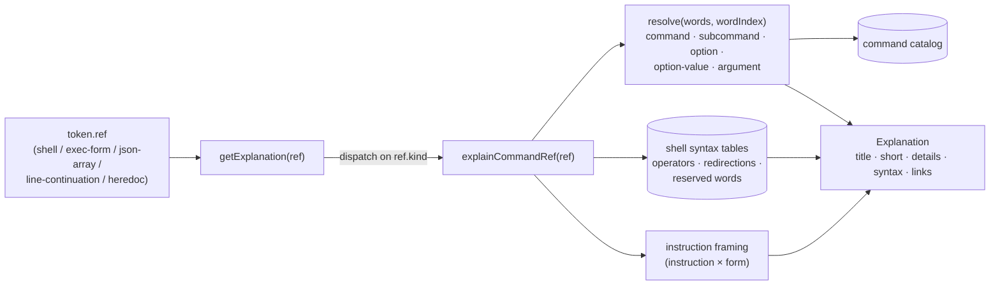

# Spec: Command explanations

|                   |                                                                                                                                                                                                                                        |
| ----------------- | -------------------------------------------------------------------------------------------------------------------------------------------------------------------------------------------------------------------------------------- |
| **Status**        | Implemented (2026-10-12). The design was rewritten on 2026-10-12 and builds on the tokenizer ([tokenizer.md](./tokenizer.md)); §13 records the migration from `RUN_CHUNK:` keys. The file name is kept so existing links keep working. |
| **Source**        | [web/src/data/commands/](../../web/src/data/commands/explain.ts) (`explain.ts`, `resolve.ts`, `catalog.ts`, `shell-syntax.ts`); dispatched from `getExplanation()` in [explanations.ts](../../web/src/data/explanations.ts)            |
| **Rendered by**   | `TokenButton` in [DockerfileViewer.tsx](../../web/src/components/DockerfileViewer.tsx), [ExplanationContent.tsx](../../web/src/components/ExplanationContent.tsx)                                                                      |
| **Tests**         | [web/src/\_\_tests\_\_/commands.test.ts](../../web/src/__tests__/commands.test.ts), plus the fixtures shared with the tokenizer                                                                                                        |
| **Related specs** | [tokenizer.md](./tokenizer.md) (refs and command context, §3.3, TOK-33 to TOK-36), [explanation-content-model.md](./explanation-content-model.md) (schema and authoring rules), [explanation-panel.md](./explanation-panel.md)         |

## 1. Purpose and scope

The commands inside a Dockerfile are where most of the learning happens, and they are free-form, so no static map can cover them. This spec defines how every fragment of a command gets a **useful, accurate, context-aware** explanation.

**In scope:** tokens whose ref kind is one of the following.

| Ref kind            | Where it comes from                                                                                                   |
| ------------------- | --------------------------------------------------------------------------------------------------------------------- |
| `shell`             | Shell form of `RUN`, `CMD`, `ENTRYPOINT` and `HEALTHCHECK CMD`, including `ONBUILD` triggers and `RUN` heredoc bodies |
| `exec-form`         | JSON-array elements of `RUN`, `CMD`, `ENTRYPOINT`, `SHELL` and `HEALTHCHECK CMD`                                      |
| `json-array`        | The brackets and commas of those arrays                                                                               |
| `line-continuation` | The escape character at the end of a continued line                                                                   |
| `heredoc`           | Heredoc markers and terminators                                                                                       |

**Out of scope** ([explanation-content-model.md](./explanation-content-model.md)): instruction keywords, sub-keywords, Docker flags, instruction arguments, variables and parser directives.

| #      | Goal                                                                                                                                                                                                                                      |
| ------ | ----------------------------------------------------------------------------------------------------------------------------------------------------------------------------------------------------------------------------------------- |
| **G1** | **Complete.** Every in-scope ref produces an explanation, so every command fragment is clickable.                                                                                                                                         |
| **G2** | **Contextual.** An explanation names the command it belongs to, the instruction and form it runs in, and, for operators, the commands on each side.                                                                                       |
| **G3** | **Accurate.** Specific meanings come only from the curated command catalog (§5). For anything the catalog doesn't know, the explanation says what kind of fragment it is and where to look. It never guesses what an unknown option does. |
| **G4** | **Teaches Docker.** Explanations point out what matters in a Dockerfile: layers, exit status failing a build, PID 1 and signals, exec vs. shell form, cache cleanup.                                                                      |
| **G5** | **Safe and small.** Output is plain text (EXP-5). Generation is synchronous and pure, and the catalog fits a fixed size budget (CMDX-20).                                                                                                 |

## 2. Architecture



| Module                     | Responsibility                                                                                     |
| -------------------------- | -------------------------------------------------------------------------------------------------- |
| `commands/explain.ts`      | `explainCommandRef(ref): Explanation`. Composes framing, the role-specific text and links (§6–§7). |
| `commands/resolve.ts`      | `resolve(words, wordIndex)`: works out what a word means for its tool, using the catalog (§4).     |
| `commands/catalog.ts`      | The curated command catalog (§5): a `Map`, not a plain object.                                     |
| `commands/shell-syntax.ts` | Fixed tables for operators, redirections, reserved words and substitutions (§7.6 to §7.9).         |

- **CMDX-1** All four modules are in the data layer: pure, with no Preact or DOM (ARCH-1), and covered by the ESLint guard.
- **CMDX-2** `explainCommandRef` returns an explanation for every in-scope ref (G1); it never returns `null`. `getExplanation` sends refs of these five kinds here and no others.
- **CMDX-3** Generation is deterministic: the same ref always gives a deep-equal explanation. Results are not cached by `refKey`, because two refs with the same key (the same option in different commands, for example) can need different text. Generating text is cheap enough to do on demand.

## 3. Inputs

The tokenizer supplies the syntax; this layer adds the knowledge about tools. All fields come from [tokenizer.md §3.3](./tokenizer.md).

| Field                | Used for                                                                                                                                                              |
| -------------------- | --------------------------------------------------------------------------------------------------------------------------------------------------------------------- |
| `instruction`        | Framing (§6): when and how the command runs. `HEALTHCHECK` for `HEALTHCHECK CMD`; the nested keyword for `ONBUILD` triggers (TOK-6).                                  |
| `kind`               | `shell` means shell form; `exec-form` means exec form. Together with `instruction`, it selects the framing.                                                           |
| `role`               | The fragment's syntactic role: `command`, `option`, `argument`, `assignment`, `operator`, `redirection`, `redirect-target`, `reserved`, `substitution`, `executable`. |
| `words`, `wordIndex` | The whole simple command (or exec-form array), with quotes removed, and this word's position in it. This is the input to `resolve` (§4).                              |
| `before`, `after`    | For control operators: the commands on either side.                                                                                                                   |
| `text`               | The fragment's own source text, shown as the title.                                                                                                                   |

## 4. Resolving a word against its tool

The tokenizer knows that `ci` is the second word of `npm ci --omit=dev`, but not that `ci` is an npm _subcommand_ or that `--omit` takes a value. `resolve` adds that knowledge.

- **CMDX-4** `resolve(words, wordIndex)` returns one of:

  | Result                                        | Meaning                                                                                                                 |
  | --------------------------------------------- | ----------------------------------------------------------------------------------------------------------------------- |
  | `{ kind: 'command', info }`                   | `words[0]`; `info` is the catalog entry, or `null`.                                                                     |
  | `{ kind: 'subcommand', info, sub }`           | The first non-option word after the command, when the catalog lists it as a subcommand.                                 |
  | `{ kind: 'option', info, sub, parts }`        | An option. `parts` gives each option it contains, with an optional `value` and a catalog description if known (CMDX-6). |
  | `{ kind: 'option-value', info, sub, option }` | The word right after an option that the catalog says takes a separate value (`appgroup` in `-G appgroup`).              |
  | `{ kind: 'end-of-options' }`                  | A lone `--`.                                                                                                            |
  | `{ kind: 'argument', info, sub }`             | Anything else.                                                                                                          |

- **CMDX-5** The command name is normalized before lookup: take the basename of a path (`/usr/local/bin/npm` → `npm`), drop a leading `\` (which bypasses shell aliases), then resolve catalog aliases (`python3` → `python`). Matching is case-sensitive, like the shell.
- **CMDX-6** Options are matched in this order; the first match wins:
  1. `--name=value` is split at the first `=`; then `--name` is looked up.
  2. A subcommand's own options (`npm ci` → `--omit`).
  3. The command's options (`wget` → `-q`).
  4. **Short-option clusters** (`-eux`, `-qO-`) are expanded letter by letter, from left to right. When a letter's option takes a value, the rest of the cluster is that value (`-qO-` is `-q`, then `-O` with value `-`). The cluster is explained only if **every** letter resolves; otherwise it falls back to the generic text (G3).
  5. Otherwise the option is unknown, and the generic text applies.
- **CMDX-7** The resolver walks `words` from left to right, keeping track of: whether a subcommand has been seen; whether the previous word was an option that takes a value; and whether a `--` has ended option parsing. It uses only the catalog and `words`, so `shell` and `exec-form` refs resolve the same way. For example, `-g` in `CMD ["nginx", "-g", "daemon off;"]` is an nginx option, and `"daemon off;"` is its value.

## 5. Command catalog

### 5.1 Schema

```ts
interface CommandInfo {
  name: string; // canonical name, e.g. 'apt-get'
  aliases?: readonly string[]; // e.g. ['python3']
  summary: string; // ≤ 80 characters: what the tool is
  details?: string; // the Dockerfile-relevant behaviour; `\n\n` between paragraphs
  docs: Link; // the tool's official documentation
  options?: ReadonlyMap<string, OptionInfo>; // keyed by '-S', '--no-cache', …
  subcommands?: ReadonlyMap<string, SubcommandInfo>;
  argumentsHint?: string; // what positional arguments are, e.g. 'package names'
  tips?: readonly string[]; // Dockerfile best practice, one sentence each
}

interface SubcommandInfo {
  summary: string; // ≤ 80 characters
  options?: ReadonlyMap<string, OptionInfo>;
  argumentsHint?: string;
  tips?: readonly string[];
}

interface OptionInfo {
  summary: string; // ≤ 80 characters, e.g. 'create a system user'
  value?: string; // present if the option takes a value; describes it, e.g. 'group name'
}
```

### 5.2 Content rules

- **CMDX-8** Every fact in the catalog is checked against the tool's own documentation. `docs` links to that documentation: the project's own docs, or a man page on `manpages.debian.org` or `man7.org`. For tools whose behaviour differs between distributions (BusyBox `adduser` on Alpine vs. `shadow-utils` on Debian), the entry describes the variant used in the bundled examples and says which one it is.
- **CMDX-9** `summary` and `OptionInfo.summary` are sentence fragments of at most 80 characters, so they fit inside generated `short` text (CMDX-21).
- **CMDX-10** `tips` are Dockerfile-specific: run `apt-get update` and `install` in the same `RUN`, clean caches in the same layer, use `npm ci` rather than `npm install` for reproducible builds, use `--no-cache` with `apk add`. They are not general tool tutorials.
- **CMDX-11** The catalog is a `Map` keyed by canonical name, with an alias `Map` beside it. Lookups never index plain objects with arbitrary strings (TOK-2, EXP-13).

### 5.3 Coverage

- **CMDX-12** **Required coverage:** every command word, subcommand and option that appears in the bundled `EXAMPLES` has a catalog entry. A test enforces this (§11). Today that means:
  - `npm` (`install`, `ci`, `run`; `--omit`)
  - `node`
  - `nginx` (`-g`)
  - `wget` (`-q`, `-O`)
  - `exit`
  - `addgroup` (`-S`)
  - `adduser` (`-S`, `-G`)
- **CMDX-13** **Recommended coverage**, the commands most common in real Dockerfiles: `apt-get`, `apk`, `dnf`/`yum`, `pip`, `curl`, `tar`, `rm`, `mkdir`, `chown`, `chmod`, `cp`, `mv`, `ln`, `cd`, `echo`, `set`, `sh`/`bash`, `git`, `make`, `go`, `python`, `useradd`, `groupadd`, `test`/`[`. Each comes with its common options.

## 6. Instruction framing

Every explanation in scope includes one framing sentence. It says when and how the fragment runs, which is the most important Dockerfile-specific context.

| #           | Context                        | Framing sentence                                                                                                                                      | First link              |
| ----------- | ------------------------------ | ----------------------------------------------------------------------------------------------------------------------------------------------------- | ----------------------- |
| **CMDX-14** | `RUN`, shell form              | Runs at build time through `/bin/sh -c`; the result is saved as a new image layer, and a non-zero exit status fails the build.                        | `RUN` reference         |
|             | `RUN`, exec form               | Runs at build time without a shell, so there is no variable expansion, `&&` or redirection.                                                           | `RUN` reference         |
|             | `CMD`, shell form              | The default command for containers, run through `/bin/sh -c`. The shell becomes PID 1, so the process may not receive stop signals; prefer exec form. | `CMD` reference         |
|             | `CMD`, exec form               | The default command for containers; `docker run` arguments replace it. With an `ENTRYPOINT`, it supplies the entrypoint's default arguments.          | `CMD` reference         |
|             | `ENTRYPOINT`, shell form       | Runs through `/bin/sh -c`. `CMD` and `docker run` arguments are ignored, and stop signals don't reach the process; prefer exec form.                  | `ENTRYPOINT` reference  |
|             | `ENTRYPOINT`, exec form        | The container's main process; `CMD` and `docker run` arguments are appended to it.                                                                    | `ENTRYPOINT` reference  |
|             | `HEALTHCHECK CMD`, either form | Runs inside the running container on a schedule; exit status 0 means healthy and 1 means unhealthy.                                                   | `HEALTHCHECK` reference |
|             | `SHELL`, exec form             | Sets the program that runs the shell form of later `RUN`, `CMD` and `ENTRYPOINT` instructions.                                                        | `SHELL` reference       |

- **CMDX-15** The framing goes in `details`, after the role-specific text. `links` always starts with the instruction's reference on `docs.docker.com` (EXP-4), followed by any catalog or syntax links.
- **CMDX-16** The framing assumes the default `/bin/sh -c` shell. Tracking a `SHELL` instruction's effect on later instructions is a future extension (§12).

## 7. Explanations by role

Each subsection gives the explanation's `title` and `short` and what goes into `details`. `<cmd>` is the resolved command name, `<sub>` the subcommand, and `<before>`/`<after>` the neighbouring commands. Interpolated values are shortened per CMDX-21.

- **CMDX-17** `title` is always the token's ref `text` (the whole word, TOK-5). The panel heading therefore shows exactly what was clicked.

### 7.1 Command (`shell` role `command`; `exec-form` role `executable`)

| Case                            | `short`                                                                               | `details`                                                                                                              |
| ------------------------------- | ------------------------------------------------------------------------------------- | ---------------------------------------------------------------------------------------------------------------------- |
| In the catalog                  | `` `<cmd>`: <summary>. ``                                                             | catalog `details`; tips; framing                                                                                       |
| A path (`./build.sh`, `/opt/x`) | ``Runs the program or script at `<path>`.``                                           | framing                                                                                                                |
| Not in the catalog              | ``Runs the `<cmd>` program.``                                                         | "This explainer has no notes for `<cmd>`; its documentation (`<cmd> --help` or `man <cmd>`) has the details." Framing. |
| `CMD` exec form, not in catalog | ``The program to run, or the first argument for the `ENTRYPOINT`: `<word>`.``         | framing. Without a cross-instruction view (§12.2), `CMD ["dist/server.js"]` may be `ENTRYPOINT` arguments.             |
| Single-quoted "JSON" (CMDX-29)  | `Looks like exec form, but JSON needs double quotes, so the shell runs this as text.` | how to fix it; link to the exec-form docs                                                                              |

### 7.2 Subcommand

`short`: `` `<cmd> <sub>`: <sub summary>. `` `details`: the subcommand's tips, the command's summary, and the framing.

### 7.3 Option

| Case                                     | `short`                                                                                 |
| ---------------------------------------- | --------------------------------------------------------------------------------------- |
| Single known option                      | `` `<option>`: <summary> (`<cmd>` option). ``                                           |
| Known option with a value (`--omit=dev`) | `` `--omit=dev`: <summary>; value `dev`. ``                                             |
| Fully resolved cluster (`-qO-`)          | ``Combined `<cmd>` options: `-q` <summary>, `-O -` <summary>.`` (shortened per CMDX-21) |
| `--` (end of options)                    | `Ends option parsing; later words are arguments even if they start with "-".`           |
| Unknown                                  | ``An option for `<cmd>`; its meaning is defined by `<cmd>`.``                           |

`details`: one line per resolved part when there are two or more (rendered as a list, EXP-16); then the docs pointer for unknown options; then the framing.

### 7.4 Option value and argument

| Case                                                    | `short`                                                 |
| ------------------------------------------------------- | ------------------------------------------------------- |
| Option value                                            | ``Value for `<option>`: <OptionInfo.value>.``           |
| Argument; the subcommand or command has `argumentsHint` | ``Argument to `<cmd> <sub>`: <argumentsHint>.``         |
| Argument, no hint                                       | ``An argument passed to `<cmd>`.``                      |
| `-` as an argument                                      | ``Usually means standard input or output for `<cmd>`.`` |

### 7.5 Assignment

| Case                                                          | `short`                                                                                         |
| ------------------------------------------------------------- | ----------------------------------------------------------------------------------------------- |
| Before a command (`DEBIAN_FRONTEND=noninteractive apt-get …`) | ``Sets `<NAME>` only while `<cmd>` runs.``                                                      |
| Standalone, in `RUN`                                          | ``Sets shell variable `<NAME>` for the rest of this RUN step only; use ENV or ARG to keep it.`` |
| Standalone, elsewhere                                         | ``Sets shell variable `<NAME>` for the rest of this command.``                                  |

### 7.6 Control operators

| Operator | `short`                                                         | `details` adds                                                                                                   |
| -------- | --------------------------------------------------------------- | ---------------------------------------------------------------------------------------------------------------- |
| `&&`     | ``Runs `<after>` only if `<before>` succeeds.``                 | Chaining with `&&` keeps related steps in one layer and stops the build at the first failure.                    |
| `\|\|`   | ``Runs `<after>` only if `<before>` fails.``                    | Often used to supply a fallback or to set an explicit exit status (`\|\| exit 1`).                               |
| `;`      | ``Runs `<after>` after `<before>`, even if `<before>` failed.`` | Unless `set -e` is in effect, a failure before `;` does not fail the build.                                      |
| `\|`     | ``Sends the output of `<before>` into `<after>`.``              | In `/bin/sh`, a pipeline's exit status is that of its last command, so a failure in `<before>` can go unnoticed. |
| `&`      | ``Starts `<before>` in the background.``                        | Background processes don't outlive the `RUN` step.                                                               |
| `(`, `)` | `Runs the enclosed commands in a subshell.`                     | Changes such as `cd` or variable assignments inside don't affect the commands after it.                          |

- **CMDX-18** When `before` or `after` is `null`, use "the previous command" or "the next command" instead.

### 7.7 Redirections and targets

| Fragment           | `short`                                                                 |
| ------------------ | ----------------------------------------------------------------------- |
| `>` (`1>`)         | ``Writes the output of `<cmd>` to a file, replacing it.``               |
| `>>`               | ``Appends the output of `<cmd>` to a file.``                            |
| `<`                | ``Feeds a file to `<cmd>` as its input.``                               |
| `2>`               | ``Writes the errors of `<cmd>` to a file, replacing it.``               |
| `2>&1`             | ``Sends the errors of `<cmd>` to the same place as its normal output.`` |
| `>&2`, `1>&2`      | ``Sends the normal output of `<cmd>` to the error stream.``             |
| `<<<`              | ``Feeds the following word to `<cmd>` as its input.``                   |
| `>\|`              | `Writes to a file even if the shell's noclobber option is set.`         |
| Target `/dev/null` | `Discards whatever is redirected here.`                                 |
| Any other target   | ``The file `<target>` that the redirection reads from or writes to.``   |

Other file-descriptor numbers are described generically, as "stream N".

### 7.8 Reserved words

`if`/`then`/`elif`/`else`/`fi`, `for`/`in`/`do`/`done`, `while`/`until`, `case`/`esac`, `{`/`}` and `!` each have a one-sentence `short` describing their part in the construct, such as "`then`: starts the commands that run when the `if` condition succeeds." `details` gives a minimal example in `syntax`.

### 7.9 Substitution

| Fragment           | `short`                                                                   |
| ------------------ | ------------------------------------------------------------------------- |
| `$(`, `)`, `` ` `` | `Command substitution: runs the enclosed command and inserts its output.` |
| `$((`, `))`        | `Arithmetic expansion: calculates the enclosed expression.`               |

### 7.10 Exec-form syntax (`json-array`)

`short`: `Exec form: a JSON array that Docker runs directly, without a shell.` `details`: the array's first element is the program and the rest are its arguments; strings must use double quotes; no variable expansion, `&&` or redirection; and the instruction-specific framing. `syntax`: `INSTRUCTION ["executable", "arg1", "arg2"]`.

### 7.11 Line continuation

`short`: `Line continuation: joins this line with the next into a single instruction.` `details`: the escape character is `\` unless a `# escape=` directive changes it; comment lines between continued lines are dropped. A `RUN` that uses continuations is still one step and one layer. Link: Dockerfile reference `#escape`.

### 7.12 Heredoc

Markers and terminators share one ref (`{ kind: 'heredoc', instruction, delimiter }`), so they share one explanation.

| Instruction    | `short`                                                                        |
| -------------- | ------------------------------------------------------------------------------ |
| `RUN`          | ``Heredoc: the lines up to `<DELIM>` are a script, or input for the command.`` |
| `COPY` / `ADD` | ``Heredoc: the lines up to `<DELIM>` become the contents of a file.``          |

`details` says when a `RUN` heredoc is a script (on its own) and when it is a command's input (after a command, TOK-41). Link: Dockerfile reference `#here-documents`.

## 8. Content rules

These are in addition to the general authoring rules in [explanation-content-model.md](./explanation-content-model.md) (EXP-2, EXP-4, EXP-5, EXP-16).

- **CMDX-19** `syntax` is set wherever it helps: a minimal example of the construct, such as `RUN <before> && <after>` or `CMD ["executable", "arg"]`.
- **CMDX-20** **Size budget:** the catalog stays at or below **4 KB gzipped**, measured by a unit test on the gzipped serialized catalog. The whole bundle must still fit the gzipped JS budget (ARCH-15, D16). The catalog is not lazy-loaded, so `getExplanation` stays synchronous and the panel never needs a loading state (ARCH-14).
- **CMDX-21** **Length:** `short` must be at most 120 characters (EXP-2) whatever the input. Every interpolated value is cut to 32 characters plus `…`; if `short` is still too long, the least important clause is dropped. `title` is cut to 60 characters plus `…`. A property test checks both limits over long, random inputs.
- **CMDX-22** **No markup injection** (replaces RUNX-14). Interpolated values are arbitrary source text. Generators build rich text with the builder API (EXP-31): every interpolated value becomes a plain-text or inline-code node and is never parsed as rich-text syntax. Values reach the DOM only as text nodes (EXP-5, PNL-12).
- **CMDX-23** Backticks in the §7 templates mark **inline code**: the value inside is rendered in code style in the panel (EXP-18), and flattened to plain text in tooltips and accessible names (EXP-29). Templates are written with the builder API, not as strings to be parsed (CMDX-22).

## 9. UI behaviour

The panel and token rules in [explanation-panel.md](./explanation-panel.md) and the button semantics in `DockerfileViewer` apply unchanged.

- **CMDX-24** Because of CMDX-2, every in-scope token is interactive. Whitespace and comments have no ref and stay plain text.
- **CMDX-25** The toolbar hint changes from "Click a keyword, flag, or command fragment to explore" to "Click any highlighted part of the Dockerfile to explore", since nearly everything is now explainable. It is static text, not a live region (explanation-panel.md §7).

## 10. Worked examples (bundled examples)

These are the `short` texts the bundled examples produce, checked exactly by the golden tests (§11).

```text
RUN --mount=type=cache,target=/root/.npm \
    npm ci --omit=dev
```

| Fragment     | Resolution                     | `short`                                                                     |
| ------------ | ------------------------------ | --------------------------------------------------------------------------- |
| `\`          | line continuation              | Line continuation: joins this line with the next into a single instruction. |
| `npm`        | command (catalog)              | `npm`: the Node.js package manager.                                         |
| `ci`         | subcommand                     | `npm ci`: clean install that exactly matches package-lock.json.             |
| `--omit=dev` | option of `npm ci`, with value | `--omit=dev`: skip installing dependencies of this type; value `dev`.       |

```text
RUN addgroup -S appgroup && adduser -S appuser -G appgroup
```

| Fragment   | Resolution                       | `short`                                                    |
| ---------- | -------------------------------- | ---------------------------------------------------------- |
| `addgroup` | command (catalog, BusyBox)       | `addgroup`: create a group (BusyBox, as in Alpine images). |
| `-S`       | option of `addgroup`             | `-S`: create a system group (`addgroup` option).           |
| `appgroup` | argument                         | Argument to `addgroup`: the name of the group to create.   |
| `&&`       | operator, `addgroup` → `adduser` | Runs `adduser` only if `addgroup` succeeds.                |
| `-G`       | option of `adduser`, takes value | `-G`: add the user to this group (`adduser` option).       |
| `appgroup` | value of `-G`                    | Value for `-G`: group name.                                |

```text
HEALTHCHECK --interval=30s --timeout=5s --retries=3 \
    CMD wget -qO- http://localhost:3000/health || exit 1
```

| Fragment | Resolution                              | `short`                                                                                         |
| -------- | --------------------------------------- | ----------------------------------------------------------------------------------------------- |
| `wget`   | command, `HEALTHCHECK` framing          | `wget`: download files over HTTP, HTTPS or FTP.                                                 |
| `-qO-`   | cluster: `-q`, then `-O` with value `-` | Combined `wget` options: `-q` turn off progress output, `-O -` write the download to this file. |
| `\|\|`   | operator, `wget` → `exit`               | Runs `exit` only if `wget` fails.                                                               |
| `1`      | argument to `exit`                      | Argument to `exit`: the exit status (`0` means success, anything else failure).                 |

```text
CMD ["nginx", "-g", "daemon off;"]
```

| Fragment        | Resolution                     | `short`                                                             |
| --------------- | ------------------------------ | ------------------------------------------------------------------- |
| `[` `,` `]`     | exec-form syntax               | Exec form: a JSON array that Docker runs directly, without a shell. |
| `"nginx"`       | executable (catalog)           | `nginx`: web server and reverse proxy.                              |
| `"-g"`          | option of `nginx`, takes value | `-g`: set global configuration directives (`nginx` option).         |
| `"daemon off;"` | value of `-g`                  | Value for `-g`: configuration directives, e.g. `daemon off;`.       |

The `details` for `"nginx"` include the `CMD` exec-form framing. The nginx entry's tip explains that `daemon off;` keeps nginx in the foreground, which a container needs because it stops when its main process exits.

## 11. Testing

| Layer             | What                                                                                                                                                                                                                                                                |
| ----------------- | ------------------------------------------------------------------------------------------------------------------------------------------------------------------------------------------------------------------------------------------------------------------- |
| Coverage          | For every token in every `EXAMPLES` entry with an in-scope ref, `getExplanation` is non-null (CMDX-2). Every command word, subcommand and option in the examples resolves to a catalog entry (CMDX-12).                                                             |
| Content contract  | Property test over all refs from the examples, the tokenizer fixtures and randomly generated commands (long words, odd characters, unknown commands and options): `title` ≤ 60 + `…`, `short` ≤ 120, and the first link is on `docs.docker.com` (CMDX-15, CMDX-21). |
| Resolver          | Unit tests for CMDX-5 to CMDX-7: paths and aliases, `--name=value`, subcommand options before command options, clusters with and without a value-taking letter, partially unknown clusters (must be generic), `--`, option values, and exec-form arrays.            |
| Syntax tables     | One test per operator, redirection, reserved word and substitution, including `null` `before`/`after` (CMDX-18).                                                                                                                                                    |
| Golden            | The §10 tables, checked exactly.                                                                                                                                                                                                                                    |
| Catalog integrity | Every entry has a `docs` link, summaries ≤ 80 characters (CMDX-9), no alias equals another entry's name, and the 4 KB gzipped budget holds (CMDX-20).                                                                                                               |
| UI / E2E          | `App.test.tsx`: clicking `--omit=dev` in the Complex example shows the `npm ci` option explanation. `instruction_explanation.feature`: a scenario clicks a continuation-line fragment and checks the panel title.                                                   |

## 12. Non-goals and future extensions

### 12.1 Non-goals

- Explaining programs that aren't in the catalog beyond the generic text (G3). No guessing, no man-page scraping, no network.
- Running or validating commands, or warning about mistakes beyond the single-quoted "JSON" case.
- Explaining the inside of `COPY`/`ADD` heredoc file contents.

### 12.2 Future extensions

- **`ENTRYPOINT` + `CMD` together:** explain the final command line a container runs, combining both instructions. This needs a cross-instruction view the refs don't give today.
- **`SHELL`-aware framing:** after `SHELL ["powershell", …]`, frame later shell-form commands with that shell, and include PowerShell entries in the catalog.
- **`ONBUILD` framing:** say that a trigger runs when another image builds `FROM` this one. That needs an `onbuild` marker on the ref.
- **Catalog growth:** if the catalog outgrows CMDX-20, lazy-load the full catalog after first render while keeping the example commands in the main bundle. That is an architecture change to ARCH-14.

## 13. Migration from the previous implementation

The migration below is complete (2026-10-12); it is kept as a record.

| Current                                                                        | Target                                                                                         |
| ------------------------------------------------------------------------------ | ---------------------------------------------------------------------------------------------- |
| `RUN_CHUNK:<text>` keys from the tokenizer                                     | `shell`, `exec-form`, `json-array`, `line-continuation` and `heredoc` refs (tokenizer.md §3.3) |
| `buildRunChunkExplanation(chunk)` with three generic categories                | `explainCommandRef(ref)` with resolver, catalog, syntax tables and framing                     |
| `RUN` only, first line only                                                    | All shell and exec form, on every physical line (tokenizer TOK-14 to TOK-17)                   |
| `--omit=dev` became a Docker flag with no explanation                          | A shell option, resolved against `npm ci` (TOK-24, CMDX-6)                                     |
| `\`, `[`, `,`, `]`, `$`, `(date)` all explained as "part of the shell command" | Line continuation, exec-form syntax, variable and substitution explanations (§7)               |
| One operator paragraph that always described `&&`                              | One entry per operator, naming the commands on each side (§7.6)                                |
| Option text always said "for example adduser/addgroup"                         | Names the actual command, with catalog meaning when known (§7.3)                               |

### 13.1 Rule mapping

| Previous                           | Now                                                       |
| ---------------------------------- | --------------------------------------------------------- |
| RUNX-1 to RUNX-4 (key generation)  | Tokenizer refs (TOK-33 to TOK-36); no reserved key prefix |
| RUNX-5 to RUNX-8 (lookup)          | CMDX-2, CMDX-3                                            |
| RUNX-9 to RUNX-11 (classification) | Tokenizer roles plus `resolve` (§4)                       |
| RUNX-12, RUNX-13 (fixed text)      | §7 templates, CMDX-21                                     |
| RUNX-14 (plain text)               | CMDX-22                                                   |
| RUNX-15 (no list blocks)           | Lists are now used deliberately for clusters (§7.3)       |
| RUNX-16 to RUNX-19 (UI)            | §9, explanation-panel.md                                  |
| §9.1 to §9.7 open questions        | Settled by tokenizer.md §6 and by §4 to §7 here           |

### 13.2 Other documents to update in the same change

- **explanation-content-model.md:**
  - EXP-5 and EXP-11 cite RUNX-14 and RUNX-5; point them at CMDX-22 and CMDX-2.
  - Its key-namespace section (§3) is replaced by ref kinds, as listed in tokenizer.md §12.2.
- **site-architecture.md:** ARCH-24 cites RUNX-14; point it at CMDX-22.
- **README.md:** the specs table describes this file as "Generated explanations for `RUN` command fragments"; change it to "Explanations for shell and exec-form commands".
