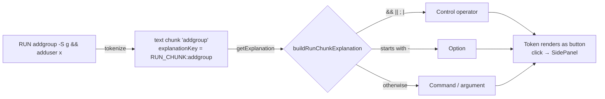

# Spec: RUN command explanations

|                 |                                                                                                                                                                                           |
| --------------- | ----------------------------------------------------------------------------------------------------------------------------------------------------------------------------------------- |
| **Status**      | Draft. Documents current behaviour; deviations and open questions are flagged inline.                                                                                                     |
| **Source**      | `getChunkExplanationKey()` in [tokenizer.ts](../../web/src/data/tokenizer.ts); `getExplanation()` / `buildRunChunkExplanation()` in [explanations.ts](../../web/src/data/explanations.ts) |
| **Rendered by** | `Token` in [DockerfileViewer.tsx](../../web/src/components/DockerfileViewer.tsx), [SidePanel.tsx](../../web/src/components/SidePanel.tsx)                                                 |
| **Tests**       | [tokenizer.test.ts](../../web/src/__tests__/tokenizer.test.ts), [App.test.tsx](../../web/src/__tests__/App.test.tsx)                                                                      |
| **Related**     | [tokenizer.md](./tokenizer.md) (TOK-20, TOK-22, §6.2–6.4)                                                                                                                                 |

## 1. Purpose

Instruction keywords and Docker flags each have a hand-written explanation. The shell command after `RUN` is free-form, so it cannot be covered by a static map. This feature makes every fragment of a `RUN` shell command clickable. Each fragment gets a **generated** explanation that:

1. tells the user what kind of fragment it is (command/argument, option, or control operator), and
2. points to the `RUN` reference.

The UI hint "Click a keyword, flag, or **command fragment** to explore" in `App` advertises this feature.

## 2. Pipeline

## 3. Key generation (tokenizer)

- **RUNX-1** A token gets the key `RUN_CHUNK:<text>` if and only if all of these hold:
  - its line is an `instruction` line with `keyword === 'RUN'`,
  - it is a `text` **chunk** (tokenizer rule TOK-15), and
  - its text is not whitespace-only.
- **RUNX-2** The following tokens on a `RUN` line do **not** get a `RUN_CHUNK:` key:
  - the `RUN` keyword itself (key `RUN`),
  - long flags (`flag` type, key = flag name, e.g. `--mount`), including shell long options such as `--omit=dev`,
  - `variable` and `string` tokens (key `null`),
  - whitespace (key `null`).
- **RUNX-3** The key contains the chunk text verbatim: no trimming, no normalisation, no escaping. If the same text appears twice, both tokens get the same key. Each token keeps its own `id`, so only the clicked one is highlighted.
- **RUNX-4** `RUN_CHUNK:` is a reserved key prefix. The static `EXPLANATIONS` map must not contain keys with this prefix.

## 4. Explanation lookup

- **RUNX-5** `getExplanation(key)` sends any key starting with `RUN_CHUNK:` to `buildRunChunkExplanation(chunk)`, where `chunk` is the key with the prefix removed. These keys never go through the static map.
- **RUNX-6** An empty chunk (`RUN_CHUNK:`) returns `null`. The tokenizer never produces one, but the guard must stay.
- **RUNX-7** Every non-empty chunk returns an explanation. RUN fragments therefore never fail lookup, and every one is interactive.
- **RUNX-8** Each call builds a **new** object. Consumers must not rely on object identity or cache by reference.

## 5. Classification

The chunk is matched against these rules in order; the first match wins:

| #           | Category           | Condition                                      | Example chunks                                      |
| ----------- | ------------------ | ---------------------------------------------- | --------------------------------------------------- |
| **RUNX-9**  | Control operator   | `chunk` is exactly one of `&&` `\|\|` `;` `\|` | `&&`                                                |
| **RUNX-10** | Option             | `chunk.startsWith('-')`                        | `-S`, `-G`, `-qO-`, `--`                            |
| **RUNX-11** | Command / argument | anything else                                  | `npm`, `ci`, `addgroup`, `/app`, `\`, `[`, `(date)` |

Notes:

- Operators are recognised only when they are a whole chunk. In `foo;` or `a&&b` (no surrounding whitespace) the operator is part of a larger chunk and falls through to RUNX-10 or RUNX-11.
- Long options never reach RUNX-10, because the tokenizer emits them as `flag` tokens first (RUNX-2). In practice the Option category only covers single-dash options and a bare `--`.
- Other shell operators (`&`, `>`, `>>`, `<`, `2>&1`, `!`) are not recognised and fall into RUNX-11.

## 6. Generated content

Every generated explanation fits the standard `Explanation` shape (`title`, `short`, `details`, `syntax`, `links`). It must also meet the content rules in [CONTRIBUTING.md](../../CONTRIBUTING.md):

- `short` is one sentence of 120 characters or fewer,
- `details` uses `\n\n` between paragraphs,
- there is at least one official Docker docs link.

| Field        | Control operator                                                      | Option                                                                                      | Command / argument                                             |
| ------------ | --------------------------------------------------------------------- | ------------------------------------------------------------------------------------------- | -------------------------------------------------------------- |
| `title`      | `chunk`                                                               | `chunk`                                                                                     | `chunk`                                                        |
| `short`      | `Shell control operator used to chain commands in RUN.`               | `Command-line option passed to the command in RUN.`                                         | `Part of the shell command executed by RUN.`                   |
| `details` ¶1 | `"<chunk>" controls how shell commands flow inside RUN.`              | `"<chunk>" is an option argument for the command being run (for example adduser/addgroup).` | `"<chunk>" is a command or argument in the RUN shell command.` |
| `details` ¶2 | Combine steps in one layer; explains `&&`                             | Option meaning depends on the tool; check its docs                                          | Runs via `/bin/sh -c`; invites clicking other fragments        |
| `syntax`     | `RUN command <chunk> command`                                         | `RUN command <chunk> <value>`                                                               | `RUN <chunk>`                                                  |
| `links`      | `RUN reference` → `https://docs.docker.com/reference/dockerfile/#run` | same                                                                                        | same                                                           |

- **RUNX-12** All three `short` strings are fixed (they do not include the chunk text), so they always stay within the 120-character limit.
- **RUNX-13** Paragraph 2 of the operator explanation always describes `&&`, whichever operator was clicked.
- **RUNX-14** Chunk text is interpolated into `title`, `details`, and `syntax`. These are rendered as **text nodes** (Preact escapes them). They must never be rendered with `dangerouslySetInnerHTML` or any other HTML sink, because chunk text is arbitrary source text.
- **RUNX-15** `details` never meets the panel's list-detection rule (it needs two or more non-empty lines in a single block). Every block renders as a `
`.

## 7. UI behaviour

These rules apply equally to static explanations; they are listed here because RUN fragments are the bulk of the interactive tokens.

- **RUNX-16** A token with a resolvable `RUN_CHUNK:` key renders as a `<button type="button">` with:
  - `title` = `short`,
  - `aria-label` = `` `${text}: ${short}` `` (e.g. `addgroup: Part of the shell command executed by RUN.`),
  - `aria-pressed` = whether it is the active token.
- **RUNX-17** Clicking the token opens the side panel. The panel heading (`h2`) is the chunk text, followed by the content from §6.
- **RUNX-18** Clicking a different fragment (or a keyword/flag) while the panel is open swaps the content in place. The panel stays open.
- **RUNX-19** Visual style follows the token's `type` (`text`). There is no separate style for each category.

## 8. Coverage in bundled examples

<!-- Leading spaces in the Line column are significant (indented lines). -->
<!-- markdownlint-disable MD038 -->

| Example | Line                                                         | Interactive RUN fragments                                                        |
| ------- | ------------------------------------------------------------ | -------------------------------------------------------------------------------- |
| Simple  | `RUN npm install`                                            | `npm`, `install`                                                                 |
| Average | `RUN npm ci`                                                 | `npm`, `ci`                                                                      |
| Average | `RUN npm run build`                                          | `npm`, `run`, `build`                                                            |
| Complex | `RUN --mount=type=cache,target=/root/.npm \`                 | `\` only (`--mount` is a flag)                                                   |
| Complex | `    npm ci --omit=dev`                                      | **none** (continuation line; see §9.1)                                           |
| Complex | `RUN npm ci` / `RUN npm run build`                           | as Average                                                                       |
| Complex | `RUN addgroup -S appgroup && adduser -S appuser -G appgroup` | `addgroup`, `-S`, `appgroup`, `&&`, `adduser`, `-S`, `appuser`, `-G`, `appgroup` |

<!-- markdownlint-enable MD038 -->

## 9. Known deviations and open questions

### 9.1 Continuation lines lose RUN context

_(tokenizer.md §6.2)_ The lines after `RUN … \` are tokenized without the `RUN` keyword, so none of their fragments are interactive. The only shell command in the Complex example's cache-mount step (`npm ci --omit=dev`) can't be clicked, while the same words on a single-line `RUN` can.

**Decision needed:** carry `RUN` context across `\`-continued lines.

### 9.2 Structural characters are explained as commands

The line-continuation `\`, the exec-form punctuation `[`, `,`, `]`, and the `$` in `$(…)` / `$1` all match RUNX-11. They are shown as "a command or argument in the RUN shell command", which is wrong.

**Decision needed:** either give these chunks no key (not interactive), or add categories for them, for example:

- _Line continuation_, linking to the Dockerfile escape/line-continuation docs,
- _Exec form_, explaining JSON-array `RUN`.

Exec-form `RUN ["a", "b"]` is not run by a shell at all, so the RUNX-11 wording "executed by the image shell" is wrong for it.

### 9.3 Shell long options are not interactive

_(tokenizer.md §6.4)_ `--omit=dev` becomes a `flag` with key `--omit`. That key has no explanation, so the token is not interactive, while `-S` is. **Decision needed:** inside `RUN`, classify long options after the first non-flag argument as chunks, so they fall under RUNX-10.

### 9.4 Option explanation names specific tools

RUNX-10 paragraph 1 always says "(for example adduser/addgroup)", even for options of unrelated tools (`wget -qO-` would get it if it appeared on a `RUN` line). **Proposed:** drop the parenthetical, or name the command the option belongs to (the nearest preceding non-option chunk).

### 9.5 Operator explanation always describes `&&`

_(RUNX-13)_ Clicking `||`, `;`, or `|` shows a paragraph explaining `&&`. **Proposed:** add a short per-operator sentence:

- `&&` runs the next command on success,
- `||` runs it on failure,
- `;` runs it unconditionally,
- `|` pipes stdout to the next command.

### 9.6 Operator recognition is whitespace-dependent

`a&&b` and `foo;` are not recognised as containing operators (§5 notes). This is acceptable for the bundled examples. Revisit only if user-supplied Dockerfiles become a feature.

### 9.7 Commands carry no specific knowledge

Every command (`npm`, `apt-get`, `adduser`) gets the same generic text. **Open question:** add an optional static map of common commands (e.g. `RUN_CMD:apt-get`) with tailored explanations and links? If added, define:

- how it is keyed (first chunk after `RUN` or after an operator only),
- precedence over the generic fallback,
- the bundle-size budget for the extra content.

## 10. Non-goals

- Parsing shell grammar (quoting, subshells, redirections, heredocs, variable expansion).
- Explaining what the arguments of a specific command mean.
- Running or validating commands.
- Generated explanations for instructions other than `RUN` (e.g. `CMD`/`ENTRYPOINT` shell form, `HEALTHCHECK … CMD`).

## 11. Test coverage

| Rule                                                        | Covered?   | Where / what to add                                                                        |
| ----------------------------------------------------------- | ---------- | ------------------------------------------------------------------------------------------ |
| RUNX-1 keys for command, option, operator chunks            | ✅         | `tokenizer.test.ts` › "sets explanation keys for non-whitespace RUN command fragments"     |
| RUNX-1 no keys for whitespace / non-RUN lines               | ❌         | Assert `null` for whitespace on `RUN` and for chunks on `COPY`                             |
| RUNX-2 flags, variables, strings on RUN keep non-chunk keys | ❌         | `RUN --mount=x echo "$HOME" $X`                                                            |
| RUNX-5–7 lookup routing, empty chunk → `null`               | ❌         | Unit-test `getExplanation` directly (no `explanations.test.ts` yet)                        |
| RUNX-9–11 classification for each category                  | ❌         | One case per category, plus `--` and `foo;`                                                |
| RUNX-12 `short` ≤ 120 chars, ≥ 1 link                       | ❌         | Property check across all generated categories and all static entries                      |
| RUNX-16 button `aria-label` / `title`                       | ✅ partial | `App.test.tsx` finds `/^addgroup:/` by role/name                                           |
| RUNX-17 panel heading = chunk text                          | ✅         | `App.test.tsx` › "opens for RUN command fragments after the keyword"                       |
| RUNX-18 swapping between fragments                          | ❌         | Click `addgroup` then `&&`; panel stays open and heading changes                           |
| End-to-end (Cucumber)                                       | ❌         | Scenario in `instruction_explanation.feature`: click a RUN fragment in the Complex example |
