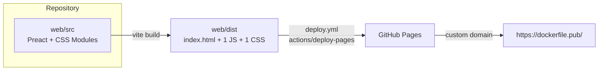
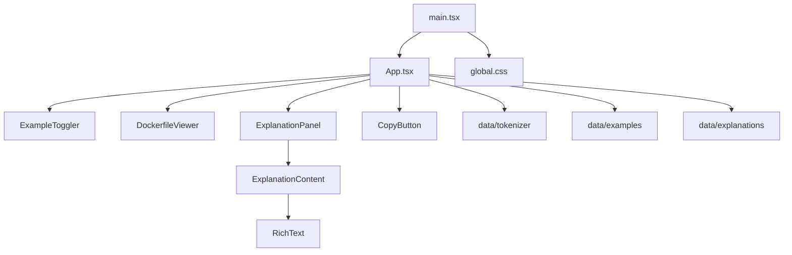

# Spec: Site architecture

|                   |                                                                                                                                                                                                                                                                |
| ----------------- | -------------------------------------------------------------------------------------------------------------------------------------------------------------------------------------------------------------------------------------------------------------- |
| **Status**        | Draft. Documents the current architecture; deviations and open questions are flagged inline.                                                                                                                                                                   |
| **Last verified** | 2026-10-11 (against `main` + the `specs` branch changes)                                                                                                                                                                                                       |
| **Scope**         | Runtime structure, build, styling, testing layers, CI/CD, hosting, and the decisions behind them                                                                                                                                                               |
| **Related specs** | [tokenizer.md](./tokenizer.md) · [run-command-explanations.md](./run-command-explanations.md) · [explanation-content-model.md](./explanation-content-model.md) · [explanation-panel.md](./explanation-panel.md) · [github-workflows.md](./github-workflows.md) |

## 1. Overview

Dockerfile Explainer is a **static, client-only single-page app**. When the bundle loads, the page tokenizes bundled Dockerfile examples in the browser and renders them as interactive tokens that open explanations. The app has:

- no backend,
- no API calls,
- no routing,
- no third-party runtime scripts,
- no user-supplied input.

## 2. Repository layout

| Path                                                    | Role                                                                                                                            |
| ------------------------------------------------------- | ------------------------------------------------------------------------------------------------------------------------------- |
| `web/`                                                  | The whole app. All npm scripts run from here.                                                                                   |
| `web/index.html`                                        | Vite entry HTML. Contains `
`, the meta description and the favicon link.                                         |
| `web/public/`                                           | Static files copied to `dist/` unchanged (`favicon.svg`).                                                                       |
| `web/src/main.tsx`                                      | Bootstrap: imports `global.css` and renders `<App />` into `#root`.                                                             |
| `web/src/App.tsx`                                       | The only stateful component: holds state and lays out the page.                                                                 |
| `web/src/components/`                                   | UI components, one `.module.css` per component.                                                                                 |
| `web/src/data/`                                         | Pure TypeScript: `tokenizer/`, explanation `content/`, `commands/`, the `explanations.ts` entry point and `examples.ts`.        |
| `web/src/styles/global.css`                             | Design tokens, reset and base element styles.                                                                                   |
| `web/src/__tests__/`                                    | Vitest unit and component tests. `setup.ts` holds shared test setup.                                                            |
| `web/features/`                                         | Cucumber + Puppeteer end-to-end tests.                                                                                          |
| `web/scripts/check-size.ts`                             | Bundle-size budget check (`npm run size`, ARCH-15).                                                                             |
| `web/tsconfig.json`                                     | TypeScript config for every `.ts`/`.tsx` file in `web/` (`npm run typecheck`, ARCH-6).                                          |
| `web/.nvmrc`                                            | The Node version used by CI and deploy (WF-31).                                                                                 |
| `web/cucumber.yml`                                      | Cucumber profiles: `default` and `smoke` (ARCH-18).                                                                             |
| `web/eslint.config.ts`, `web/.stylelintrc.json`         | TypeScript and CSS lint config (§8).                                                                                            |
| `.prettierrc`, `.prettierignore`, `.markdownlint.jsonc` | Repo-wide format and Markdown lint config (§8). They live at the root so they apply to `README.md`, `docs/` and `.github/` too. |
| `.github/workflows/`                                    | `ci.yml` (verify) and `deploy.yml` (publish).                                                                                   |
| `docs/specs/`                                           | These specs. This file is the source of truth for architecture; the README links here instead of repeating it.                  |

## 3. Runtime architecture

### 3.1 Module layers

- **ARCH-1 Data layer is pure.** Modules in `src/data/` must not import Preact, the DOM or browser APIs. They must be deterministic, so they can run in Node directly (`node --input-type=module`) and be unit-tested without jsdom.
  - Enforced by ESLint for `src/data/**`: `no-restricted-imports` blocks `preact`, `preact/*`, components, `App` and CSS; `no-restricted-globals` blocks `window`, `document`, `navigator`, `localStorage`, `sessionStorage` and `fetch`.
- **ARCH-2 Components receive data through props.** Components get everything they render from props and raise events through callbacks (`onChange`, `onTokenSelect`, `onClose`, `onBack`, `onNavigate`). They hold only local UI state, such as `CopyButton`'s "Copied!" flag, the viewer's roving tab stop or the panel's exit transition. Components do not import runtime code from `src/data/`.
  - `App` resolves each token's explanation once per example switch and attaches it as `token.explanation` (`Explanation | null`), together with `token.summary`, the flattened `short` text (EXP-29). `DockerfileViewer` treats a token as interactive when `token.explanation` is non-null and uses `summary` for its tooltip and accessible name. `ExplanationPanel` receives a `PanelEntry` (`{ key, ref, explanation }`) derived from `App`'s panel state. Components may import types from `src/data/`, but no runtime code. The tokenizer itself stays independent of the explanation content (tokenizer spec §2).
- **ARCH-3 There is one owner of application state.** `App` holds all cross-component state:

  | State           | Type                                                                                       | Persisted                                                                                                    |
  | --------------- | ------------------------------------------------------------------------------------------ | ------------------------------------------------------------------------------------------------------------ |
  | `activeExample` | example key                                                                                | `localStorage['df-example']` (invalid or missing values fall back to `simple`; storage errors are swallowed) |
  | `panel`         | `PanelState`: `{ sourceTokenId, stack: PanelEntry[] }` or `null` (explanation-panel.md §3) | no                                                                                                           |

  The open entry, the Back target, the highlighted token and the status announcement are all derived from `panel`.

  There is no store, context or router. Introduce one only if state has to be shared across more than one level of components, or deep links are added (see §10.2).

- **ARCH-4 Derived data is memoised.** The tokenized `lines`, with explanations attached, are recomputed only when `activeExample` changes (`useMemo`). The example list is computed once. The tokenizer runs on the client, on every example switch; this is cheap because inputs are under 30 lines.

### 3.2 Framework

- **ARCH-5 Preact 10, not React.** Chosen to keep the bundle small (see §6). Code uses `preact/hooks` and Preact's native `class` attribute. ESLint's React rules are configured for this (`react/no-unknown-property` ignores `class` and `for`; `react/prop-types` is off).
- **ARCH-6 TypeScript everywhere.** Every source file in `web/` is TypeScript: `.tsx` for components and `.ts` for everything else, including tests, Cucumber steps, scripts and the Vite and ESLint configs. There are no `.js` source files. TypeScript is a dev dependency only and never ships in the bundle.
  - One [tsconfig.json](../../web/tsconfig.json) covers `src/`, `features/`, `scripts/` and the root config files. It uses `strict`, `noEmit`, `isolatedModules`, `verbatimModuleSyntax` and `erasableSyntaxOnly`. `npm run typecheck` (`tsc`) runs in CI.
  - **Erasable syntax only:** no `enum`, `namespace` or constructor parameter properties. This lets Node run `.ts` files directly through its built-in type stripping, used by `node scripts/check-size.ts` and by Cucumber loading `features/**/*.ts`, with no build step or loader. That requires Node 22.18 or later (WF-31). Use `as const` objects plus derived union types instead of enums (e.g. `TOKEN_TYPE` / `TokenType`).
  - `verbatimModuleSyntax` means type-only imports must use `import type`. This also guarantees that side-effect imports are never silently dropped.
  - Vite (app and Vitest) and ESLint (via `jiti`) compile TypeScript themselves; `tsc` only checks types.
  - TypeScript is pinned to `~6.0`. typescript-eslint does not yet support the native TypeScript 7 compiler, which has no JS API. Upgrade both together.
  - The shared `ResolvedToken` type (a token plus its explanation, ARCH-2) is exported from `DockerfileViewer.tsx`, and `PanelEntry` from `ExplanationPanel.tsx`; `App` imports both with `import type`.
  - Prefer typed refs (`useRef<HTMLElement>(null)`) and narrowing with `?.` over non-null assertions. The only cast in app code is `#root` in `main.tsx`, which `index.html` guarantees exists. Cucumber's world declares `browser!`/`page!`, because the `@browser` hook sets them before any step runs.

## 4. Styling

- **ARCH-7 CSS Modules per component**, plus one global stylesheet. Global CSS is limited to:
  - design tokens (custom properties),
  - the reset,
  - `body` and `#root` base styles,
  - the `:focus-visible` outline.

  **No `:global()` selectors that target another module's class.** CSS Modules renames classes at build time (for example `.viewer` becomes `._viewer_1cdr5_1`), so such a selector silently matches nothing. When a parent needs to style a child component, the parent either owns that styling itself or passes a `class` prop down.

  > Fixed 2026-10-11: `App.module.css` had a dead `.viewerSection :global(.viewer)` rule, so the viewer rendered a double border. The viewer no longer draws its own border; the parent `.viewerSection` owns the frame.

- **ARCH-8 Design tokens** cover colour, syntax-highlight colours, type scale, spacing, radius, shadows, transition durations and `--header-height`. **Colours, shadows and transition durations must use tokens.** Literal sizes (e.g. a 28 px icon button) are allowed. The macOS window dots in the viewer header (`#ff5f57` etc.) are intentional exceptions.
  - Text drawn on an accent background uses `--c-on-accent`: dark text on the dark theme's light-blue accent, and white on the light theme's dark-blue accent. Both meet WCAG AA (ARCH-29).
  > Fixed 2026-10-11: the hard-coded `#fff` in `ExampleToggler` (2.5:1 contrast in dark mode) now uses `--c-on-accent`, and the unused `--c-image` token was removed.
- **ARCH-9 Theming:** dark is the default. A light palette overrides the colour and shadow tokens under `@media (prefers-color-scheme: light)`. There is no manual toggle and no persisted preference.
- **ARCH-10 Responsive layout:** one breakpoint at `width <= 768px`. Above it, the viewer and panel sit side by side. Below it, the page stacks and the panel becomes a bottom sheet (see the panel spec, §5).
- **ARCH-11 Fonts:** system font stacks only. No web fonts are loaded, so `JetBrains Mono` and the other named fonts are used only if the user already has them installed.
- **ARCH-12 Motion:** **required** to respect `prefers-reduced-motion`.
  - Implemented once, globally, in `global.css`: under `prefers-reduced-motion: reduce`, every element gets `transition-duration: 0s !important` and `animation-duration: 0s !important`, and `scroll-behavior` falls back to `auto`. `!important` is needed so the rule also beats transition styles set inline from JS (`ExampleToggler`'s indicator). Components do not add their own reduced-motion rules.
  - Verified by [reduced_motion.feature](../../web/features/reduced_motion.feature) (E2E), which checks both the reduced and the default case.

## 5. Build

- **ARCH-13 Vite** with `@preact/preset-vite`. The config ([vite.config.ts](../../web/vite.config.ts)) also holds the Vitest config and a small build-only plugin that injects the CSP (ARCH-24). No `base`, `build.target` or chunking options are set, so Vite's defaults apply:
  - `base: '/'`, which means asset URLs are root-absolute (see ARCH-23),
  - build target = Vite 8's `baseline-widely-available` (see ARCH-30),
  - a single JS chunk and a single CSS file.
- **ARCH-14 All content is bundled.** Examples and explanations ship in the main JS chunk. There is no lazy loading and nothing is fetched at runtime.

## 6. Performance budget

- **ARCH-15 Budget.** CONTRIBUTING.md says "No new dependencies unless strictly necessary. The bundle must stay small." The README cites the measured size and the budget below.

  | Asset | Raw      | Gzip    | Measured                               |
  | ----- | -------- | ------- | -------------------------------------- |
  | JS    | 120.7 KB | 39.8 KB | 2026-10-12, `vite build`               |
  | CSS   | 14.2 KB  | 3.6 KB  | 2026-10-12                             |
  | HTML  | 0.8 KB   | 0.5 KB  | 2026-10-11 (includes the CSP meta tag) |

  > ✅ **Enforced in CI.** [scripts/check-size.ts](../../web/scripts/check-size.ts) (`npm run size`, run after Build in `ci.yml`) fails if the gzipped JS total exceeds **40 KB** or the gzipped CSS total exceeds **5 KB**. It also fails if `dist/assets` contains no JS. The README cites the same numbers. (`vite build` reports kB of 1,000 bytes; `check-size.ts` reports KiB, so the same bundle shows as 38.5 KB there.)
  >
  > The JS budget was raised from 20 KB to 28 KB on 2026-10-12 (D15), then to 40 KB later the same day (D16), after the tokenizer (about 7 KB gzipped), the explanation content and the command catalog were implemented and measured. 40 KB still leaves headroom while catching a framework-sized dependency.

- **ARCH-16 Runtime work.** Tokenizing and `getExplanation` both run once per token per example switch (memoised, ARCH-4). Both are O(n) in the example size. No virtualisation is needed.

## 7. Testing architecture

| Layer          | Tooling                                | Target                                                                                                         | Scope                                                                   | Runs in                                                                          |
| -------------- | -------------------------------------- | -------------------------------------------------------------------------------------------------------------- | ----------------------------------------------------------------------- | -------------------------------------------------------------------------------- |
| Unit           | Vitest                                 | `src/data/*`                                                                                                   | Tokenizer and explanation logic                                         | **Node** (`// @vitest-environment node` at the top of each data-layer test file) |
| Component / UI | Vitest + Testing Library + jsdom       | `src/components/*`, `App`                                                                                      | Rendering, ARIA, events, `localStorage`                                 | jsdom (the default in `vite.config.ts`)                                          |
| End-to-end     | Cucumber + Puppeteer (headless Chrome) | A running site at `BASE_URL` (default `http://localhost:5173`; CI uses `vite preview` of the production build) | User flows, real layout and CSS, CSP, reduced motion, axe accessibility | Real browser                                                                     |

- **ARCH-17** Each layer owns different behaviour:
  - Behaviour that depends on **real layout or CSS** (one-third/two-thirds split, bottom sheet, reduced motion, focus visibility) belongs in end-to-end tests.
  - Behaviour driven by **logic, ARIA or state** belongs in unit/component tests.
  - Data-layer tests run in Node, not jsdom. A data-layer test that needs a DOM indicates an ARCH-1 violation.
  - E2E scenarios that need a browser are tagged `@browser`. The `Before`/`After` hooks open and close Chrome around them and save a full-page screenshot when a scenario fails, to `FEATURE_ARTIFACTS_DIR`, which defaults to `features/artifacts` (gitignored).
- **ARCH-18** E2E tests target any environment through `BASE_URL`, including production. They start with a "site is up" health check so they fail fast with a clear message.
  - [cucumber.yml](../../web/cucumber.yml) has two profiles: `default` (every feature) and `smoke` (`site.feature` only, used after deploys). Select one with `--profile`. Paths passed on the CLI are merged with the profile's paths rather than replacing them, so pass a profile, not a file path, to run a subset.
- **ARCH-19** jsdom workaround: [setup.ts](../../web/src/__tests__/setup.ts) replaces Node 22+'s experimental `localStorage` global with jsdom's. Remove it once the supported Node versions no longer need it.
- **ARCH-26** Placeholder Cucumber scaffolding was removed 2026-10-11. Every feature file must test real behaviour.

## 8. Tooling and conventions

| Concern            | Tool                                                                                                                                                                 | Scope                                                                                                      | Enforced in CI? |
| ------------------ | -------------------------------------------------------------------------------------------------------------------------------------------------------------------- | ---------------------------------------------------------------------------------------------------------- | --------------- |
| Lint: TypeScript   | ESLint 10 (flat config, `eslint.config.ts`), `@eslint/js` + typescript-eslint `recommendedTypeChecked` + `react` + `react-hooks`, plus the data-layer guard (ARCH-1) | all of `web/` (`npm run lint:js`), `--max-warnings 0`                                                      | ✅ (`ci.yml`)   |
| Lint: CSS          | Stylelint + `stylelint-config-standard` ([.stylelintrc.json](../../web/.stylelintrc.json))                                                                           | `web/src/**/*.css` (`npm run lint:css`)                                                                    | ✅ (`ci.yml`)   |
| Lint: Markdown     | markdownlint-cli2 ([.markdownlint.jsonc](../../.markdownlint.jsonc))                                                                                                 | every `*.md` in the repo (`npm run lint:md`)                                                               | ✅ (`ci.yml`)   |
| Lint: workflows    | actionlint (pinned Docker image, includes shellcheck)                                                                                                                | `.github/workflows/*.yml`                                                                                  | ✅ (`ci.yml`)   |
| Type-check         | `tsc` (TypeScript ~6.0), `strict` (ARCH-6)                                                                                                                           | every `.ts`/`.tsx` file in `web/`                                                                          | ✅ (`ci.yml`)   |
| Format             | Prettier ([.prettierrc](../../.prettierrc): `singleQuote`, `trailingComma: all`, `printWidth: 100`) + `prettier-plugin-gherkin`                                      | the whole repo except [.prettierignore](../../.prettierignore) (`npm run format` / `npm run format:check`) | ✅ (`ci.yml`)   |
| Bundle size        | `scripts/check-size.ts` (ARCH-15)                                                                                                                                    | `dist/assets`                                                                                              | ✅ (`ci.yml`)   |
| Runtime            | Node from [web/.nvmrc](../../web/.nvmrc) (22); `package.json` `engines: >=22.18` (native TS type stripping)                                                          | both workflows use `node-version-file`                                                                     | ✅              |
| Dependency updates | Dependabot                                                                                                                                                           | npm (`/web`) and GitHub Actions, weekly                                                                    | n/a             |

- **ARCH-27 Lint and format everything that isn't generated** (decided 2026-10-11).
  - The only files excluded are generated or vendored ones: `node_modules/`, `dist/`, `coverage/`, `features/artifacts/` and `package-lock.json`. Add new generated outputs to `.prettierignore` (and to ESLint's `ignores`) when they appear.
  - All tooling is installed in `web/`, so the npm scripts run from `web/` and reach root files through `..`. Prettier must run from `web/` so it can resolve `prettier-plugin-gherkin`; running `prettier` from the repo root fails to load the plugin.
  - ESLint uses typescript-eslint's type-aware `recommendedTypeChecked` rules (`projectService`, sharing `tsconfig.json`). Globals depend on where code runs: browser for `src/`, Node for config files and `scripts/`, and both for `features/`, because step definitions pass callbacks to `page.evaluate()`.
  - Stylelint uses the standard config, with camelCase class names allowed for CSS Modules. Its autofixes moved the CSS to modern colour notation (`rgb(r g b / a%)`) and range media queries (`width <= 768px`). Both are inside the ARCH-30 browser baseline.
  - markdownlint disables MD013 (line length), because prose isn't hard-wrapped. Tables whose code cells start with significant spaces turn off MD038 locally, with a comment explaining why.
  - Not linted, with no maintained tool or no real benefit: `.feature` files (Prettier formats them, but `gherkin-lint` hasn't been released since 2023), `index.html` (one small file; its rendered output is checked by axe) and `favicon.svg`.

## 9. CI/CD and hosting

### 9.1 Workflows

The detailed rules (WF-*) live in [github-workflows.md](./github-workflows.md); this section records only the architectural decisions.

- `ci.yml` verifies every PR to `main` and every push to `main`: lint, format, type-check, unit/component tests, build, bundle size, then E2E against the production build.
- `deploy.yml` builds `main`, publishes `web/dist/` to GitHub Pages, then smoke-tests the live site.

- **ARCH-20 Deploys are gated by branch protection, not by the deploy workflow.** `deploy.yml` does not wait for `ci.yml`. Instead, `main` requires PRs, and a PR must pass CI before it can be merged. Every commit that reaches `main` through a PR has therefore already passed the full CI suite. Decision recorded 2026-10-11 (D11).
  - Remaining exposure: commits that reach `main` without a PR (an admin bypassing protection), and manual `workflow_dispatch` runs. Both are accepted.
- **ARCH-21 E2E runs against the production build** (`vite preview` after `vite build`), so the base path, minification, asset hashing and the build-only CSP are all covered. See WF-12.
- **ARCH-22 Post-deploy smoke test.** The `smoke` job in `deploy.yml` runs the `smoke` Cucumber profile against the deployed `page_url`. See WF-25.

### 9.2 Hosting

- **ARCH-23 GitHub Pages, served from a custom domain at the root.**
  - `https://abraham.github.io/dockerfile-pub/` redirects to `https://dockerfile.pub/`, which serves the app at `/`. Verified 2026-10-11.
  - Vite's default `base: '/'` produces root-absolute URLs (`/assets/index-*.js`, `/favicon.svg`). These are correct only because the site is served at the domain root.
  - The custom domain is set in the repository's Pages settings, and **this spec is the source of truth for it**. The site deploys with GitHub Actions, and GitHub ignores a `CNAME` file in that case, so a `CNAME` file would only mislead. If the Pages setting were removed, the site would be served from `/dockerfile-pub/` and every asset would 404.
  - The README links (Live demo, production `BASE_URL` example) use `https://dockerfile.pub/`.
- **ARCH-24 Static hosting limits.** GitHub Pages does not allow custom response headers (CSP, HSTS policy, cache headers). With no backend and no third-party scripts, the main risk would be an XSS hole in rendering. That is covered by the text-only rendering rules (EXP-5, CMDX-22, PNL-12).
  - As defence in depth, the production build has a `<meta http-equiv="Content-Security-Policy">`: `default-src 'self'; script-src 'self'; style-src 'self'; img-src 'self' data:; object-src 'none'; base-uri 'self'; form-action 'none'`.
  - It is injected by a Vite plugin in [vite.config.ts](../../web/vite.config.ts) (`transformIndexHtml`, `apply: 'build'`). It is deliberately absent in dev, because the dev server adds inline scripts for hot reload.
  - The production output has no inline scripts or styles. `ExampleToggler` sets styles through the CSSOM (`element.style.*`), which `style-src 'self'` allows.
  - `site.feature` records `securitypolicyviolation` events while the page is used and fails on any violation. It runs against the production build in CI and against the live site after each deploy.
  - Meta-tag CSP cannot set `frame-ancestors`; clickjacking protection would need response headers, which Pages does not support.
- **ARCH-25 No SPA routing.** The app has one URL. GitHub Pages' default 404 page is acceptable as long as deep links (§10.2) are not added.

## 10. Cross-cutting decisions and open questions

### 10.1 Privacy

The site has no analytics, no cookies and no external requests at runtime. The only things stored on the user's device are the selected example (`localStorage['df-example']`) and clipboard writes, which happen only when the user clicks Copy. **Required:** keep it that way unless a privacy note is added to the README.

### 10.2 Deep linking

The selected example and token live only in memory and `localStorage`, so a specific explanation cannot be shared by URL. **Open question:** add a hash-based state such as `#complex/14-3` or `#complex/--mount`. Hash-based state works on static hosting with no 404 workaround. Token ids are tied to line positions (tokenizer INV-4, INV-8), so a key-based anchor built from `refKey` (TOK-2, such as `flag:RUN:--mount`) would survive changes to the examples better than an id-based one.

### 10.3 User-supplied Dockerfiles

Today all input is bundled and trusted. Letting users paste their own Dockerfile would change several assumptions:

- the tokenizer is already built as a robustness boundary (tokenizer.md P1, P2, INV-1, INV-2 and INV-9), but larger inputs need a re-check,
- text-only rendering becomes security-critical,
- performance needs to be re-checked for large files,
- persisting the content would raise privacy questions.

Treat this as a new spec, not an extension of an existing one.

### 10.4 Metadata and SEO

`index.html` has a `<title>`, a meta description and an SVG favicon. It has no Open Graph or Twitter card tags, no `theme-color` and no canonical URL (relevant because of the github.io → custom domain redirect). **Optional:** add them.

### 10.5 Error handling

- **ARCH-28** Browser-API calls (`localStorage`, `navigator.clipboard`, and any added later) **fail softly**:
  - Feature-detect or `try`/`catch` every call. Never let it throw into a render or an event handler, and never leave an unhandled promise rejection.
  - If a background action fails, such as persisting the example choice, ignore the failure silently.
  - If an action the user started fails, such as Copy, show a visible failure state, e.g. "Copy failed" with an updated `aria-label`.
  - `CopyButton` feature-detects `navigator.clipboard.writeText` and handles rejection. On failure it shows "Copy failed" (accessible name "Copy to clipboard failed") for 2 s, the same timing as "Copied!". Both paths are unit-tested. The `localStorage` calls in `App` also comply.

### 10.6 Accessibility baseline

- **ARCH-29** Every component follows these rules. Component specs (e.g. [explanation-panel.md](./explanation-panel.md) §6–7) add detail but must not contradict them.
  - **Native elements first:** interactive things are `<button type="button">` or `<a href>`, never clickable `
`/``.
  - **Keyboard:** everything interactive is reachable with Tab/Shift+Tab in DOM order. Anything dismissible closes on Escape.
  - **Focus visibility:** the global `:focus-visible` outline (`--c-accent`, 2 px) is never removed. A component may restyle it but must keep a visible indicator.
  - **Names and state:** each control has an accessible name (visible text or `aria-label`). Toggles expose state with `aria-pressed`. Landmarks and regions are labelled (`aria-label` / `aria-labelledby`).
  - **Motion:** see ARCH-12.
  - **Colour:** text and syntax-highlight tokens meet WCAG 2.2 AA contrast in both themes, including on hover backgrounds.
  - **Scrollable regions** that can hold overflowing content without anything focusable inside (e.g. the panel's syntax `<pre>`) get `tabIndex={0}`, `role="region"` and an `aria-label`, so keyboard users can scroll them.
  - **Target size (WCAG 2.5.8):** controls are at least 24×24 px, except code tokens in the Dockerfile viewer. Those are inline targets whose size is set by the code's line height, which falls under the 2.5.8 "inline" exception.
  - Verified by [accessibility.feature](../../web/features/accessibility.feature). It runs axe-core with the WCAG 2.0/2.1/2.2 A and AA tags in the dark and light colour schemes, on the Complex example with the panel open. `target-size` is checked everywhere except inside `[aria-label="Dockerfile source"]`.
  > Fixed 2026-10-11 after the first axe run:
  >
  > - dark-mode active example text (2.5:1 → 7.5:1 via `--c-on-accent`);
  > - dark comments (3.8:1 → 5.6:1);
  > - light comments on hover (4.3:1 → 5.7:1);
  > - the syntax block was not keyboard-scrollable.

### 10.7 Browser support

- **ARCH-30** Supported browsers are Vite 8's default `baseline-widely-available` build target: **Chrome/Edge 111+, Firefox 114+, Safari/iOS Safari 16.4+**.
  - The CSS features in use (`dvh` units, `:focus-visible`, custom properties) and the JS syntax in use (`??`, `?.`, `||=`) are all available in these versions.
  - New CSS or JS features must be available in every one of these versions, or be degraded gracefully.
  - Changing `build.target` in `vite.config.ts` is an architecture change and must update this rule.

## 11. Decision log

| #   | Decision                                                                                                            | Rationale                                                                                                                                              | Status                                              |
| --- | ------------------------------------------------------------------------------------------------------------------- | ------------------------------------------------------------------------------------------------------------------------------------------------------ | --------------------------------------------------- |
| D1  | Static SPA, no backend                                                                                              | Content is fixed; zero hosting cost; nothing to secure server-side                                                                                     | Accepted                                            |
| D2  | Preact over React                                                                                                   | Bundle size (ARCH-15)                                                                                                                                  | Accepted                                            |
| D3  | TypeScript for all source, using erasable syntax only (superseded the original "JS + JSDoc" decision on 2026-10-11) | Real type annotations instead of JSDoc casts; one toolchain for app, tests, E2E and scripts; Node runs `.ts` directly, so there is no extra build step | Accepted 2026-10-11; see ARCH-6                     |
| D4  | CSS Modules + custom-property tokens; no CSS framework                                                              | Scoped styles, theming through tokens, zero runtime cost                                                                                               | Accepted                                            |
| D5  | Dark by default, light through `prefers-color-scheme`; no toggle                                                    | Developer-tool convention; no state to persist                                                                                                         | Accepted                                            |
| D6  | Content bundled as JS modules                                                                                       | Small size; type-adjacent; no fetch                                                                                                                    | Accepted; revisit per content spec §8.4             |
| D7  | Tokenize on the client, per logical instruction, display-only                                                       | Keeps raw examples human-editable                                                                                                                      | Accepted; see tokenizer spec                        |
| D8  | All state in `App`                                                                                                  | Shallow tree; three pieces of state                                                                                                                    | Accepted; see ARCH-3                                |
| D9  | Three test layers (Vitest unit, Vitest + jsdom UI, Cucumber + Puppeteer E2E)                                        | Readable acceptance scenarios; E2E can target any environment                                                                                          | Accepted                                            |
| D10 | GitHub Pages + custom domain at the root                                                                            | Free, integrated with Actions                                                                                                                          | Accepted; see ARCH-23 (configured outside the repo) |
| D11 | Deploy is not gated by the deploy workflow; branch protection on `main` requires PRs to pass CI before merging      | CI already runs on every PR; avoids `workflow_run` complexity                                                                                          | Accepted 2026-10-11; see ARCH-20                    |
| D12 | Explanations are resolved in `App` and attached to tokens; components never import `src/data`                       | One lookup per token per example switch; clear layer boundary                                                                                          | Accepted; see ARCH-2                                |
| D13 | Automated accessibility checks run in the E2E layer (axe-core), not in jsdom                                        | jsdom cannot compute real colours, layout or target sizes                                                                                              | Accepted 2026-10-11; see ARCH-29                    |
| D14 | No `CNAME` file; the Pages setting plus this spec are the record of the custom domain                               | GitHub ignores `CNAME` for Actions deployments                                                                                                         | Accepted 2026-10-11; see ARCH-23                    |
| D15 | JS budget raised from 20 KB to 28 KB gzipped; content stays bundled, not lazy-loaded                                | Keeps explanation lookup synchronous with no loading states, while fitting the target tokenizer, content and command catalog                           | Superseded by D16                                   |
| D16 | JS budget raised from 28 KB to 40 KB gzipped after measuring the implemented tokenizer, content and catalog         | Every token's tooltip and accessible name need `short` at first render, so content can't be deferred without changing that; 40 KB keeps headroom       | Accepted 2026-10-12; see ARCH-15, EXP-41, CMDX-20   |

## 12. Verification checklist

Steps that turn the rules in this spec into automated checks:

- [x] Data-layer purity (ARCH-1): ESLint `no-restricted-imports` + `no-restricted-globals` for `src/data/**`.
- [x] Data-layer tests run in Node (ARCH-17): `// @vitest-environment node`.
- [x] Bundle budget (ARCH-15): `npm run size` after Build in `ci.yml`.
- [x] Type-check (ARCH-6): `npm run typecheck` in `ci.yml`.
- [x] Convert all JS to TypeScript (ARCH-6 / D3).
- [x] Strict type-checking, including tests (ARCH-6).
- [x] Fix the dead `:global(.viewer)` rule and the double border (ARCH-7).
- [x] Replace the `#fff` literal and remove `--c-image` (ARCH-8).
- [x] Reduced motion (ARCH-12): global rule + `reduced_motion.feature`.
- [x] Clipboard failure handling in `CopyButton` (ARCH-28).
- [x] Automated axe check in both colour schemes (ARCH-29): `accessibility.feature`.
- [x] Production-build E2E (ARCH-21 / WF-12).
- [x] Post-deploy smoke test (ARCH-22 / WF-25).
- [x] Deploy gating decided (ARCH-20 / D11): branch protection requires CI.
- [x] Node version pinned consistently (WF-19 / WF-31): `web/.nvmrc` + `engines`.
- [x] Custom domain recorded (ARCH-23 / D14): this spec + README links.
- [x] Build-only CSP (ARCH-24), verified by `site.feature`.
- [x] Delete placeholder feature files (ARCH-26).
- [x] `prettier --check` in CI (WF-15).
- [x] Lint and format everything that isn't generated (ARCH-27).
- [ ] Automated contrast check for hover/active states. axe only measures the resting state; the current hover colours were checked by hand.
