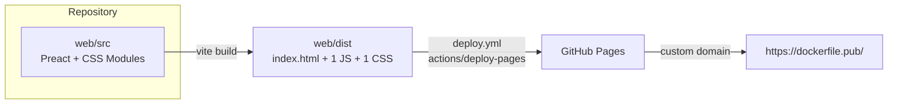
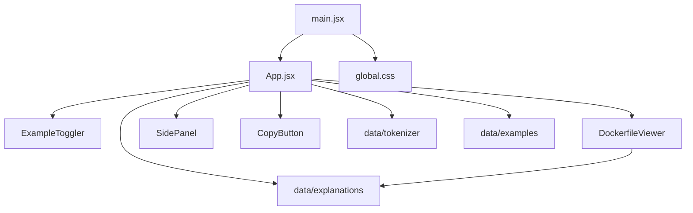

# Spec: Site architecture

| | |
|---|---|
| **Status** | Draft. Documents the current architecture; deviations and open questions are flagged inline. |
| **Scope** | Runtime structure, build, styling, testing layers, CI/CD, hosting, and the decisions behind them |
| **Related specs** | [tokenizer.md](./tokenizer.md) · [run-command-explanations.md](./run-command-explanations.md) · [explanation-content-model.md](./explanation-content-model.md) · [explanation-panel.md](./explanation-panel.md) · [github-workflows.md](./github-workflows.md) |

## 1. Overview

Dockerfile Explainer is a **static, client-only single-page app**. When the bundle loads, the page tokenizes bundled Dockerfile examples in the browser and renders them as interactive tokens that open explanations. The app has:

- no backend,
- no API calls,
- no routing,
- no third-party runtime scripts,
- no user-supplied input.

## 2. Repository layout

| Path | Role |
|---|---|
| `web/` | The whole app. All npm scripts run from here. |
| `web/index.html` | Vite entry HTML. Contains `
`, the meta description and the favicon link. |
| `web/public/` | Static files copied to `dist/` unchanged (`favicon.svg`). |
| `web/src/main.jsx` | Bootstrap: imports `global.css` and renders `<App />` into `#root`. |
| `web/src/App.jsx` | The only stateful component: holds state and lays out the page. |
| `web/src/components/` | UI components, one `.module.css` per component. |
| `web/src/data/` | Pure JS: tokenizer, explanations, examples. Has no Preact imports. |
| `web/src/styles/global.css` | Design tokens, reset and base element styles. |
| `web/src/__tests__/` | Vitest unit and component tests. |
| `web/features/` | Cucumber + Puppeteer end-to-end tests. |
| `.github/workflows/` | `ci.yml` (verify) and `deploy.yml` (publish). |
| `docs/specs/` | These specs. |

## 3. Runtime architecture

### 3.1 Module layers

- **ARCH-1 Data layer is pure.** Modules in `src/data/` must not import Preact, the DOM or browser APIs. They must be deterministic, so they can run in Node directly (`node --input-type=module`) and be unit-tested without jsdom.
- **ARCH-2 Components receive data through props.** Components get everything they render from props and raise events through callbacks (`onChange`, `onTokenClick`, `onClose`). They hold only local UI state, such as `CopyButton`'s "Copied!" flag or `ExampleToggler`'s indicator refs.
  > Exception: `DockerfileViewer` calls `getExplanation()` directly to decide whether each token is interactive and what its tooltip says. This is acceptable because the lookup is pure, but it means the viewer and `App` each resolve explanations on their own. **Open question:** have the tokenizer or `App` attach the explanation (or a boolean `interactive` flag) to each token instead.
- **ARCH-3 There is one owner of application state.** `App` holds all cross-component state:

  | State | Type | Persisted |
  |---|---|---|
  | `activeExample` | example key | `localStorage['df-example']` (invalid or missing values fall back to `simple`; storage errors are swallowed) |
  | `activeToken` | `Token & { explanation }` or `null` | no |
  | `isPanelOpen` | `boolean` | no |

  There is no store, context or router. Introduce one only if state has to be shared across more than one level of components, or deep links are added (see §10.2).
- **ARCH-4 Derived data is memoised.** The tokenized `lines` are recomputed only when `activeExample` changes (`useMemo`). The example list is computed once. The tokenizer runs on the client, on every example switch; this is cheap because inputs are under 30 lines.

### 3.2 Framework

- **ARCH-5 Preact 10, not React.** Chosen to keep the bundle small (see §6). Code uses `preact/hooks` and Preact's native `class` attribute. ESLint's React rules are configured for this (`react/no-unknown-property` ignores `class` and `for`; `react/prop-types` is off).
- **ARCH-6 JavaScript with JSDoc types, not TypeScript.** Types are documented with `@typedef` and are not type-checked. **Open question:** add `// @ts-check`, or run `tsc --noEmit` with `checkJs` in CI, so the JSDoc types are actually enforced at no runtime cost.

## 4. Styling

- **ARCH-7 CSS Modules per component**, plus one global stylesheet. Global CSS is limited to:
  - design tokens (custom properties),
  - the reset,
  - `body` and `#root` base styles,
  - the `:focus-visible` outline.

  The only exception is a single `:global(.viewer)` reference in `App.module.css`.
- **ARCH-8 Design tokens** cover colour, syntax-highlight colours, type scale, spacing, radius, shadows, transition durations and `--header-height`. Components must use tokens, not literal values. The macOS window dots in the viewer header (`#ff5f57` etc.) are intentional exceptions.
- **ARCH-9 Theming:** dark is the default. A light palette overrides the colour and shadow tokens under `@media (prefers-color-scheme: light)`. There is no manual toggle and no persisted preference.
- **ARCH-10 Responsive layout:** one breakpoint at `max-width: 768px`. Above it, the viewer and panel sit side by side. Below it, the page stacks and the panel becomes a bottom sheet (see the panel spec, §5).
- **ARCH-11 Fonts:** system font stacks only. No web fonts are loaded, so `JetBrains Mono` and the other named fonts are used only if the user already has them installed.
- **ARCH-12 Motion:** **required** to respect `prefers-reduced-motion`.
  > ⚠️ **Partially violated.** Only `ExampleToggler` respects it. The panel transitions and the global `scroll-behavior: smooth` do not.

## 5. Build

- **ARCH-13 Vite** with `@preact/preset-vite`. The config ([vite.config.js](../../web/vite.config.js)) also holds the Vitest config. No `base`, `build.target` or chunking options are set, so Vite's defaults apply:
  - `base: '/'`, which means asset URLs are root-absolute (see ARCH-21),
  - build target = Vite's default browser baseline,
  - a single JS chunk and a single CSS file.
- **ARCH-14 All content is bundled.** Examples and explanations ship in the main JS chunk. There is no lazy loading and nothing is fetched at runtime.

## 6. Performance budget

- **ARCH-15 Budget.** The README claims "~15 KB gzipped". CONTRIBUTING.md says "No new dependencies unless strictly necessary. The bundle must stay small."

  | Asset | Raw | Gzip | Measured |
  |---|---|---|---|
  | JS | 41.4 KB | 15.2 KB | 2026-10-11, `vite build` |
  | CSS | 12.3 KB | 3.2 KB | 2026-10-11 |
  | HTML | 0.6 KB | 0.4 KB | 2026-10-11 |

  > ⚠️ **The budget is not enforced.** Nothing in CI checks the size. The README's "~11 KB CSS" figure has already drifted to 12.3 KB. **Proposed:** a CI step that fails if gzipped JS exceeds **20 KB** or gzipped CSS exceeds **5 KB**. That leaves room to add content without letting a framework-sized dependency slip in. The README should cite the same numbers.

- **ARCH-16 Runtime work.** Tokenizing runs once per example switch, and `getExplanation` runs once per token per render. Both are O(n) in the example size. No virtualisation is needed.

## 7. Testing architecture

| Layer | Tooling | Target | Scope | Runs in |
|---|---|---|---|---|
| Unit | Vitest | `src/data/*` | Tokenizer and explanation logic | jsdom (the data layer does not need it; see ARCH-1) |
| Component / UI | Vitest + Testing Library + jsdom | `src/components/*`, `App` | Rendering, ARIA, events, `localStorage` | jsdom |
| End-to-end | Cucumber + Puppeteer (headless Chrome) | A running site at `BASE_URL` (default `http://localhost:5173`) | User flows, real layout and CSS | Real browser |

- **ARCH-17** Each layer owns different behaviour:
  - Behaviour that depends on **real layout or CSS** (one-third/two-thirds split, bottom sheet, reduced motion, focus visibility) belongs in end-to-end tests.
  - Behaviour driven by **logic, ARIA or state** belongs in unit/component tests.
  - E2E scenarios that need a browser are tagged `@browser`. The `Before`/`After` hooks open and close Chrome around them and save a full-page screenshot when a scenario fails, to `FEATURE_ARTIFACTS_DIR`, which defaults to `features/artifacts` (gitignored).
- **ARCH-18** E2E tests target any environment through `BASE_URL`, including production. They start with a "site is up" health check so they fail fast with a clear message.
- **ARCH-19** jsdom workaround: [setup.js](../../web/src/__tests__/setup.js) replaces Node 22+'s experimental `localStorage` global with jsdom's. Remove it once the supported Node versions no longer need it.
- [placeholder.feature](../../web/features/placeholder.feature) and `placeholder.steps.js` are leftover scaffolding. **Proposed:** delete them.

## 8. Tooling and conventions

| Concern | Tool | Scope | Enforced in CI? |
|---|---|---|---|
| Lint | ESLint 10 (flat config), `@eslint/js` + `react` + `react-hooks` | `src/` only, `--max-warnings 0` | ✅ (`ci.yml`) |
| Format | Prettier (`singleQuote`, `trailingComma: all`, `printWidth: 100`) | `src/` only (`npm run format`) | ❌ (no `prettier --check` step) |
| Dependency updates | Dependabot | npm (`/web`) and GitHub Actions, weekly | n/a |

**Open questions:**

- Should lint and format also cover `features/`, `vite.config.js` and `eslint.config.js`?
- Should CI run `prettier --check`?

## 9. CI/CD and hosting

### 9.1 Workflows

Summary only. The detailed rules (WF-*) are in [github-workflows.md](./github-workflows.md).

| | `ci.yml` | `deploy.yml` |
|---|---|---|
| Trigger | PRs to `main` and pushes to `main` | Pushes to `main`, `workflow_dispatch` |
| Node | **22** | **20** |
| Lint | ✅ | ❌ |
| Unit / component tests | ✅ | ✅ |
| E2E (Cucumber) | ✅ against `vite dev` on `127.0.0.1:4173`; artifacts uploaded on failure | ❌ |
| Build | ✅ | ✅ → `upload-pages-artifact` → `deploy-pages` |
| Permissions | `contents: read` | `contents: read`, `pages: write`, `id-token: write` |
| Concurrency | none | `pages` group, does not cancel in-progress deploys |

- **ARCH-20 Deploy does not depend on CI.** Both workflows start independently on a push to `main`. A commit that fails lint or E2E in `ci.yml` can still be deployed, as long as its unit tests pass.

  **Decision needed** (recommended: first option):
  - make deploy wait for CI (`workflow_run` on CI success, or a single workflow where `deploy` depends on `test` via `needs`),
  - or accept the gap and document it.

  Also align the Node versions: CI uses 22, deploy uses 20, and `package.json` has no `engines` field. The README says "Node.js 20+". **Proposed:**
  - add `"engines": { "node": ">=20" }`,
  - pin both workflows to the same version (or a matrix),
  - add a `.nvmrc`.
- **ARCH-21 E2E runs against the dev server, not the production build.** `ci.yml` starts `npm run dev`, so production-only problems (base path, minification, asset hashing) are not covered. **Proposed:** run E2E against `vite preview` after `vite build`.
- **ARCH-22 No post-deploy check.** The suite can already target production through `BASE_URL`. **Proposed:** after `deploy-pages`, run at least `site.feature` against the deployed `page_url`.

### 9.2 Hosting

- **ARCH-23 GitHub Pages, served from a custom domain at the root.**
  - `https://abraham.github.io/dockerfile-pub/` redirects to `https://dockerfile.pub/`, which serves the app at `/`. Verified 2026-10-11.
  - Vite's default `base: '/'` produces root-absolute URLs (`/assets/index-*.js`, `/favicon.svg`). These are correct only because the site is served at the domain root.
  - The custom domain is set in the repository's Pages settings, **not in the repo** (there is no `CNAME` file in `web/public/`). If that setting were removed, the site would be served from `/dockerfile-pub/` and every asset would 404.
  - **Proposed:** record the domain in the repo, either by adding `web/public/CNAME` containing `dockerfile.pub` or by documenting it here as the source of truth. Then update the README links (Live demo, `BASE_URL` example) to `https://dockerfile.pub/`.
- **ARCH-24 Static hosting limits.** GitHub Pages does not allow custom response headers (CSP, HSTS policy, cache headers). With no backend and no third-party scripts, the main risk would be an XSS hole in rendering. That is covered by the text-only rendering rules (EXP-5, RUNX-14, PNL-12). **Optional:** add a `<meta http-equiv="Content-Security-Policy">` that allows only `'self'`, as defence in depth.
- **ARCH-25 No SPA routing.** The app has one URL. GitHub Pages' default 404 page is acceptable as long as deep links (§10.2) are not added.

## 10. Cross-cutting decisions and open questions

### 10.1 Privacy

The site has no analytics, no cookies and no external requests at runtime. The only things stored on the user's device are the selected example (`localStorage['df-example']`) and clipboard writes, which happen only when the user clicks Copy. **Required:** keep it that way unless a privacy note is added to the README.

### 10.2 Deep linking

The selected example and token live only in memory and `localStorage`, so a specific explanation cannot be shared by URL. **Open question:** add a hash-based state such as `#complex/14-3` or `#complex/--mount`. Hash-based state works on static hosting with no 404 workaround. Token ids are tied to line positions (tokenizer INV-6), so a key-based anchor (`--mount`) would survive changes to the examples better than an id-based one.

### 10.3 User-supplied Dockerfiles

Today all input is bundled and trusted. Letting users paste their own Dockerfile would change several assumptions:

- the tokenizer becomes a robustness boundary (tokenizer.md §6.1 and §6.6 become must-fix),
- text-only rendering becomes security-critical,
- performance needs to be re-checked for large files,
- persisting the content would raise privacy questions.

Treat this as a new spec, not an extension of an existing one.

### 10.4 Metadata and SEO

`index.html` has a `<title>`, a meta description and an SVG favicon. It has no Open Graph or Twitter card tags, no `theme-color` and no canonical URL (relevant because of the github.io → custom domain redirect). **Optional:** add them.

## 11. Decision log

| # | Decision | Rationale | Status |
|---|---|---|---|
| D1 | Static SPA, no backend | Content is fixed; zero hosting cost; nothing to secure server-side | Accepted |
| D2 | Preact over React | Bundle size (ARCH-15) | Accepted |
| D3 | JS + JSDoc over TypeScript | Simplicity; no build-time types | Accepted; see ARCH-6 |
| D4 | CSS Modules + custom-property tokens; no CSS framework | Scoped styles, theming through tokens, zero runtime cost | Accepted |
| D5 | Dark by default, light through `prefers-color-scheme`; no toggle | Developer-tool convention; no state to persist | Accepted |
| D6 | Content bundled as JS modules | Small size; type-adjacent; no fetch | Accepted; revisit per content spec §8.4 |
| D7 | Tokenize on the client, per line, display-only | Keeps raw examples human-editable | Accepted; see tokenizer spec |
| D8 | All state in `App` | Shallow tree; three pieces of state | Accepted; see ARCH-3 |
| D9 | Three test layers (Vitest unit, Vitest + jsdom UI, Cucumber + Puppeteer E2E) | Readable acceptance scenarios; E2E can target any environment | Accepted |
| D10 | GitHub Pages + custom domain at the root | Free, integrated with Actions | Accepted; see ARCH-23 (configured outside the repo) |
| D11 | Deploy independent of CI | Not recorded — probably accidental | **Open**; see ARCH-20 |

## 12. Verification checklist

Steps that turn the rules in this spec into automated checks:

- [ ] Data-layer purity (ARCH-1): an ESLint `no-restricted-imports` rule for `preact*` in `src/data/**`.
- [ ] Bundle budget (ARCH-15): a CI step that checks gzipped asset sizes after `npm run build`.
- [ ] Reduced motion (ARCH-12): an E2E scenario with the emulated media feature; computed `transition-duration` is `0s`.
- [ ] Production-build E2E (ARCH-21): `ci.yml` runs Cucumber against `vite preview`.
- [ ] Post-deploy smoke test (ARCH-22): `deploy.yml` runs `site.feature` against `page_url`.
- [ ] Deploy gated on CI (ARCH-20).
- [ ] Node version pinned consistently (ARCH-20).
- [ ] Custom domain recorded in the repo (ARCH-23).
