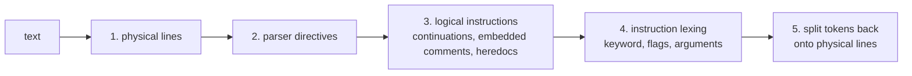

# Spec: Dockerfile tokenizer

|                   |                                                                                                                                                                                                |
| ----------------- | ---------------------------------------------------------------------------------------------------------------------------------------------------------------------------------------------- |
| **Status**        | Implemented (2026-10-12). The design was rewritten on 2026-10-11 and implemented as specified; §12 records the migration from the older line-by-line design.                                   |
| **Source**        | [web/src/data/tokenizer/](../../web/src/data/tokenizer/index.ts) (modules in §4.6)                                                                                                             |
| **Tests**         | [web/src/\_\_tests\_\_/tokenizer.test.ts](../../web/src/__tests__/tokenizer.test.ts)                                                                                                           |
| **Consumers**     | `App` (attaches explanations to tokens), `DockerfileViewer` (renders lines and token types), `getExplanation()` in [explanations.ts](../../web/src/data/explanations.ts) (resolves token refs) |
| **Related specs** | [run-command-explanations.md](./run-command-explanations.md), [explanation-content-model.md](./explanation-content-model.md), [site-architecture.md](./site-architecture.md)                   |

## 1. Purpose and principles

The tokenizer turns Dockerfile text into lines of tokens so the viewer can:

1. render the file exactly as written, with syntax highlighting;
2. make every meaningful fragment clickable and explain it in context;
3. keep track of the selected token between renders.

It is a **display lexer**, not a validating parser. It follows the rules of Docker's own Dockerfile parser (BuildKit) wherever they change what a fragment _means_, and it never rejects input.

| #      | Principle                                                                                                                                                                                                               |
| ------ | ----------------------------------------------------------------------------------------------------------------------------------------------------------------------------------------------------------------------- |
| **P1** | **Lossless.** The input can be rebuilt exactly from the output, character for character (INV-1).                                                                                                                        |
| **P2** | **Total.** Every string tokenizes. The tokenizer never throws, never stops early and never drops text. Malformed input is tokenized as well as possible.                                                                |
| **P3** | **Faithful to Docker.** Line continuations, parser directives, case-insensitive instructions, flag position, exec vs. shell form and heredocs follow BuildKit's rules, so what is highlighted matches what Docker does. |
| **P4** | **Look and meaning are separate.** `type` says how a token is drawn; `ref` says what it means and what to explain. The viewer styles by `type`; the explanation layer reads only `ref`.                                 |
| **P5** | **Pure and fast.** No Preact, DOM or I/O (ARCH-1). The output depends only on the input. Running time is linear in the input length, with no regex backtracking that can blow up.                                       |

## 2. Public API

```ts
export function tokenize(text: string): Line[];
export function refKey(ref: ExplanationRef): string;

export const INSTRUCTIONS: readonly Instruction[];
export const TOKEN_TYPE: { readonly [K: string]: TokenType }; // `as const` object
export const LINE_TYPE: { readonly [K: string]: LineType }; // `as const` object

export type { Instruction, Line, LineType, InstructionContext, Token, TokenType };
export type { ExplanationRef, ArgumentRole, ShellRole };
```

- **TOK-1** `tokenize` is the only entry point that does any work. It is pure and deterministic: the same input always gives deep-equal output.
- **TOK-2** `refKey` turns a ref into a stable, unique string, such as `flag:COPY:--from` or `shell:RUN:command:npm`. Use it wherever a ref needs to be a key: `Map` lookups, React keys, caches, and future deep links (ARCH §10.2). Explanation lookup must use `Map`s or own-property checks, never plain-object indexing with arbitrary strings (EXP-13).
- **TOK-3** Constants are `as const` objects with derived union types. There are no TypeScript `enum`s (ARCH-6).

## 3. Data model

```ts
type Instruction =
  | 'ADD'
  | 'ARG'
  | 'CMD'
  | 'COPY'
  | 'ENTRYPOINT'
  | 'ENV'
  | 'EXPOSE'
  | 'FROM'
  | 'HEALTHCHECK'
  | 'LABEL'
  | 'MAINTAINER'
  | 'ONBUILD'
  | 'RUN'
  | 'SHELL'
  | 'STOPSIGNAL'
  | 'USER'
  | 'VOLUME'
  | 'WORKDIR';

interface Line {
  lineIndex: number; // 0-based physical line number
  raw: string; // the line's text, without its terminator
  eol: '' | '\n' | '\r\n'; // the terminator that followed it ('' only on the last line)
  type: LineType;
  instruction: InstructionContext | null; // the instruction this line belongs to, if any
  tokens: Token[]; // empty only when raw === ''
}

interface InstructionContext {
  keyword: Instruction; // normalized to upper case
  startLine: number; // lineIndex of the line holding the keyword
  form: 'exec' | 'shell' | null; // for instructions that accept both forms; otherwise null
}

interface Token {
  id: string; // `${lineIndex}-${tokenIndex}`
  lineIndex: number;
  tokenIndex: number; // 0-based position within the line
  column: number; // UTF-16 offset of the token's first character in Line.raw
  text: string; // non-empty
  type: TokenType; // how it looks
  ref: ExplanationRef | null; // what it means; null = not explainable
}
```

### 3.1 Line types

| `LineType`     | Meaning                                                                                                  |
| -------------- | -------------------------------------------------------------------------------------------------------- |
| `directive`    | A parser directive at the top of the file (§4.2).                                                        |
| `instruction`  | The first physical line of an instruction (it holds the keyword).                                        |
| `continuation` | A later physical line of the same instruction, reached through a line continuation (§4.3).               |
| `heredoc`      | A heredoc body line or terminator line that belongs to an instruction (§5.7).                            |
| `comment`      | A `#` comment line. It may sit inside an instruction's continuation, in which case `instruction` is set. |
| `blank`        | Empty or whitespace-only. It may sit inside a continuation, in which case `instruction` is set.          |
| `unknown`      | Not blank, not a comment, and does not start with an instruction keyword, outside any instruction.       |

### 3.2 Token types

`type` controls styling only. Each value is also a CSS class suffix (`type-<value>` in `DockerfileViewer`), so renaming or adding a value is a styling change.

| `TokenType`   | Used for                                                                                                |
| ------------- | ------------------------------------------------------------------------------------------------------- |
| `keyword`     | Instruction keywords and the sub-keywords `AS`, `CMD` and `NONE`.                                       |
| `flag`        | The `--name` part of an instruction flag.                                                               |
| `string`      | Quoted text, including any unterminated quoted text.                                                    |
| `variable`    | `$NAME`, `${…}` and shell special parameters (`$1`, `$?`, …).                                           |
| `operator`    | Shell operators and redirections, command substitution delimiters, and heredoc markers and terminators. |
| `punctuation` | JSON-array brackets and commas, and the `=` in `key=value` and `--flag=value`.                          |
| `escape`      | The line-continuation character at the end of a line.                                                   |
| `directive`   | The `#` and name of a parser directive.                                                                 |
| `comment`     | Comment text: Dockerfile comment lines and shell comments.                                              |
| `whitespace`  | Runs of spaces and tabs (and a stray `\r` that isn't part of a CRLF line ending).                       |
| `text`        | Everything else: commands, arguments, paths, image names, values.                                       |

### 3.3 Explanation refs

```ts
type ExplanationRef =
  | { kind: 'instruction'; instruction: Instruction }
  | { kind: 'subkeyword'; instruction: Instruction; word: 'AS' | 'CMD' | 'NONE' }
  | { kind: 'flag'; instruction: Instruction; flag: string } // flag = '--mount'
  | { kind: 'argument'; instruction: Instruction; role: ArgumentRole; text: string }
  | { kind: 'json-array'; instruction: Instruction } // brackets and commas
  | {
      kind: 'exec-form';
      instruction: Instruction;
      role: 'executable' | 'argument';
      text: string;
      words: readonly string[]; // every element's value, quotes removed
      wordIndex: number; // this element's index in words
    }
  | {
      kind: 'shell';
      instruction: Instruction;
      role: ShellRole;
      command: string | null;
      text: string;
      words: readonly string[]; // the simple command's words, quotes removed (TOK-36)
      wordIndex: number; // this word's index in words, or -1
      before: string | null; // command word of the previous simple command (operators only)
      after: string | null; // command word of the next simple command (operators only)
    }
  | {
      kind: 'variable';
      name: string; // 'NODE_VERSION', '1', '?'
      text: string; // the whole reference, e.g. '${NODE_VERSION:-26}'
      instruction: Instruction;
      expandedBy: 'docker' | 'shell'; // TOK-28
    }
  | { kind: 'heredoc'; instruction: Instruction; delimiter: string }
  | { kind: 'directive'; directive: string } // lower case: 'syntax' | 'escape' | 'check' | …
  | { kind: 'line-continuation'; escape: '\\' | '`' };

type ArgumentRole =
  | 'image'
  | 'stage-name'
  | 'source'
  | 'destination'
  | 'path'
  | 'user'
  | 'port'
  | 'key'
  | 'value'
  | 'signal'
  | 'name'
  | 'word';

type ShellRole =
  | 'command'
  | 'option'
  | 'argument'
  | 'assignment'
  | 'operator'
  | 'redirection'
  | 'redirect-target'
  | 'reserved'
  | 'substitution';
```

- **TOK-4** A ref describes **what the fragment is in its context**, not just its text. `-S` in `adduser -S` is `{ kind: 'shell', role: 'option', command: 'adduser', text: '-S' }`. The content layer can then say "an option passed to `adduser`" instead of a generic message.
- **TOK-5** `text` in a ref is the **whole word** the token belongs to, not just the token's own slice. A word built from several tokens (for example `node:` + `${NODE_VERSION}` + `-alpine`) gives every piece the same ref, except that variable pieces get their own `variable` ref (§6).
- **TOK-6** `instruction` in a ref is the instruction that **gives the fragment its meaning**. For `ONBUILD RUN make`, `make` has `instruction: 'RUN'`. For `HEALTHCHECK … CMD curl …`, `curl` has `instruction: 'HEALTHCHECK'`.

## 4. Pipeline

The tokenizer runs in five phases. Each phase consumes the previous phase's output; only phase 5 produces tokens.



### 4.1 Physical lines

- **TOK-7** Split on `\r\n` and `\n`. The terminator is stored in `Line.eol`, not in `raw`. A lone `\r` is ordinary content and becomes `whitespace`.
- **TOK-8** A single trailing terminator does **not** create an extra empty last line: `"FROM x\n"` gives one line with `eol: '\n'`. `""` gives one blank line with `raw: ''`, `eol: ''` and no tokens.

### 4.2 Parser directives

- **TOK-9** Directives are recognized only at the top of the file, as BuildKit does. Each line is checked against `^\s*#\s*([A-Za-z][A-Za-z0-9]*)\s*=\s*(.*?)\s*$`. The directive section ends at the first line that is not a directive: blank, comment, instruction or anything else.
- **TOK-10** Known directives are `syntax`, `escape` and `check`; names are case-insensitive. A directive with an unknown name, or a repeat of one already seen, is a `comment` line, and it ends the directive section.
- **TOK-11** `escape` sets the escape character for the whole file. Only `\` (the default) and `` ` `` are valid; any other value leaves `\` in force. The escape character controls line continuations (§4.3) and escaping inside Dockerfile words (§5.4). It does not change shell quoting inside shell form (§5.6), with one exception: under `` # escape=` `` the shell is a Windows shell, where `\` is the path separator, so the shell lexer treats `\` as an ordinary character (`RUN dir c:\` keeps `c:\` as one word).
- **TOK-12** Tokens: optional leading `whitespace`; `#` with the space around the name (`directive`); the name (`directive`); `=` (`punctuation`); the value (`text`); optional trailing `whitespace`. Every non-whitespace token has the ref `{ kind: 'directive', directive: <lower-cased name> }`.

### 4.3 Logical instructions

- **TOK-13** An instruction starts on a line whose first word (after optional leading whitespace) matches an instruction keyword, **case-insensitively** and as a **whole word**: the keyword must be followed by whitespace, the escape character or the end of the line. `from node` is a `FROM` instruction; `FROMnode` and `RUNNER x` are `unknown` lines.
- **TOK-14** A line **continues** onto the next one when it ends with the escape character, optionally followed by spaces and tabs (BuildKit's continuation pattern). The next line is part of the same instruction whatever it starts with. In particular, an indented `CMD` after `HEALTHCHECK … \` is the `HEALTHCHECK`'s `CMD` sub-keyword, not a new instruction.
- **TOK-15** While an instruction is continuing, `comment` and `blank` lines do not end it, matching Docker, which removes them before joining the lines. They keep their own line type, get `instruction` set to the surrounding instruction, and do not affect how it is lexed.
- **TOK-16** An instruction ends at the first physical line that doesn't continue, or at the end of the file if it is still continuing.
- **TOK-17** The **logical text** of an instruction is its physical lines joined, with each `escape + trailing whitespace + line break` removed and embedded comment and blank lines left out. Phase 4 lexes the logical text. A position map from each logical offset back to `(lineIndex, column)` lets phase 5 put tokens back on their physical lines.
- **TOK-18** Heredoc bodies (§5.7) are attached to the instruction that opened them. They start on the physical line after the instruction's last line.

### 4.4 Instruction lexing

The keyword and flags are lexed the same way for every instruction (§5.1–§5.2). The rest of the instruction, its **arguments**, is lexed by the grammar for that instruction (§5.3), which combines four sub-lexers: words (§5.4), JSON arrays (§5.5), shell (§5.6) and heredocs (§5.7).

### 4.5 Splitting tokens back onto lines

- **TOK-19** No token spans a line break. If a lexical token crosses a removed continuation (for example a quoted string that continues onto the next line, or a word split by `\`), it is cut at the line boundary. Each piece keeps the same `type` and `ref`.
- **TOK-20** Each removed continuation reappears at the end of its physical line as an `escape` token with ref `{ kind: 'line-continuation', escape }`, followed by a `whitespace` token if there was trailing whitespace after it.
- **TOK-21** Leading indentation on any line is a `whitespace` token with no ref.
- **TOK-22** After splitting, tokens are numbered per line (`tokenIndex` from 0) and given `column` and `id`.

### 4.6 Module layout

| Module                      | Responsibility                                                |
| --------------------------- | ------------------------------------------------------------- |
| `tokenizer/index.ts`        | `tokenize`, `refKey` and the public types; runs phases 1–5.   |
| `tokenizer/types.ts`        | Types, constants and character helpers shared by the lexers.  |
| `tokenizer/lines.ts`        | Phases 1–3: physical lines, directives, logical instructions. |
| `tokenizer/instructions.ts` | Keyword, flags and the per-instruction grammar table (§5.3).  |
| `tokenizer/words.ts`        | Word lexer for non-shell arguments (§5.4).                    |
| `tokenizer/json-array.ts`   | JSON-array detection and lexing (§5.5).                       |
| `tokenizer/shell.ts`        | Shell-form lexer and role assignment (§5.6).                  |
| `tokenizer/heredoc.ts`      | Heredoc markers and bodies (§5.7).                            |

Every lexer is a hand-written cursor scanner over the logical text. Sticky (`y`) regexes are allowed for single tokens; nothing may backtrack across the input.

## 5. Grammar

### 5.1 Keyword

- **TOK-23** The keyword token keeps its original spelling in `text`; its ref is `{ kind: 'instruction', instruction: <upper-cased keyword> }` and its type is `keyword`.

### 5.2 Flags

- **TOK-24** Instruction flags are recognized **only in flag position**: after the keyword (or after `HEALTHCHECK`, before its `CMD`/`NONE`), before the first argument. A word that starts with `--` anywhere else belongs to the arguments. Inside shell form it is a shell option (§5.6); for example, `npm ci --omit=dev` is not a Docker flag.
- **TOK-25** A flag is `--name` or `--name=value`. It is emitted as `--name` (`flag`), then `=` (`punctuation`), then the value lexed as words (§5.4), so `--chown="a b"` keeps its quoted value whole. Every token of the flag, including the value, has the ref `{ kind: 'flag', instruction, flag: '--name' }`.
- **TOK-26** The tokenizer does not check flag names against a list. Unknown flags are still flags; whether one can be explained is a content question (EXP-20).

### 5.3 Per-instruction argument grammar

| Instruction         | Arguments after flags                                 | Roles and forms                                                                                                                                                                                                   |
| ------------------- | ----------------------------------------------------- | ----------------------------------------------------------------------------------------------------------------------------------------------------------------------------------------------------------------- |
| `FROM`              | `image [AS name]`                                     | image → `argument` role `image`; `AS` (case-insensitive) → `keyword`, ref `subkeyword` `AS`; name → role `stage-name`. Variables are split out (§6).                                                              |
| `RUN`               | JSON array **or** shell form, plus heredocs           | JSON array (§5.5) → `form: 'exec'`; otherwise shell form (§5.6) → `form: 'shell'`. Heredoc markers start bodies (§5.7).                                                                                           |
| `CMD`, `ENTRYPOINT` | JSON array **or** shell form                          | As `RUN`, without heredocs.                                                                                                                                                                                       |
| `SHELL`             | JSON array                                            | Exec-form roles. If it isn't a valid JSON array, it is lexed as words with role `word`.                                                                                                                           |
| `HEALTHCHECK`       | `NONE` **or** `CMD <command>`                         | `NONE`/`CMD` (case-insensitive) → `keyword`, ref `subkeyword`. What follows `CMD` is lexed like `CMD`'s arguments, with `instruction: 'HEALTHCHECK'` in its refs.                                                 |
| `ONBUILD`           | another instruction                                   | The rest is lexed as a complete nested instruction (§5.1–§5.7), whose refs use the nested keyword. `ONBUILD`, `FROM` and `MAINTAINER` cannot be nested; if they appear, they are lexed as words with role `word`. |
| `COPY`, `ADD`       | JSON array **or** words, plus heredocs                | The last path is role `destination`; the others are role `source`. A heredoc marker counts as a source.                                                                                                           |
| `ENV`, `LABEL`      | `key=value …`, or the legacy `key value` (`ENV` only) | key → role `key`; `=` → `punctuation`, no ref; value → role `value`. In the legacy form, everything after the key is one value.                                                                                   |
| `ARG`               | `name[=default] …`                                    | name → role `key`; default → role `value`.                                                                                                                                                                        |
| `WORKDIR`, `VOLUME` | path(s); `VOLUME` also accepts a JSON array           | role `path`.                                                                                                                                                                                                      |
| `USER`              | `user[:group]`                                        | role `user`.                                                                                                                                                                                                      |
| `EXPOSE`            | `port[/protocol] …`                                   | role `port`.                                                                                                                                                                                                      |
| `STOPSIGNAL`        | signal                                                | role `signal`.                                                                                                                                                                                                    |
| `MAINTAINER`        | free text                                             | The whole remainder is one value with role `name`.                                                                                                                                                                |

- **TOK-27** Any argument that the grammar doesn't expect (an extra word after `USER`, for example) gets role `word`. The tokenizer never drops or rejects input (P2).
- **TOK-28** **Environment replacement:** variables are split out (§6) in the arguments of `ADD`, `COPY`, `ENV`, `EXPOSE`, `FROM`, `LABEL`, `STOPSIGNAL`, `USER`, `VOLUME`, `WORKDIR` and `ARG` defaults, as Docker expands them. They are also split out in shell form, because the shell expands them. They are **not** split out in exec-form JSON arrays of `RUN`/`CMD`/`ENTRYPOINT`/`SHELL`/`HEALTHCHECK`, which Docker does not expand. A variable ref's `expandedBy` is `docker` for environment replacement (substituted while building) and `shell` for shell form and `RUN` heredoc bodies (expanded by the shell when the command runs). The explanation layer needs this, because the two are evaluated at different times and with different values.

### 5.4 Words (non-shell arguments)

- **TOK-29** Words are separated by whitespace. Inside a word:
  - the escape character escapes the next character, and both stay part of the word;
  - `"…"` is a `string` piece, in which the escape character escapes `"` and variables are split out (when TOK-28 applies);
  - `'…'` is a `string` piece with no escapes and no variables;
  - `$NAME` and `${…}` are `variable` pieces (when TOK-28 applies);
  - everything else is a `text` piece.
- **TOK-30** An unterminated quote runs to the end of the logical instruction as a `string` (P2, INV-1).
- **TOK-31** In `key=value` instructions, the first `=` in a pair is its own `punctuation` token.

### 5.5 JSON arrays (exec form)

- **TOK-32** Docker treats the arguments as exec form only if the whole remaining logical text is a valid JSON array of strings: `[`, then zero or more double-quoted JSON strings separated by `,`, then `]`, with optional whitespace and nothing after. Anything else, **including single-quoted "JSON"**, is not exec form, and the instruction falls back to its other form (§5.3). This mirrors Docker, and it is a common mistake worth highlighting correctly.
- **TOK-33** Tokens: `[`, `,` and `]` → `punctuation` with ref `{ kind: 'json-array', instruction }`; each element → `string`. For command instructions (`RUN`, `CMD`, `ENTRYPOINT`, `SHELL`, `HEALTHCHECK CMD`), the first element has ref `exec-form` role `executable` and the rest have role `argument`; `words` holds every element's decoded JSON string value. For `COPY`/`ADD`/`VOLUME`, elements get the argument roles from §5.3.

### 5.6 Shell form

The shell lexer covers the POSIX shell subset that appears in Dockerfiles. It works on the logical text, so a command split across continuation lines is lexed as one command (TOK-17).

| Construct                                                                                             | `type`                                         | Ref                                                                  |
| ----------------------------------------------------------------------------------------------------- | ---------------------------------------------- | -------------------------------------------------------------------- |
| Spaces and tabs                                                                                       | `whitespace`                                   | none                                                                 |
| Control operators `&&` `\|\|` `;` `\|` `&` `(` `)`                                                    | `operator`                                     | `shell`, role `operator`                                             |
| Redirections `>` `>>` `<` `>&` `<&` `>\|` `<<<`, with an optional fd number before them (e.g. `2>&1`) | `operator`                                     | `shell`, role `redirection`; the target word: role `redirect-target` |
| Command substitution `$(` … `)` and backticks; arithmetic `$((` … `))`                                | delimiters `operator`; contents lexed as shell | delimiters: `shell`, role `substitution`                             |
| `'…'`                                                                                                 | `string`                                       | the enclosing word's ref                                             |
| `"…"` (backslash escapes `"` `\` `$` `` ` ``; variables and substitutions inside are split out)       | `string`                                       | the enclosing word's ref                                             |
| `$NAME`, `${…}` (balanced braces), `$0`–`$9`, `$@` `$*` `$#` `$?` `$-` `$$` `$!`                      | `variable`                                     | `variable`                                                           |
| `#` at the start of a word, through to the end of the logical instruction                             | `comment`                                      | none                                                                 |
| Any other run of characters (with `\x` escapes)                                                       | `text`                                         | the word's ref                                                       |

- **TOK-34** **Words** are maximal runs of `text`, `string`, `variable` and substitution pieces with no unquoted whitespace or operator between them. Every piece of a word shares the word's role, and `ref.text` is the whole word (TOK-5).
- **TOK-35** **Roles** follow simple-command structure:
  - A simple command starts at the beginning of the shell text, after a control operator, after `(` or `$(`, and after the reserved words `then`, `do`, `else`, `elif`, `{` and `!`.
  - At the start of a simple command, words of the form `NAME=value` are `assignment`s, and the start position continues after them.
  - The next word is the `command`, unless it is a reserved word (`if` `then` `else` `elif` `fi` `for` `while` `until` `do` `done` `case` `esac` `in` `{` `}` `!`), which is `reserved`.
  - Words after the command that begin with `-` are `option`s, except a lone `-`. A lone `--` is an `option` that ends option parsing; every later word in that command is an `argument`.
  - All other words are `argument`s.
  - A redirection operator's target word (`/dev/null` in `>/dev/null`) is a `redirect-target`. It is not an argument and is left out of `words`.
- **TOK-36** Command context on `shell` refs. The tokenizer records only syntax; deciding what a word means for a particular tool (subcommand, option value) belongs to the explanation layer ([run-command-explanations.md](./run-command-explanations.md)).
  - `command` is the current simple command's `command` word, with quotes removed (as in `words`). It is `null` for operators, substitution delimiters and reserved words, and for assignments that come before the command.
  - `words` lists the simple command's words from the `command` word on, with quotes removed and variables left as written. Assignments, redirections and redirect targets are not included. `wordIndex` is this word's index in `words`, or `-1` for tokens that aren't one of them.
  - `before` and `after` are set only for control operators: the `command` words of the simple commands on each side (`addgroup` and `adduser` for the `&&` in `addgroup -S g && adduser x`), or `null` if there isn't one.
  - Redirection operators and their targets carry the `command` and `words` of the command they belong to.
- **TOK-37** An unterminated quote or substitution runs to the end of the logical instruction (P2).
- **TOK-38** Out of scope: aliases, functions, `case` patterns, globbing, brace and tilde expansion, and arithmetic semantics. These are lexed as ordinary words or operators by the rules above and never cause an error.

### 5.7 Heredocs

- **TOK-39** In `RUN`, `COPY` and `ADD`, a marker `<<WORD`, `<<-WORD`, `<<"WORD"` or `<<'WORD'` is an `operator` token with ref `{ kind: 'heredoc', instruction, delimiter: WORD }`. An instruction may open several heredocs; their bodies follow in order.
- **TOK-40** A body is the run of physical lines up to a line that equals the delimiter exactly; with `<<-`, leading tabs are ignored when comparing. Body lines are `heredoc` lines. The terminator line is a `heredoc` line whose delimiter is an `operator` token with the heredoc ref. If no terminator appears, the body runs to the end of the file.
- **TOK-41** A `RUN` body is lexed as shell script (§5.6), with a line break acting as a command separator, when the heredoc is the `RUN`'s only argument (`RUN <<EOF`), because BuildKit then runs the body as a script. When the heredoc follows a command (`RUN python3 <<EOF`, `RUN <<A cat > /a`), the body is that command's input, and is lexed like file contents. `COPY`/`ADD` bodies are file contents: each body line is one `text` token (plus leading `whitespace`), with no ref.

## 6. Explanation refs: decisions

What each fragment can be explained as. These decisions settle the open questions from the previous version of this spec (see §12.3).

| Fragment                                                                       | Ref                                     | Previously                                                           |
| ------------------------------------------------------------------------------ | --------------------------------------- | -------------------------------------------------------------------- |
| Instruction keyword, in any case                                               | `instruction`                           | upper case only                                                      |
| `AS` in `FROM`, `CMD`/`NONE` in `HEALTHCHECK`                                  | `subkeyword`                            | plain text; `HEALTHCHECK`'s `CMD` was misread as a `CMD` instruction |
| Flag name, `=` and value                                                       | `flag` (with the instruction)           | flag name only, and the key was global                               |
| Instruction arguments (image, paths, ports, keys, …)                           | `argument` with a role                  | not explainable                                                      |
| Shell fragments in `RUN`/`CMD`/`ENTRYPOINT`/`HEALTHCHECK`, on every line       | `shell` with role and command           | `RUN` only, first line only, one generic category per chunk          |
| `--omit=dev` and other long options inside shell form                          | `shell`, role `option`                  | a Docker flag with no explanation                                    |
| JSON-array brackets and commas                                                 | `json-array`                            | generic "part of the shell command"                                  |
| Exec-form elements                                                             | `exec-form` (`executable` / `argument`) | not explainable                                                      |
| Line-continuation character                                                    | `line-continuation`                     | generic "part of the shell command"                                  |
| `$NAME`, `${…}`, special parameters                                            | `variable`                              | not explainable; `$1` was split into `$` + `1`                       |
| Heredoc markers and terminators                                                | `heredoc`                               | not supported                                                        |
| Parser directives                                                              | `directive`                             | plain comment                                                        |
| Whitespace, comments, `=` in `key=value`, heredoc file contents, unknown lines | none                                    | none                                                                 |

- **TOK-42** A `null` ref means "nothing to explain". A non-null ref does **not** promise that content exists; `getExplanation(ref)` decides, and the token is interactive only when it returns an explanation (EXP-12).

## 7. Invariants

Each invariant must hold for **every** input string, and each is enforced by a property test (§11).

- **INV-1 Lossless:** `lines.map(l => l.raw + l.eol).join('') === input`, and for every line `l.tokens.map(t => t.text).join('') === l.raw`.
- **INV-2 Total:** `tokenize` returns for every input and never throws.
- **INV-3 Non-empty tokens:** every token's `text` is non-empty. A line has no tokens if and only if `raw === ''`.
- **INV-4 Positions:** within a line, `tokenIndex` runs `0..n-1` in order; `column` equals the total length of the earlier tokens on the line; `` id === `${lineIndex}-${tokenIndex}` ``; ids are unique across the result.
- **INV-5 Line-bounded:** no token's `text` contains `\n` or a CRLF pair.
- **INV-6 Instruction context:** `instruction` and `continuation` lines always have an `instruction`. `heredoc` lines always have one too. `instruction.startLine <= lineIndex`, and the line at `startLine` has type `instruction`. `directive` and `unknown` lines never have one.
- **INV-7 One keyword per instruction:** every `instruction` line has exactly one token with ref kind `instruction` for its own keyword, and it is the first non-whitespace token. An `ONBUILD` line that nests a valid instruction on the same line has a second one, for the nested keyword.
- **INV-8 Deterministic and stable:** the same input gives deep-equal output, so ids are stable across re-renders (`App` relies on this for `activeTokenId`). Ids are positional; references that must survive edits to the examples use `refKey` (TOK-2).
- **INV-9 Linear time:** tokenizing `n` copies of the Complex example takes time proportional to `n`. A benchmark test checks this with a generous bound, along with pathological inputs: long runs of quotes, `$`, `\` and `<<`.

## 8. Reference examples

Notation: one token per row as `text  type  ref`. `␠` is a space. Refs are abbreviated; for example, `shell RUN option cmd=npm` means `{ kind: 'shell', instruction: 'RUN', role: 'option', command: 'npm', text: … }`.

### 8.1 Continuation with a cache mount (Complex example)

```text
RUN --mount=type=cache,target=/root/.npm \
    npm ci --omit=dev
```

```text
line 0  instruction  (RUN, start 0, shell)
  RUN                          keyword      instruction RUN
  ␠                            whitespace   —
  --mount                      flag         flag RUN --mount
  =                            punctuation  flag RUN --mount
  type=cache,target=/root/.npm text         flag RUN --mount
  ␠                            whitespace   —
  \                            escape       line-continuation
line 1  continuation (RUN, start 0, shell)
  ␠␠␠␠                         whitespace   —
  npm                          text         shell RUN command cmd=npm
  ␠                            whitespace   —
  ci                           text         shell RUN argument cmd=npm
  ␠                            whitespace   —
  --omit=dev                   text         shell RUN option cmd=npm
```

### 8.2 `HEALTHCHECK` with its `CMD` on the next line

```text
HEALTHCHECK --interval=30s --timeout=5s --retries=3 \
    CMD wget -qO- http://localhost:3000/health || exit 1
```

```text
line 1  continuation (HEALTHCHECK, start 0, shell)
  ␠␠␠␠        whitespace  —
  CMD         keyword     subkeyword HEALTHCHECK CMD
  ␠           whitespace  —
  wget        text        shell HEALTHCHECK command cmd=wget
  ␠           whitespace  —
  -qO-        text        shell HEALTHCHECK option cmd=wget
  ␠           whitespace  —
  http://localhost:3000/health  text  shell HEALTHCHECK argument cmd=wget
  ␠           whitespace  —
  ||          operator    shell HEALTHCHECK operator
  ␠           whitespace  —
  exit        text        shell HEALTHCHECK command cmd=exit
  ␠           whitespace  —
  1           text        shell HEALTHCHECK argument cmd=exit
```

### 8.3 `FROM` with a variable and a stage name

```text
FROM node:${NODE_VERSION}-alpine AS base
```

```text
  FROM             keyword     instruction FROM
  ␠                whitespace  —
  node:            text        argument FROM image text=node:${NODE_VERSION}-alpine
  ${NODE_VERSION}  variable    variable NODE_VERSION (FROM, docker)
  -alpine          text        argument FROM image text=node:${NODE_VERSION}-alpine
  ␠                whitespace  —
  AS               keyword     subkeyword FROM AS
  ␠                whitespace  —
  base             text        argument FROM stage-name
```

### 8.4 Exec form, and the single-quote mistake

```text
CMD ["node", "server.js"]
CMD ['node', 'server.js']
```

```text
line 0  instruction (CMD, exec)
  CMD          keyword      instruction CMD
  ␠            whitespace   —
  [            punctuation  json-array CMD
  "node"       string       exec-form CMD executable
  ,            punctuation  json-array CMD
  ␠            whitespace   —
  "server.js"  string       exec-form CMD argument
  ]            punctuation  json-array CMD
line 1  instruction (CMD, shell)   ← single quotes are not JSON (TOK-32)
  CMD          keyword      instruction CMD
  ␠            whitespace   —
  [            text         shell CMD command cmd=[node,
  'node'       string       shell CMD command cmd=[node,
  ,            text         shell CMD command cmd=[node,
  ␠            whitespace   —
  'server.js'  string       shell CMD argument cmd=[node,
  ]            text         shell CMD argument cmd=[node,
```

`command` holds the command word with quotes removed (`[node,`), like `words`; `text` keeps the source (`['node',`).

### 8.5 Unterminated quote (previously truncated the line)

```text
RUN echo it's here
```

```text
  RUN       keyword     instruction RUN
  ␠         whitespace  —
  echo      text        shell RUN command cmd=echo
  ␠         whitespace  —
  it        text        shell RUN argument cmd=echo text=it's here
  's here   string      shell RUN argument cmd=echo text=it's here
```

### 8.6 Heredoc

```text
RUN <<EOF
apt-get update
EOF
```

```text
line 0  instruction (RUN, shell)
  RUN      keyword     instruction RUN
  ␠        whitespace  —
  <<EOF    operator    heredoc RUN EOF
line 1  heredoc (RUN)
  apt-get  text        shell RUN command cmd=apt-get
  ␠        whitespace  —
  update   text        shell RUN argument cmd=apt-get
line 2  heredoc (RUN)
  EOF      operator    heredoc RUN EOF
```

### 8.7 Directives and the backtick escape

```text
# escape=`
FROM mcr.microsoft.com/windows/servercore
RUN dir c:\ `
    && echo done
```

- Line 0 is a `directive` line: `#␠` and `escape` (`directive`), `=` (`punctuation`) and `` ` `` (`text`), all with ref `directive escape`.
- On line 2, `c:\` is an ordinary argument, because `\` is no longer the escape character. The final `` ` `` is an `escape` token.
- Line 3 is a `continuation` whose `&&` is a shell `operator`.

### 8.8 Other cases

| Input                           | Result                                                                                                                             |
| ------------------------------- | ---------------------------------------------------------------------------------------------------------------------------------- |
| `from node`                     | `instruction` line; `from` is a `keyword` with ref `instruction FROM`.                                                             |
| `FROMnode`                      | `unknown` line; `FROMnode` is `text` with no ref.                                                                                  |
| `ONBUILD RUN make`              | `ONBUILD` → `instruction ONBUILD`; `RUN` → `keyword`, `instruction RUN`; `make` → `shell RUN command`.                             |
| `ENV NODE_ENV=production`       | `NODE_ENV` → `argument ENV key`; `=` → `punctuation`, no ref; `production` → `argument ENV value`.                                 |
| `COPY --chown="a b" src/ /app/` | `--chown`, `=`, `"a b"` → `flag COPY --chown`; `src/` → `argument COPY source`; `/app/` → `argument COPY destination`.             |
| `RUN echo $(date) $1 2>&1`      | `$(` and `)` → `shell … substitution`; `date` → `shell RUN command cmd=date`; `$1` → `variable 1`; `2>&1` → `shell … redirection`. |
| `"FROM x\r\nRUN y"`             | Two lines: `raw: 'FROM x'` with `eol: '\r\n'`, and `raw: 'RUN y'` with `eol: ''`.                                                  |
| `""`                            | One `blank` line with no tokens.                                                                                                   |

## 9. Non-goals

- Validating Dockerfiles or reporting errors. Malformed input is tokenized as well as possible (P2) and never flagged.
- Evaluating anything: variable values, stage resolution, image lookups, globbing.
- Full shell grammar (TOK-38). The goal is correct roles for the commands, options and operators that appear in Dockerfiles.
- Highlighting inside heredoc file contents for `COPY`/`ADD`.

## 10. Future extensions

These fit the data model without breaking it:

- **Variable origins:** add `declaredAt?: number` to `variable` refs, pointing at the `ARG`/`ENV` line that defines the variable in the current build stage, so the content can say "set by `ARG` on line 2".
- **Stage references:** add a `stage` ref that links `COPY --from=builder` and `FROM builder` to the `FROM … AS builder` line.
- **Diagnostics:** an optional `Line.notes` for things worth teaching (`MAINTAINER` is deprecated, single-quoted "JSON", a dangling continuation at the end of the file) without becoming a linter.
- **Incremental tokenizing**, if user-supplied Dockerfiles are added (ARCH §10.3): re-lex only the instructions that changed.

## 11. Testing strategy

| Layer           | What                                                                                                                                                                                                                                                                           |
| --------------- | ------------------------------------------------------------------------------------------------------------------------------------------------------------------------------------------------------------------------------------------------------------------------------ |
| Property tests  | INV-1 to INV-8 checked over every `EXAMPLES` entry, every fixture, and random strings drawn from Dockerfile-ish characters (`\`, `` ` ``, quotes, `$`, `{`, `<<`, `#`, CR/LF, tabs). A small seeded generator is enough; no new dependency is needed.                          |
| Golden fixtures | `src/__tests__/fixtures/*.Dockerfile`, each with a file snapshot in `src/__tests__/__snapshots__/fixtures/` in the notation of §8. The fixtures cover every example in §8 plus real-world files: multi-stage Python and Go, Windows (backtick escape), heredocs and `ONBUILD`. |
| Unit tests      | One focused test per TOK rule that has its own logic (directive section end, flag position, JSON fallback, shell role transitions, heredoc terminators, `<<-` tabs).                                                                                                           |
| Performance     | INV-9 benchmark with pathological inputs.                                                                                                                                                                                                                                      |
| Regression      | Each bug fixed gets a fixture or unit test before the fix (for example, the old unterminated-quote truncation, §8.5).                                                                                                                                                          |

## 12. Migration from the previous implementation

The migration below is complete (2026-10-12); it is kept as a record.

### 12.1 Breaking changes for consumers

| Change                                                                          | Who must update                                                                                                                                          |
| ------------------------------------------------------------------------------- | -------------------------------------------------------------------------------------------------------------------------------------------------------- |
| `Token.explanationKey: string \| null` → `Token.ref: ExplanationRef \| null`    | `App` (attach `getExplanation(token.ref)`), `explanations.ts` (`getExplanation(ref)` dispatches on `ref.kind`; static content keyed by `refKey`), tests. |
| `Line.keyword` → `Line.instruction: InstructionContext \| null`; new `Line.eol` | `DockerfileViewer` (only `type` and `tokens` are used today), tests.                                                                                     |
| New line types `directive`, `heredoc`, `unknown`                                | `DockerfileViewer` (optional styling).                                                                                                                   |
| New token types `operator`, `punctuation`, `escape`, `directive`, `whitespace`  | `DockerfileViewer.module.css` (add `type-*` classes), axe contrast check (ARCH-29).                                                                      |
| Blank lines with `raw: ''` have **no tokens** (they used to get a `' '` token)  | `DockerfileViewer` keeps the line's height with CSS (`.blank` already sets `min-height`).                                                                |
| No phantom last line after a trailing newline                                   | None of the bundled examples end with a newline; tests only.                                                                                             |
| `TOKEN_TYPE.TEXT` is no longer used for whitespace                              | Anything that filtered on `type === 'text'` to find words.                                                                                               |

### 12.2 Other specs to update in the same change

- [run-command-explanations.md](./run-command-explanations.md):
  - Replace the `RUN_CHUNK:` key scheme (RUNX-1 to RUNX-11) with `shell` refs and their roles (§5.6, §6).
  - Its §9 open questions are settled here: continuation context (TOK-14/17), structural characters (`json-array`, `line-continuation` refs), long options (TOK-24), option wording (`ref.command`) and operator recognition (shell lexer).
  - Widen its scope from `RUN` to all shell form (`CMD`, `ENTRYPOINT`, `HEALTHCHECK CMD`).
- [explanation-content-model.md](./explanation-content-model.md):
  - Replace the key namespace (§3, EXP-8 to EXP-13) with ref kinds and `refKey`.
  - Flags can now be explained per instruction, falling back to the global text (EXP-9).
  - EXP-13 (prototype keys) disappears once lookups use `Map`.
  - The missing concepts in its §8.1 (`AS`, `HEALTHCHECK CMD`, directives, variables, exec vs. shell form) now have refs.
- [site-architecture.md](./site-architecture.md):
  - §10.2 deep links can use `refKey` instead of token ids.
  - §10.3 no longer lists the tokenizer's robustness as a blocker, since P1/P2 and INV-1/INV-2 cover it.

### 12.3 Where the previous version's rules and open questions went

| Previous                                        | Now                                                                            |
| ----------------------------------------------- | ------------------------------------------------------------------------------ |
| TOK-1/TOK-2 (split on `\n`, keep `\r`)          | TOK-7/TOK-8: CRLF-aware, terminators in `eol`, no phantom last line            |
| TOK-3 (lines independent)                       | Replaced by logical instructions (TOK-13 to TOK-18)                            |
| TOK-4 (blank line gets `' '`)                   | Dropped: blank lines may have no tokens (INV-3); the viewer keeps their height |
| TOK-5 (directives are comments)                 | TOK-9 to TOK-12                                                                |
| TOK-6, §6.5 (upper case only, no word boundary) | TOK-13: case-insensitive whole-word match                                      |
| TOK-11, §6.5 (nested keywords are text)         | `ONBUILD` nesting and `AS`/`CMD`/`NONE` sub-keywords (§5.3)                    |
| TOK-12 to TOK-21 (one flat argument lexer)      | Per-instruction grammar (§5.3) with word, JSON-array, shell and heredoc lexers |
| TOK-22 (`RUN_CHUNK:` keys)                      | `shell` refs (§5.6, §6)                                                        |
| INV-1 lossless, with an exception               | INV-1 with no exception, plus INV-2 to INV-9                                   |
| §6.1 unterminated quotes truncate the line      | Fixed by TOK-30/TOK-37 and guaranteed by INV-1                                 |
| §6.2 no continuation context                    | TOK-14 to TOK-17                                                               |
| §6.3 which `RUN` chunks get keys                | §6 decision table                                                              |
| §6.4 long options inside shell commands         | TOK-24 (flag position only)                                                    |
| §6.6 CRLF                                       | TOK-7                                                                          |
| Non-goal: heredocs, `# escape=`                 | Now in scope: §5.7, TOK-11                                                     |
